# Frontend architecture

Next.js 16 App Router app for Agele. The backend contract, data model and system diagrams live in [jog01/agele/docs](https://github.com/jog01/agele/tree/main/docs).

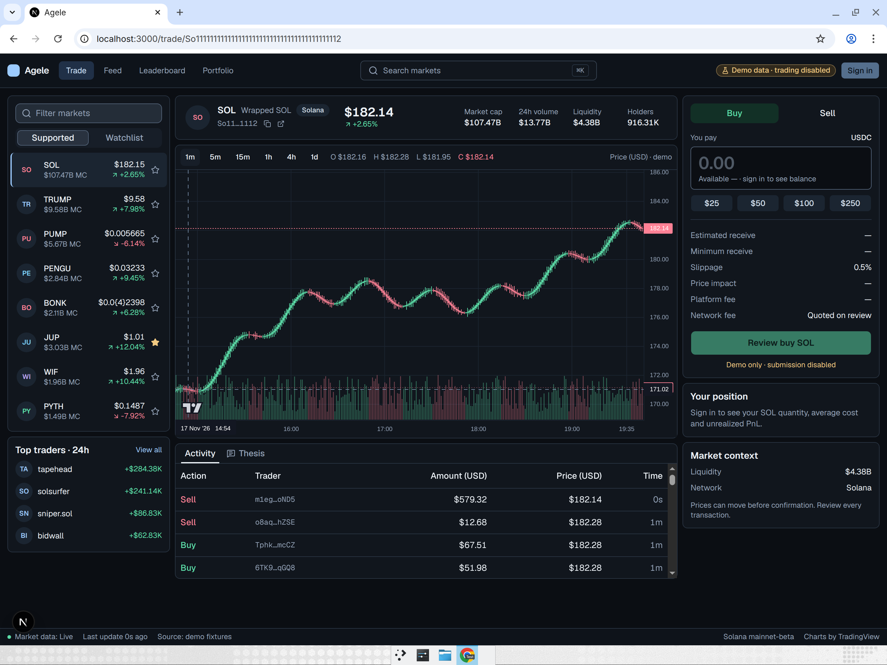

## Routes

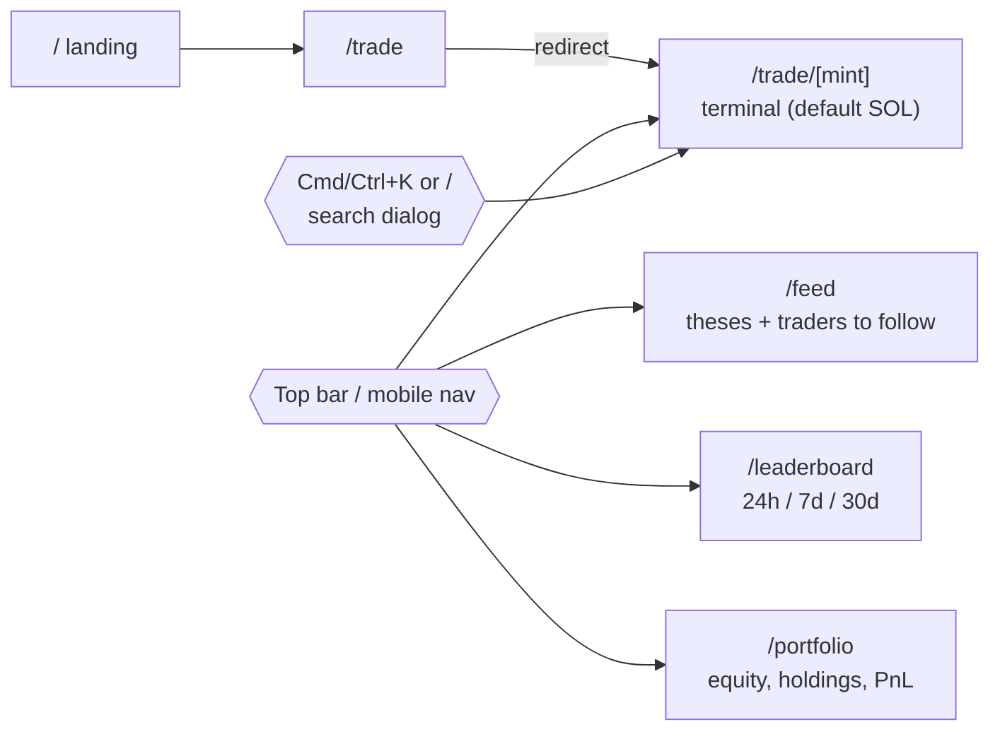

Every page renders inside `AppShell` (top bar, status strip, mobile bottom nav, search dialog). Static shells prerender; `/trade/[mint]` streams the terminal under `<Suspense>` because it reads route params.

## Screens (v0.1, demo data)

| Feed | Leaderboard | Portfolio |
| --- | --- | --- |
| 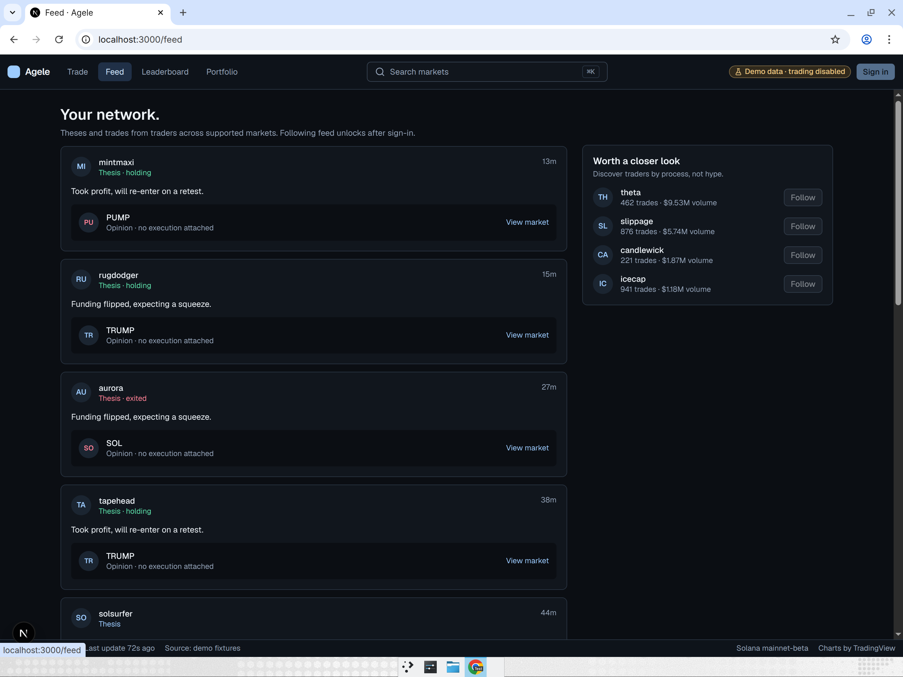 | 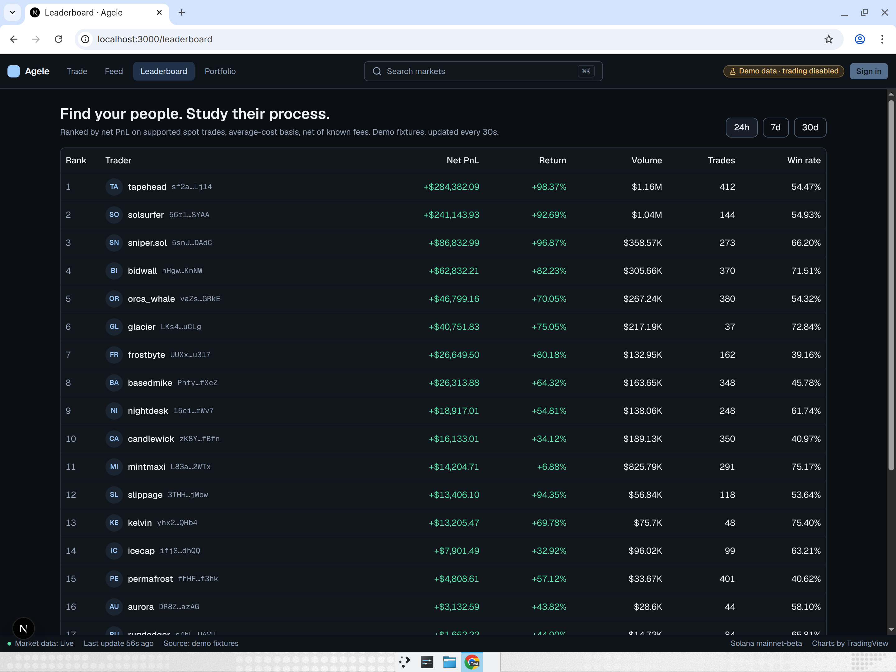 | 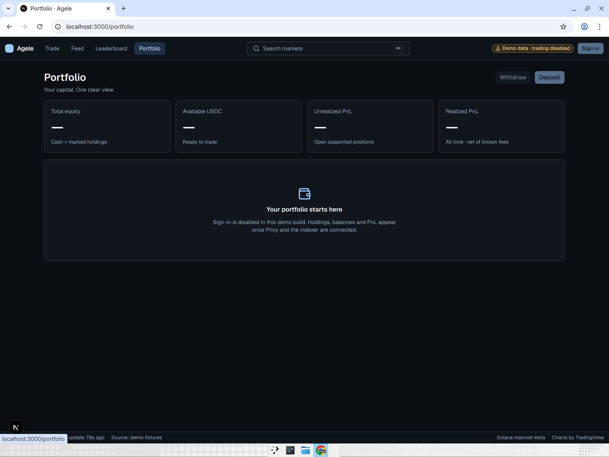 |

## Terminal component tree

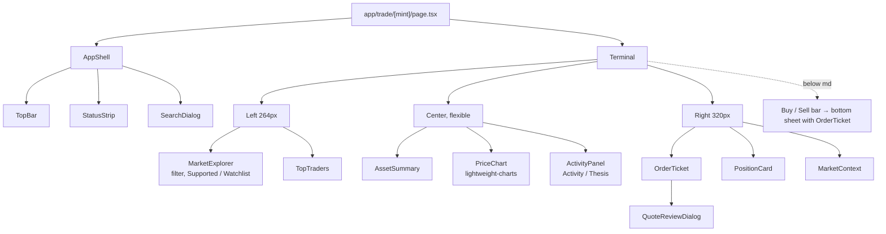

## Data flow

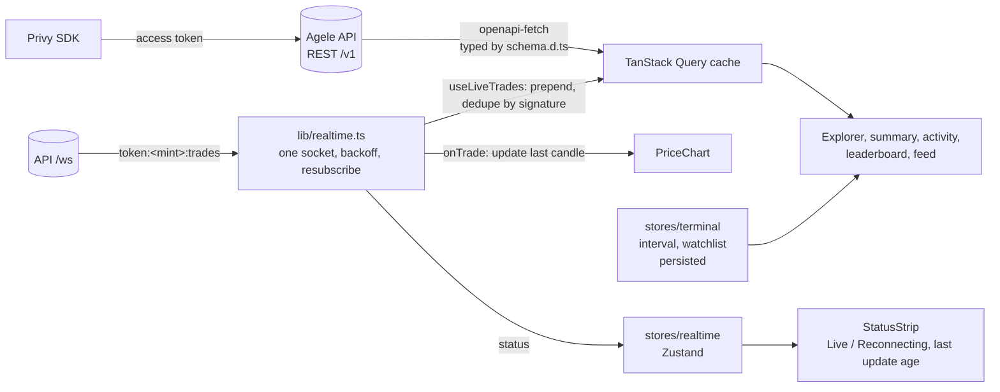

On reconnect the client re-subscribes every active topic and invalidates token queries, so the REST snapshot replaces anything missed while offline. The chart never invents candles for gaps.

## Realtime connection states

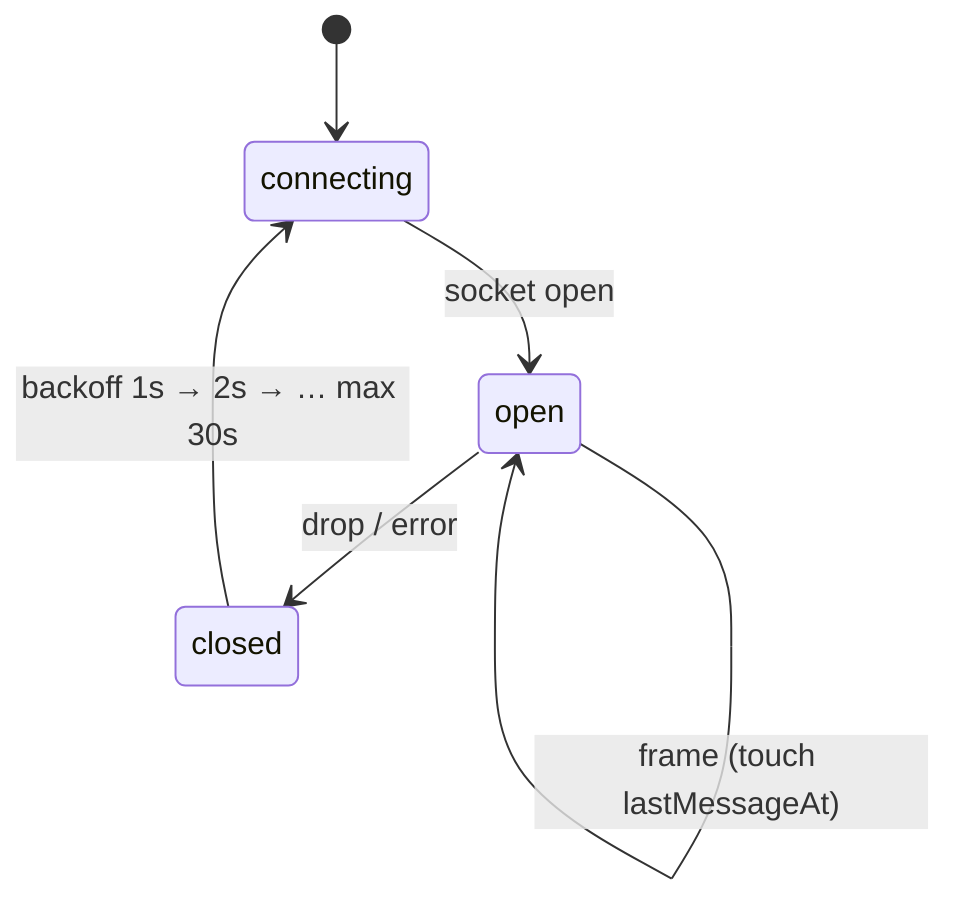

## Order flow

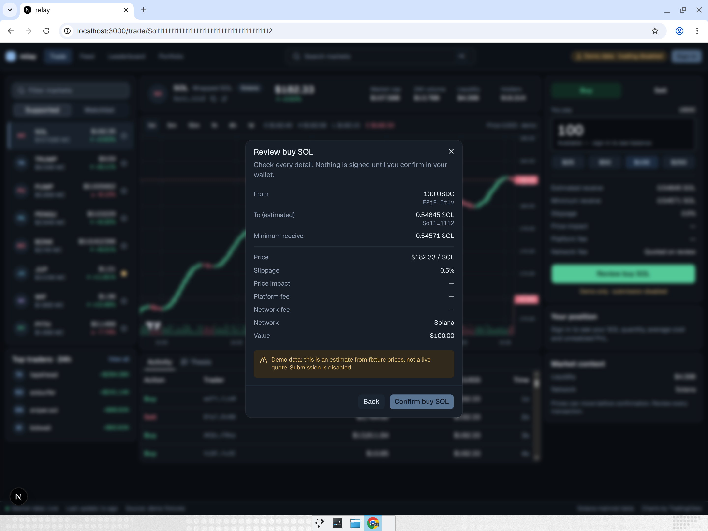

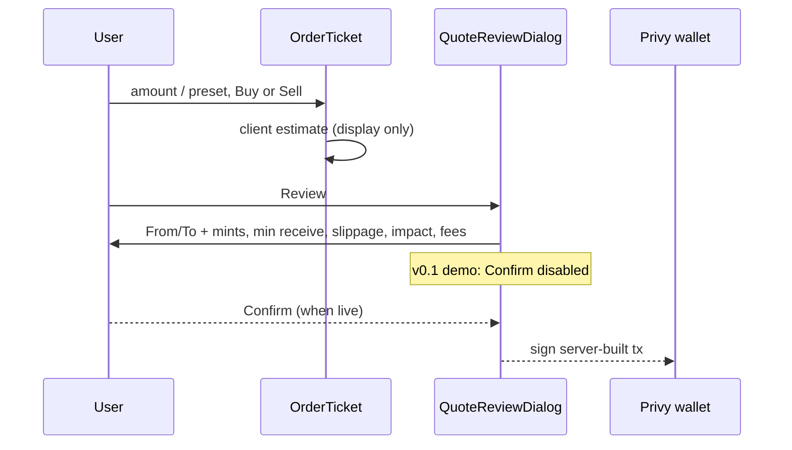

## Mobile

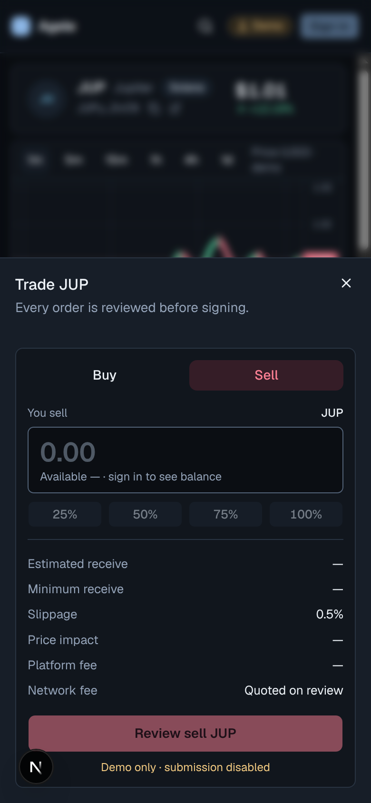

Below the `md` breakpoint the terminal is one column; the top nav moves to a bottom bar, the search opens from an icon, and Buy/Sell open the order ticket in a bottom sheet with the matching side selected.

## Theme

Graphite/Ice, dark only: shell `#0B0E13`, panel `#11161D`, floating `#171E28`, primary `#9CCBFF`, buy `#5DE0AA`, sell `#FF8195`, warning `#F1C981`. Geist / Geist Mono, data text at least 12px, colour never the only signal. Tokens live in `src/app/globals.css`.
