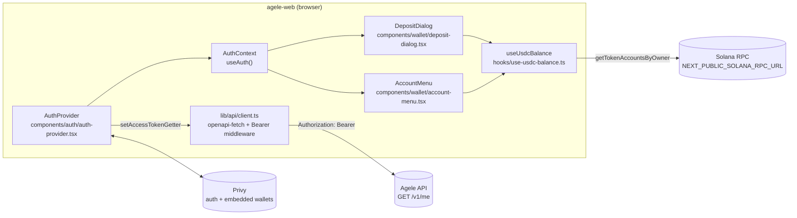
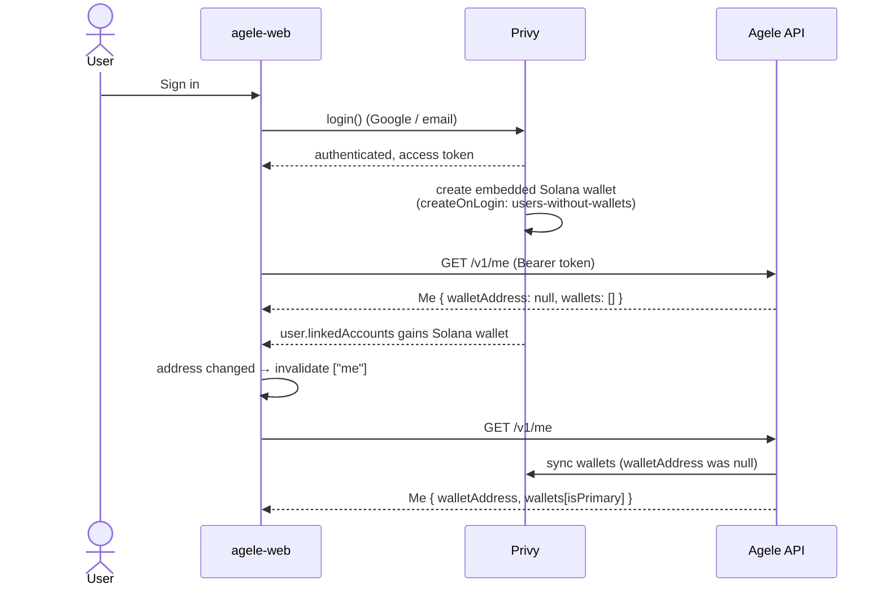
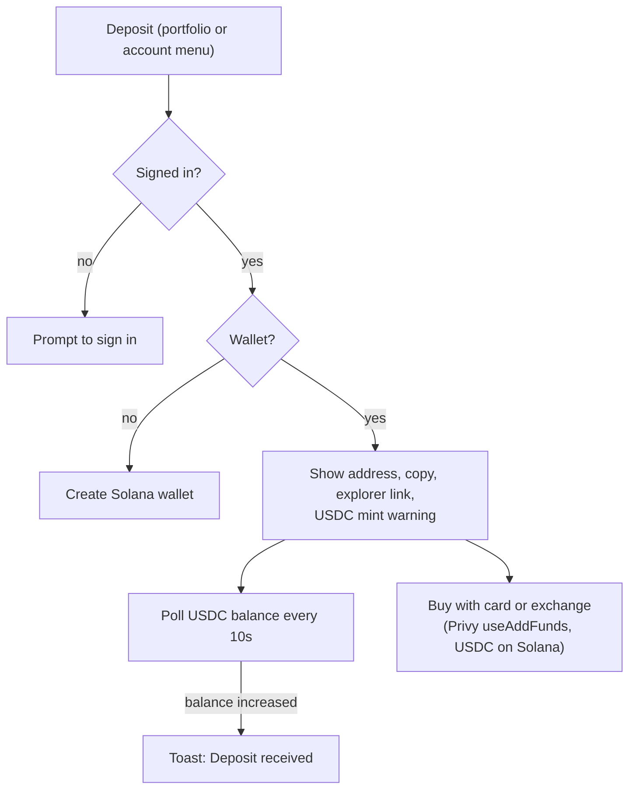
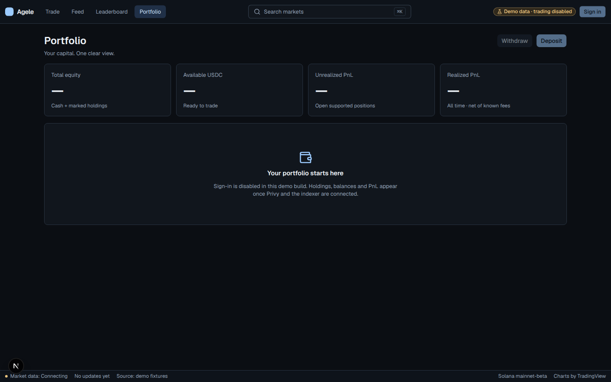
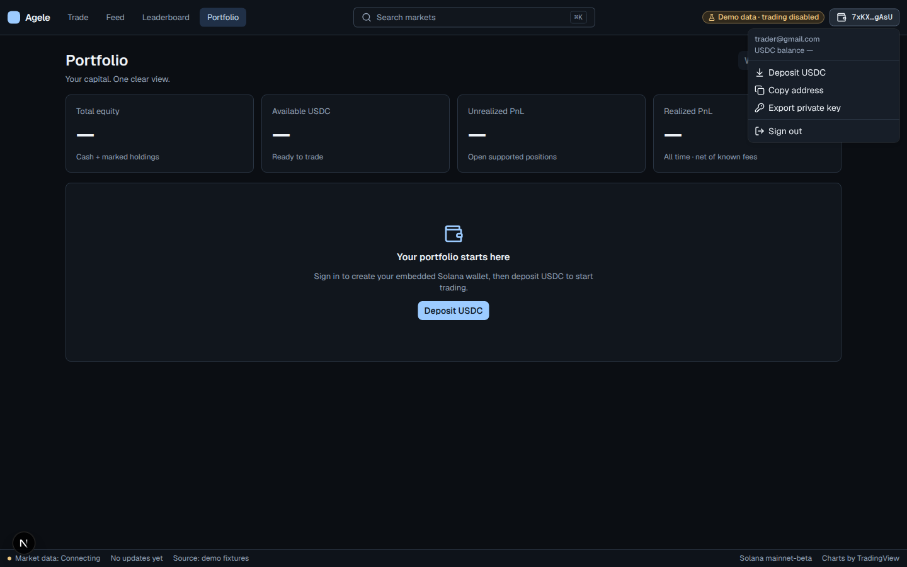
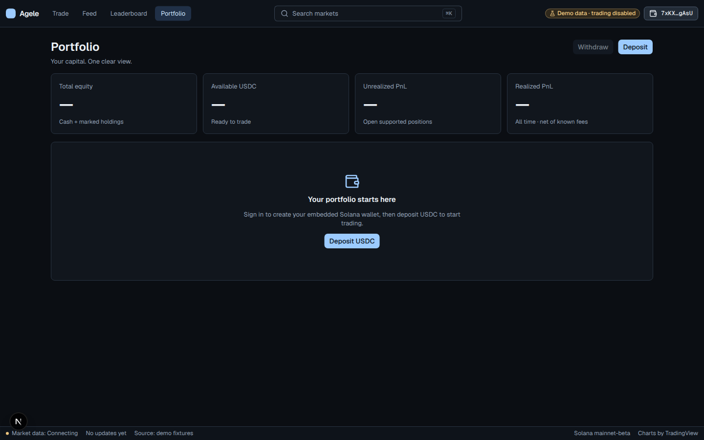
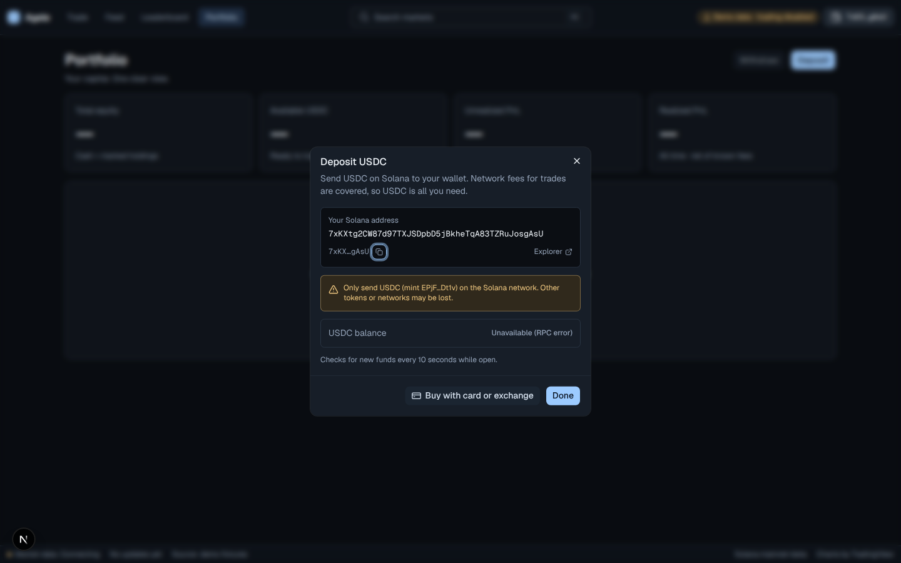

# Sign-in, embedded wallet and deposit

Users sign in with Google (or email) through [Privy](https://docs.privy.io). Privy creates a non-custodial embedded Solana wallet on first login, and the user funds it with USDC. The frontend never handles private keys: key export and signing happen inside Privy's iframe.

## Architecture

Without `NEXT_PUBLIC_PRIVY_APP_ID`, `AuthProvider` provides `demoAuth`: sign-in and Deposit are disabled and the app stays labelled as demo.

## Sign-in and wallet creation

- `primarySolanaWallet` prefers the Privy embedded wallet (`walletClientType: "privy"`) over external wallets.
- `/v1/me` errors: `401 unauthorized` stays an auth error. `503 auth_not_configured` (API without Privy keys) resolves to `null`, which the UI treats as demo mode.
- If a user has no wallet (for example, creation failed), the account menu offers **Create Solana wallet**.

## Deposit

The USDC mint follows `NEXT_PUBLIC_SOLANA_CLUSTER` (`lib/solana/cluster.ts`): `EPjF…Dt1v` on mainnet-beta, `4zMM…ncDU` on devnet.

## Screens

| Demo build (no Privy app id) | Signed in: account menu |
| --- | --- |
|  |  |

| Signed in: portfolio | Deposit dialog |
| --- | --- |
|  |  |

The screenshots of signed-in screens use a stubbed auth context. The balance shows "Unavailable" because the public mainnet RPC rejects browser token-account queries. Set `NEXT_PUBLIC_SOLANA_RPC_URL` to a domain-restricted provider key (for example, Helius).

## Configuration

| Variable | Purpose |
| --- | --- |
| `NEXT_PUBLIC_PRIVY_APP_ID` | Enables sign-in. Empty means demo mode. |
| `NEXT_PUBLIC_PRIVY_CLIENT_ID` | Optional Privy app client id, per environment. |
| `NEXT_PUBLIC_SOLANA_CLUSTER` | `mainnet-beta` (default) or `devnet`. |
| `NEXT_PUBLIC_SOLANA_RPC_URL` | Browser-safe RPC for balances and Privy signing. |

In the Privy dashboard, enable Google and email login and Solana embedded wallets, and add the app's domains to allowed origins.
