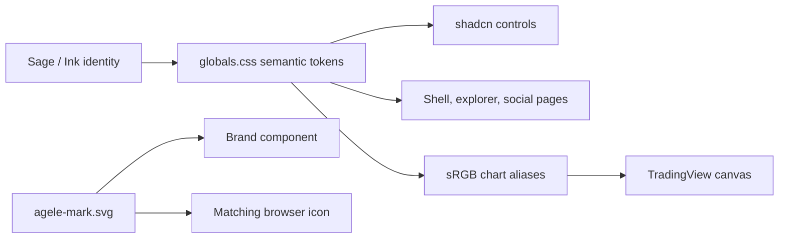

# Agele — Sage / Ink

Agele is a focused social trading desk, not a wall of widgets. Its identity pairs a pastel-green, split-sail **a** with warm ink surfaces and a close-set lowercase wordmark. The two rising strokes share a bridge: independent traders, shared context. No stock activity icon, glow, gradient, or generic blue.

Jogeshwar chose pastel green. [Sideline](https://sideline.jogeshwar.com/) is the reference for restraint, hierarchy and spacing **only**; its content, logo and sports metaphors are not reused. The terminal retains the Arbital/fomo chart-first composition and real supported-token artwork.

## Shared contract

| Role | sRGB reference | Use |
| --- | --- | --- |
| Ink | `#11110F` | Workspace |
| Panel | `#191917` | Chart, explorer and ticket |
| Floating | `#22221F` | Menus and dialogs |
| Text | `#F4F0E8` | Headings, prices, body |
| Secondary text | `#A7A69C` | Labels and supporting context |
| Pastel sage | `#B8DCA5` | Identity, navigation, primary action |
| Selected surface | `#293526` | Active market and selection |
| Divider | `#34342E` | Structural separation, never a text color |
| Input edge | `#6F7568` | Visible control boundary |
| Positive | `#72D5AB` | Buy and positive change, always labelled/signed |
| Negative | `#F18B96` | Sell and negative change, always labelled/signed |
| Caution | `#E6C17B` | Demo and warning states |

CSS semantic tokens in `src/app/globals.css` use OKLCH, rounded to three decimals. The hex values above are design handoff references. Canvas consumers use the **hex** `--chart-background`, `--chart-text`, `--chart-positive`, `--chart-negative`, `--chart-brand`, `--chart-grid` (`#292D27`) and `--chart-crosshair` (`#7E8978`) aliases; lightweight-charts must not receive raw OKLCH values. Regression tests keep those aliases aligned with UI tokens and check WCAG AA foreground/background pairs.

## Type and rhythm

- **Manrope**: UI, navigation, headings and wordmark. **Geist Mono**: prices, changing data and addresses. Both are subsetted and self-hosted through `next/font`.
- UI body 14px / 1.5; controls and names 14px; supporting data 12px; panel titles 16px. Landing copy 16–18px, display 48–72px. No fake bold/italic; no weight changes on selection.
- Panel radius 10px, controls 6–8px; panel padding 16px, gutters 12px. Rows are at least 48px (the explorer uses 64px for two lines); touch controls retain 44px targets.
- The header is 72px, the status strip 40px. Navigation uses one underline, not a row of filled pills. Green is an accent, not a flood fill.
- Explorer rows show identity/market cap and price/change in two lines. Rank, full-name repetition and a third statistic line are removed; full names remain in link titles. Watchlist is progressively disclosed.
- Keep the chart visually dominant. Secondary metrics, settings and history belong behind purposeful tabs or disclosure, not permanent extra cards.
- Selection must also have a shape cue (`aria-current`, underline or edge). Financial direction keeps Buy/Sell labels and +/- signs because brand green is not a profit signal.

## Scrolling

Keep the landing page and the workspace's outer page scrollbar native. The `workspace-scrollbars` scope styles only descendants of the main viewport: internal panels, tables and tab rows. Portalled shadcn dialogs/sheets get the same treatment; `panel-scrollbars` opts in isolated scrollers such as the footer ticker.

Use the neutral input-edge token for visible thumbs on transparent tracks, with native `scrollbar-width: thin` and `scrollbar-color`. Older WebKit gets an 8px fallback. Forced-colors mode retains system scrollbars. Do not hide bars, remove overflow, or change wheel, keyboard or touch scrolling to make a screenshot look cleaner.

## Ownership

Design owns tokens, fonts, identity, navigation, explorer and landing. Staff Frontend owns chart, under-chart panels, terminal grid, order entry and wallet. Both use this contract; chart-specific restyling ships separately to avoid overlapping file edits.

## Validation

`src/lib/brand.test.ts` checks text contrast, input-edge contrast, canvas parity and icon geometry. Existing explorer hydration and status-strip refresh tests remain in place. This brand change does not alter quotes, signing, balances or the API. Live trade and wallet verification still requires the existing Privy/API/RPC configuration.
