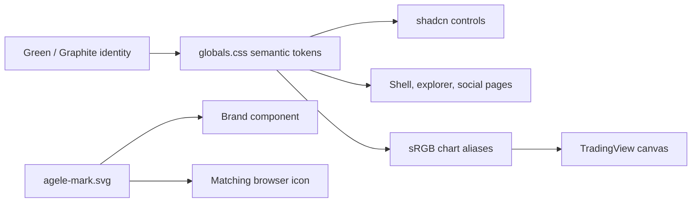

# Agele — Green / Graphite

Agele is a chart-first social trading desk. Its pastel-green, split-sail **a** and close-set lowercase wordmark sit on neutral black/grey surfaces. The two rising strokes share a bridge: independent traders, shared context. No warm ink or sage backgrounds, stock activity mark, glow, gradient, or generic blue.

Jogeshwar chose pastel green, then requested Arbital-level density with black/grey surfaces. Arbital and fomo are the composition references; [Sideline](https://sideline.jogeshwar.com/) informs restraint, not content or branding. The accessible Sideline repository is empty; do not claim its implementation was reused. Use real supported-token artwork.

## Shared contract

| Role | sRGB reference | Use |
| --- | --- | --- |
| Workspace | `#080A0D` | Black workspace |
| Panel | `#0E1116` | Chart, explorer and ticket |
| Floating | `#171B22` | Menus and dialogs |
| Text | `#EBEDF0` | Headings, prices, body |
| Secondary text | `#929BA8` | Labels and supporting context |
| Pastel sage | `#B8DCA5` | Identity, navigation, primary action |
| Selected surface | `#232830` | Neutral selection with pastel-green edge |
| Divider | `#29303A` | Structural separation, never a text color |
| Input edge | `#596474` | Visible control boundary and scroll thumb |
| Positive | `#2CDB99` | Buy and positive change, always labelled/signed |
| Negative | `#FF6177` | Sell and negative change, always labelled/signed |
| Caution | `#E6C17B` | Demo and warning states |

CSS semantic tokens in `src/app/globals.css` use OKLCH, rounded to three decimals. Components use semantic utilities, never raw colors; hex values here are handoff references. Canvas consumers use the **hex** `--chart-background`, `--chart-text`, `--chart-positive`, `--chart-negative`, `--chart-brand`, `--chart-grid` (`#1C222B`) and `--chart-crosshair` (`#596474`) aliases; lightweight-charts must not receive raw OKLCH values. Regression tests keep aliases aligned with UI tokens and check WCAG AA foreground/background pairs.

## Type and rhythm

- **Manrope**: UI, navigation, headings and wordmark. **Geist Mono**: prices, changing data and addresses. Both are subsetted and self-hosted through `next/font`.
- UI body 13px / 1.5; primary terminal data 12–13px; secondary data 11px; table captions 10px. Landing copy 16–18px, display 48–72px. No fake bold/italic or weight changes on selection.
- Panel radius 6px; explorer rows 44px with 28px logos and two lines. Terminal controls are compact; touch-only actions retain 44px targets. Do not shrink marketing typography to terminal sizes.
- Desktop header 48px, mobile header 56px, desktop status strip 28px. Active navigation has a neutral filled rectangle and pastel-green text. Green is an accent, not a flood fill.
- Explorer rows show identity/market cap and price/change in two lines. Rank, full-name repetition and a third statistic line are removed; full names remain in link titles. Watchlist is progressively disclosed.
- Keep the chart visually dominant. Secondary metrics, settings and history belong behind purposeful tabs or disclosure, not permanent extra cards.
- Selection must also have a shape cue (`aria-current`, underline or edge). Financial direction keeps Buy/Sell labels and +/- signs because brand green is not a profit signal.

## Scrolling

Keep the landing page and the workspace's outer page scrollbar native. The `workspace-scrollbars` scope styles only descendants of the main viewport: internal panels, tables and tab rows. Portalled shadcn dialogs/sheets get the same treatment; `panel-scrollbars` opts in isolated scrollers such as the footer ticker.

Use the neutral input-edge token for visible thumbs on transparent tracks, with native `scrollbar-width: thin` and `scrollbar-color`. Older WebKit gets an 8px fallback. Forced-colors mode retains system scrollbars. Do not hide bars to make a screenshot cleaner. The ticker is the sole moving scroller: its duplicate is inert and hidden from assistive technology; hover pauses movement. Keyboard focus, explicit pause and reduced-motion preferences use one static, natively scrollable token list.

## Ownership

Design owns tokens, fonts, identity, navigation, explorer and landing. Staff Frontend owns chart, under-chart panels, terminal grid, order entry and wallet. Both use this contract; chart-specific restyling ships separately to avoid overlapping file edits.

## Validation

`src/lib/brand.test.ts` checks text contrast, input-edge contrast, canvas parity and icon geometry. Existing explorer hydration and status-strip refresh tests remain in place. This brand change does not alter quotes, signing, balances or the API. Live trade and wallet verification still requires the existing Privy/API/RPC configuration.
