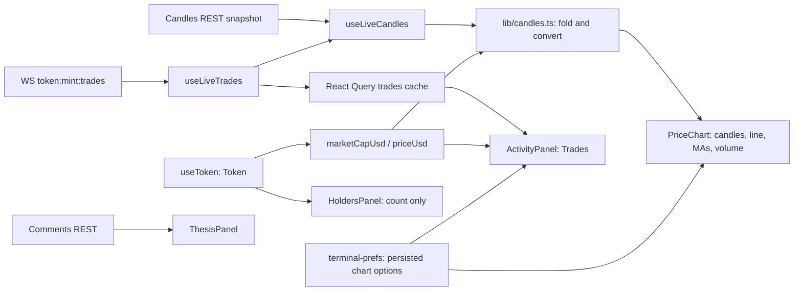
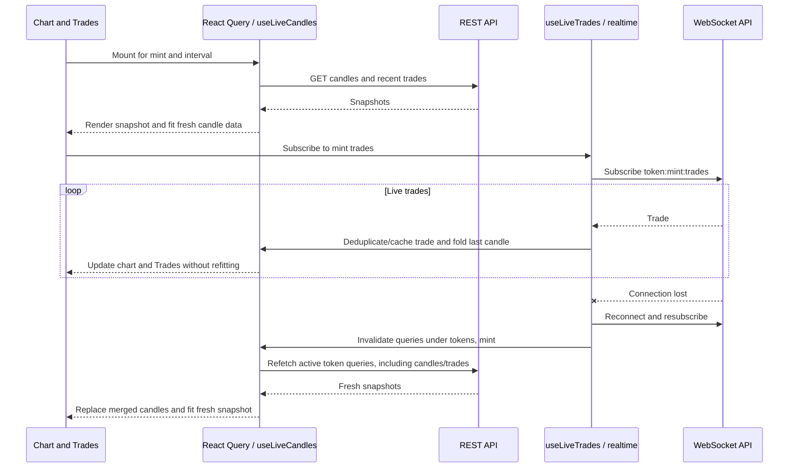
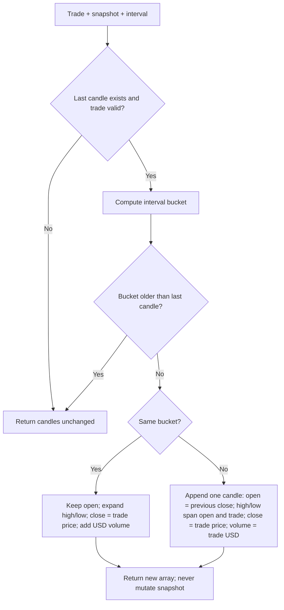
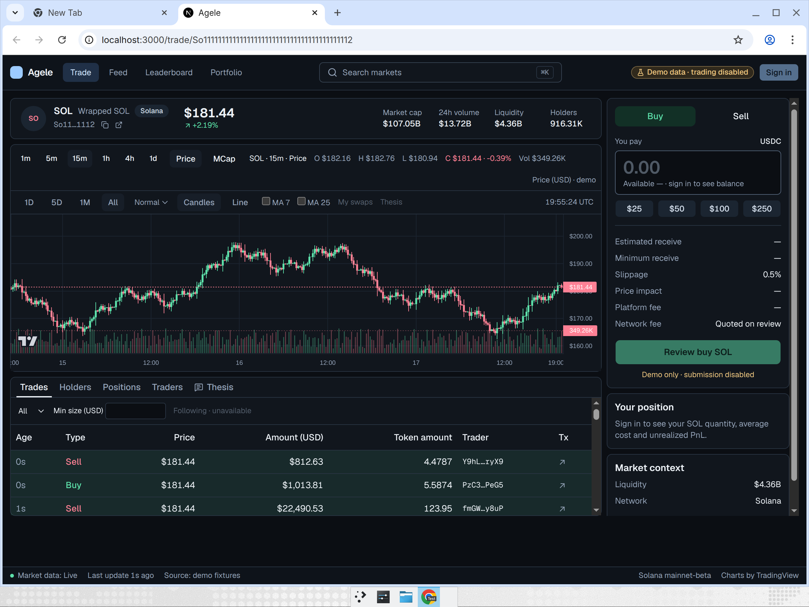
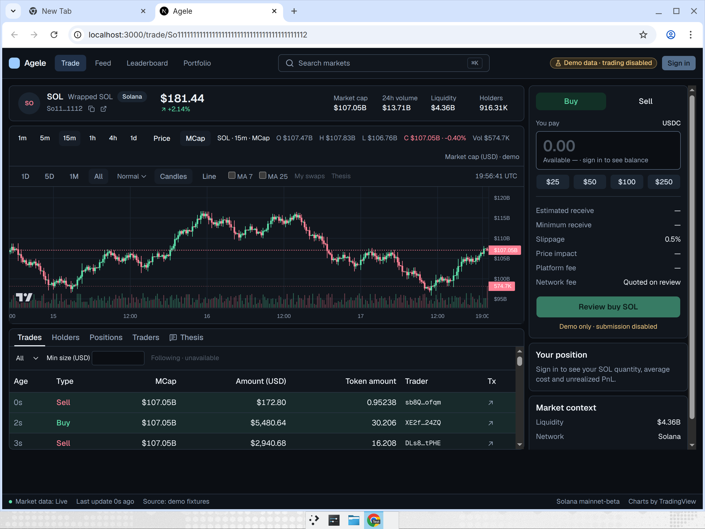

# Chart and panels

The terminal labels demo mode via `useMarketDataMode` (health-derived market
data source and auth configuration); these screens do not imply executable trading or real
fills. Depth remains unavailable. API types come from the generated
`src/lib/api/schema.d.ts`, never handwritten response models.

## Data and components

| Source | Consumer |
| --- | --- |
| `GET /v1/tokens/{mint}/candles?interval=…&limit=300` | REST candle snapshot, owned by `useLiveCandles`; 60-second stale time |
| `GET /v1/tokens/{mint}/trades?limit=40` | Initial Trades table; live cache capped at 60 rows |
| WS `token:<mint>:trades` | `useLiveTrades` updates the trades cache and delivers trades for candle folding |
| `GET /v1/tokens/{mint}` | `useToken`: price, market cap and holders count; refreshes every 15 seconds |
| `GET /v1/tokens/{mint}/comments?limit=20` | Existing Thesis discussion |



### Snapshot, live updates and reconnect



`useLiveTrades` ignores another mint's trades and re-snapshots after reconnect.
`useLiveCandles` keys merged state by mint, interval and snapshot update time, so
a new snapshot or selection cannot reuse another selection's live candles. It
deduplicates a rolling window of 500 trade signatures. Changing denomination
reuses price data; it does not refetch or refit. A fresh snapshot or an explicit
range change adjusts the visible range, not each incoming trade.

## Candle fold and MCap

`lib/candles.ts` uses Unix-second buckets:
`bucket = floor(trade.time / intervalSeconds) × intervalSeconds`.



- Valid trades have finite time, positive finite price, and finite nonnegative
  USD amount. Empty snapshots stay empty; older trades are ignored.
- Same-bucket trades update H/L/C/V. Newer buckets open at the previous close;
  **no gap candles are invented**, even across multiple missing intervals.
- Estimated supply is `Token.marketCapUsd / Token.priceUsd`, not an on-chain
  supply lookup. Missing tokens, nonpositive/non-finite inputs or a non-finite
  ratio make MCap unavailable.
- MCap OHLC = price OHLC × estimated supply; timestamps and **USD volume stay
  unchanged**. Trade MCap uses the same supply. Price uses `formatPrice` with
  magnitude-based scale precision; MCap uses `formatCompactUsd` (the percentage
  scale intentionally displays percentages). The legend shows O/H/L/C, change
  from open, and USD volume for the hovered candle, otherwise the last candle.
- MA 7 and MA 25 average candle closes over complete windows only, in the
  selected denomination; no values are drawn before a full window exists.

## Controls and persistence

Chart preferences live in the Zustand terminal store and browser storage key
`terminal-prefs` (alongside the existing watchlist).

| Control | Behavior | Persisted |
| --- | --- | --- |
| 1m / 5m / 15m / 1h / 4h / 1d | Candle interval; default 15m | Yes |
| Price / MCap | Chart and Trades denomination; default Price | Yes |
| 1D / 5D / 1M / All | Visible range ending at last candle; 1M means 30 days, no extra history fetched | Yes |
| Normal / Log / % | Price-scale mode; default Normal | Yes |
| Candles / Line | Chart style; default Candles | Yes |
| MA 7 / MA 25 | Close moving-average overlays; default off | Yes |
| UTC clock | Current UTC time | No |
| My swaps / Thesis overlays | Disabled, with explanatory titles: sign-in/API data unavailable; no overlay endpoint | No |
| Trades side / minimum USD size | All, Buys or Sells; minimum notional filter | No |

Manual pan/zoom, hovered candle and the selected under-chart tab are not stored.

## Under-chart tabs and unavailable data

| Tab | Available now / limitation |
| --- | --- |
| **Trades** | Age, type, Price/MCap, USD amount, token amount, trader and transaction links to Solscan. Live rows briefly highlight. Following is disabled: sign-in and following API data are required. Demo signatures are synthetic. |
| **Holders** | Formatted `Token.holders` count only. “Top holder list isn't available yet”: no holders endpoint exists. `HoldersPanel` is separate so a future list query can be wired here. |
| **Positions** | Honest empty state: sign-in and a positions API are required. |
| **Traders** | Honest empty state: no per-token trader-ranking endpoint. The existing separate Top Traders panel is unchanged. |
| **Thesis** | Existing discussion UI unchanged; posting remains sign-in gated. This is distinct from the disabled chart overlay. |

### Proposed holders API — not implemented

`GET /v1/tokens/{mint}/holders?limit≤100`

Here `limit≤100` describes the cap (for example, `?limit=100`), not literal query
syntax. Proposed response shape:

```ts
{
  holders: [{ rank, wallet, amount, pctSupply, valueUsd, label: "pool" | "dev" | null }],
  total
}
```

This is a backend proposal, **not part of the current generated contract**.
Implement and publish the API schema first, regenerate client types, then wire
the list; do not invent holder rows or hand-edit generated types.

## Verified demo screens

Captured at `/trade/So11111111111111111111111111111111111111112` with the local
mock API. These screenshots show UI behavior, not real market execution.

### Price candles and live Trades


### MCap candles and live Trades


### Range, line style, percentage scale and MAs


### Holders count with unavailable list


### Trades filters with no matching rows


## Checks

`bun run check && bun run build` passed for the implementation
(3 test files, 15 tests). Pure logic and hook tests cover folding, conversion,
MAs, deduplication, selection/snapshot resets, loading, empty and error states.
The screens above were visually checked; forced reconnect and mobile layout
were not visually exercised.
