# Chart and panels

The terminal labels demo mode via `useMarketDataMode` (health-derived market
data source and auth configuration); these screens do not imply executable trading or real
fills. Depth remains unavailable. API types come from the generated
`src/lib/api/schema.d.ts`, never handwritten response models.

## Data and components

| Source | Consumer |
| --- | --- |
| `GET /v1/tokens/{mint}/candles?interval=…&limit=300` | REST candle snapshot, owned by `useLiveCandles`; 60-second stale time |
| `GET /v1/tokens/{mint}/trades?limit=40` | Initial Trades table; live cache capped at 60 rows |
| WS `token:<mint>:trades` | `useLiveTrades` updates the trades cache and delivers trades for candle folding |
| `GET /v1/tokens/{mint}` | `useToken`: price, market cap and holders count; refreshes every 15 seconds |
| `GET /v1/tokens/{mint}/comments?limit=20` | Existing Thesis discussion |
| `GET /v1/tokens/{mint}/positions` | Bearer-authenticated viewer position, including closed positions; refreshes every 30 seconds |
| `GET /v1/tokens/{mint}/traders?limit=25&cursor=…` | Public indexed-volume ranking, loaded in cursor pages |
| `GET /v1/tokens/{mint}/holders?limit=20` | Public owner-wallet snapshot, top-10 concentration and update time |

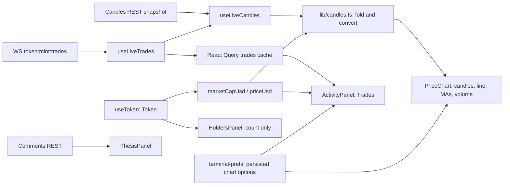

### Snapshot, live updates and reconnect

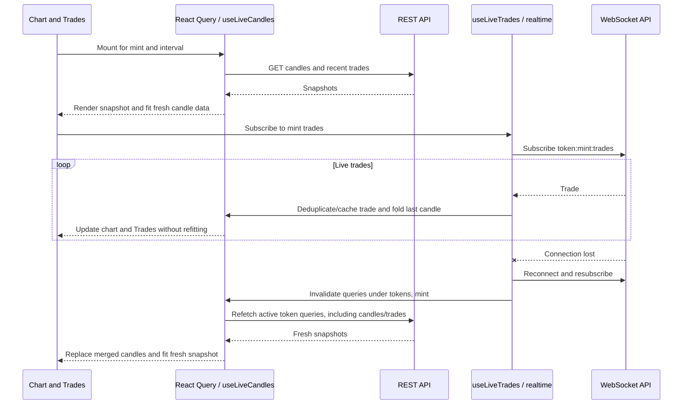

`useLiveTrades` ignores another mint's trades and re-snapshots after reconnect.
`useLiveCandles` keys merged state by mint, interval and snapshot update time, so
a new snapshot or selection cannot reuse another selection's live candles. It
deduplicates a rolling window of 500 trade signatures. Changing denomination
reuses price data; it does not refetch or refit. A fresh snapshot or an explicit
range change adjusts the visible range, not each incoming trade.

## Candle fold and MCap

`lib/candles.ts` uses Unix-second buckets:
`bucket = floor(trade.time / intervalSeconds) × intervalSeconds`.

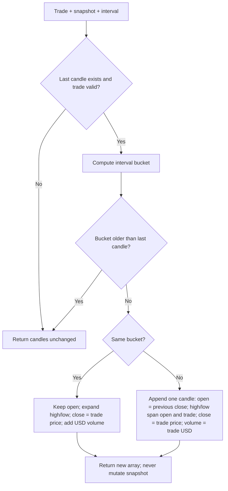

- Valid trades have finite time, positive finite price, and finite nonnegative
  USD amount. Empty snapshots stay empty; older trades are ignored.
- Same-bucket trades update H/L/C/V. Newer buckets open at the previous close;
  **no gap candles are invented**, even across multiple missing intervals.
- Estimated supply is `Token.marketCapUsd / Token.priceUsd`, not an on-chain
  supply lookup. Missing tokens, nonpositive/non-finite inputs or a non-finite
  ratio make MCap unavailable.
- MCap OHLC = price OHLC × estimated supply; timestamps and **USD volume stay
  unchanged**. Trade MCap uses the same supply. Price uses `formatPrice` with
  magnitude-based scale precision; MCap uses `formatCompactUsd` (the percentage
  scale intentionally displays percentages). The legend shows O/H/L/C, change
  from open, and USD volume for the hovered candle, otherwise the last candle.
- MA 7 and MA 25 average candle closes over complete windows only, in the
  selected denomination; no values are drawn before a full window exists.

## Controls and persistence

Chart preferences live in the Zustand terminal store and browser storage key
`terminal-prefs` (alongside the existing watchlist).

| Control | Behavior | Persisted |
| --- | --- | --- |
| 1m / 5m / 15m / 1h / 4h / 1d | Candle interval; default 15m | Yes |
| Price / MCap | Chart and Trades denomination; default Price | Yes |
| 1D / 5D / 1M / All | Visible range ending at last candle; 1M means 30 days, no extra history fetched | Yes |
| Normal / Log / % | Price-scale mode; default Normal | Yes |
| Candles / Line | Chart style; default Candles | Yes |
| MA 7 / MA 25 | Close moving-average overlays; default off | Yes |
| UTC clock | Current UTC time | No |
| My swaps / Thesis overlays | Disabled, with explanatory titles: sign-in/API data unavailable; no overlay endpoint | No |
| Trades side / minimum USD size | All, Buys or Sells; minimum notional filter | No |

Manual pan/zoom, hovered candle and the selected under-chart tab are not stored.

## Under-chart tabs and unavailable data

| Tab | Available now / limitation |
| --- | --- |
| **Trades** | Age, type, Price/MCap, USD amount, token amount, trader and transaction links to Solscan. Live rows briefly highlight. Following is disabled: sign-in and following API data are required. Demo signatures are synthetic. |
| **Holders** | Ranked owner wallets with Solscan links, amount, supply share and USD value. Pool rows use `isPool` and the API label (currently Raydium). Shows `totalHolders`, `top10Pct` and UTC `updatedAt`. Loading, empty, 404 and temporary-unavailable/Retry states are distinct. |
| **Positions** | Existing auth login entry point when signed out (disabled in unconfigured demo builds). Signed-in viewers see quantity, average cost, price, value and signed unrealized/realized PnL. Null means no position; quantity zero means closed, retaining realized PnL. |
| **Traders** | Public list ranked by lifetime indexed volume, with rank, handle/wallet, Solscan link when a wallet exists, buys/sells, volume and total PnL. Load more follows `nextCursor`; null ends pagination. The separate Top Traders panel is unchanged. |
| **Thesis** | Existing discussion UI unchanged; posting remains sign-in gated. This is distinct from the disabled chart overlay. |

### Authenticated positions and indexed traders

`tokenQueries.position` keys private results by mint and the portfolio viewer
identity (wallet address, falling back to user label). Signed-out requests are
disabled, missing bearer tokens fail before HTTP, and logout switches cache keys
so private rows cannot remain visible. Errors never become a fabricated zero
position; 404 means unknown token, not an empty holding.

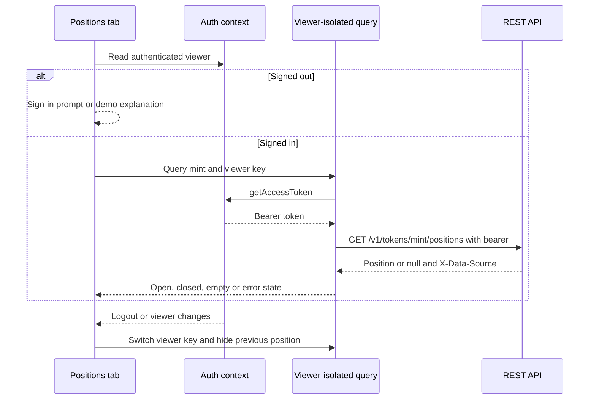

Both endpoints label successful responses from `X-Data-Source` using the same
parser as the leaderboard: indexed, demo, or unknown. PnL is signed and colored;
unknown provenance is never labelled indexed. Traders without wallets have no
invented explorer link. Rankings are live, not snapshot-isolated, so the order
may change between pages. A pagination error preserves existing rows and offers
Retry load more; initial errors and 404 show Retry without invented rows.

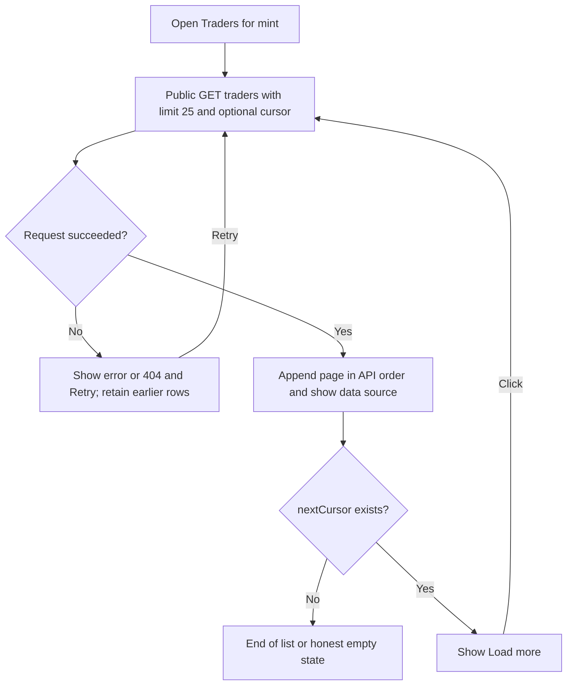

### Holders snapshot

The implemented contract replaces the earlier proposed holders API: `limit` is
**1–20**, with `{ mint, totalHolders, top10Pct, holders, updatedAt }`. Rows use
`{ rank, wallet, amount, pctSupply, valueUsd, isPool?, label? }` from generated
types. Supply percentages are already percent units, not fractions. Missing pool
labels display “Unknown pool”; only `isPool` rows get tags. Snapshot time is Unix
seconds. No automatic retry loop runs on upstream errors; Retry explicitly
requests another snapshot. The live provider may return 502 from public RPC rate
limits until a Helius key is configured; the UI does not claim the list is empty.

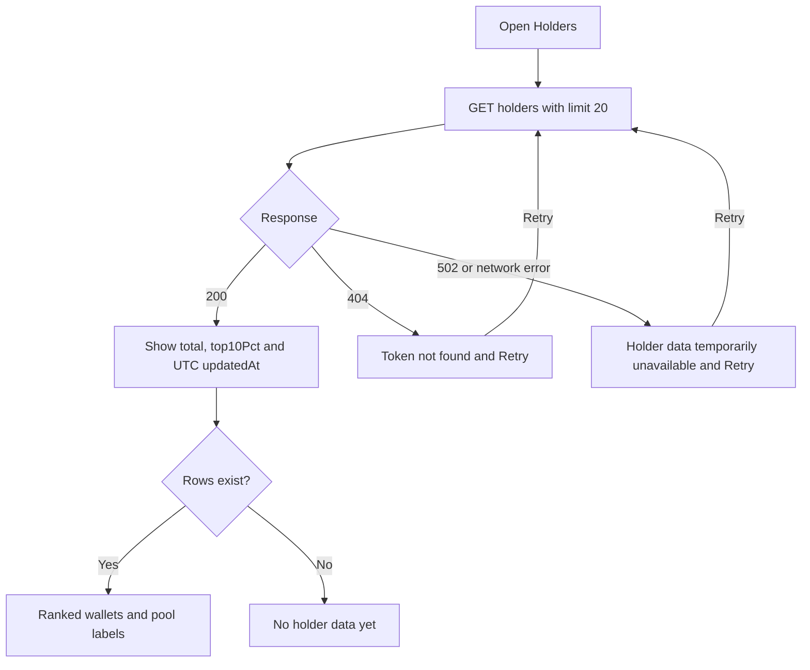

## Original chart implementation screens

Captured at `/trade/So11111111111111111111111111111111111111112` with the local
mock API. These screenshots show UI behavior, not real market execution.

### Price candles and live Trades

### MCap candles and live Trades

### Range, line style, percentage scale and MAs
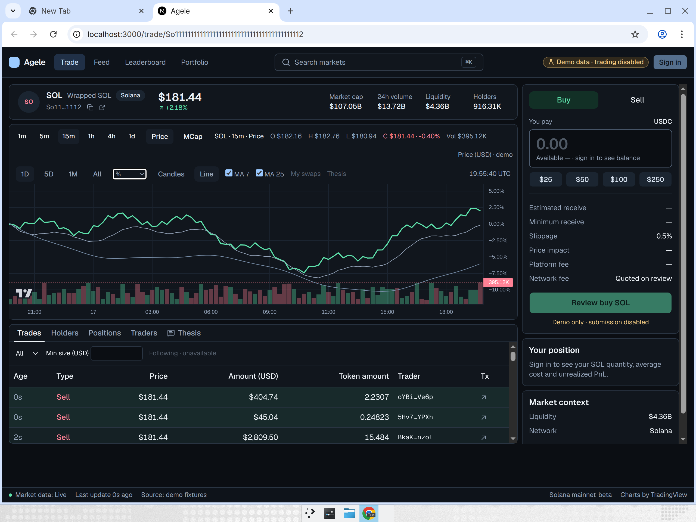

### Holders count with unavailable list
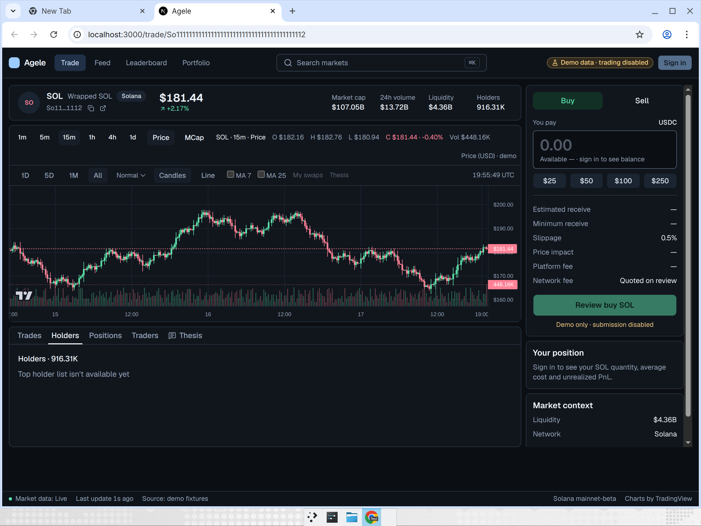

### Trades filters with no matching rows

## Original chart implementation checks

`bun run check && bun run build` passed for the implementation
(3 test files, 15 tests). Pure logic and hook tests cover folding, conversion,
MAs, deduplication, selection/snapshot resets, loading, empty and error states.
The screens above were visually checked; forced reconnect and mobile layout
were not visually exercised.

## Positions, Traders and Holders verification

Types regenerated with `OPENAPI_URL=../agele/openapi.json bun run api:types`
from backend main (the API now lives at that repository's root). New panels use
only those generated response types. My swaps and Design-owned files are untouched.

The following screens use the current local backend with
`MARKET_DATA_PROVIDER=mock`, local PostgreSQL and Redis. Holders are backend mock
fixtures. Traders come from two explicitly seeded **local demo database users and
trades**, not real indexed activity; the backend still correctly reports its
indexed repository as the data source. Positions is signed out with Privy
unconfigured. Signed-in open/null/closed and error states are covered in Vitest,
not a real Privy session. The mock provider does not emit RPC 502s: the 502 → Retry
→ recovered list interaction is tested in Vitest rather than a fabricated screenshot.

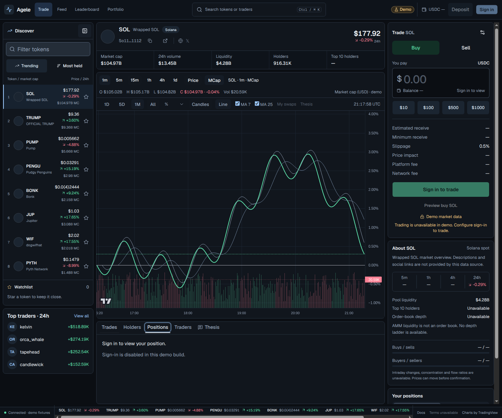
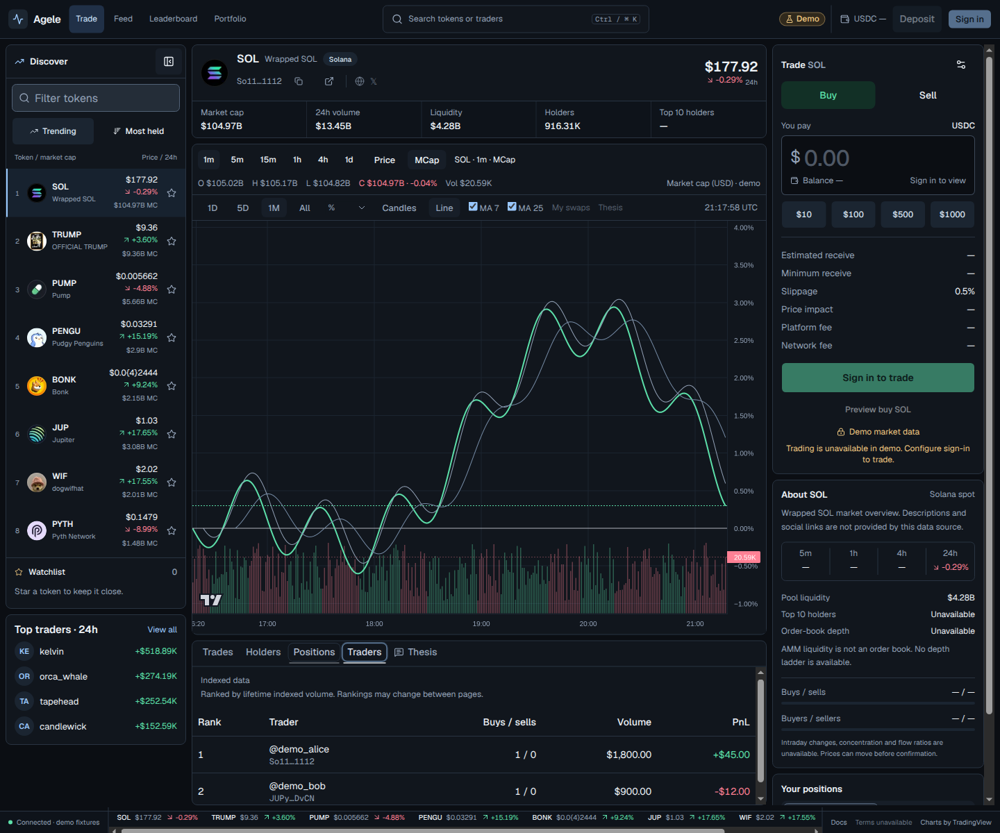
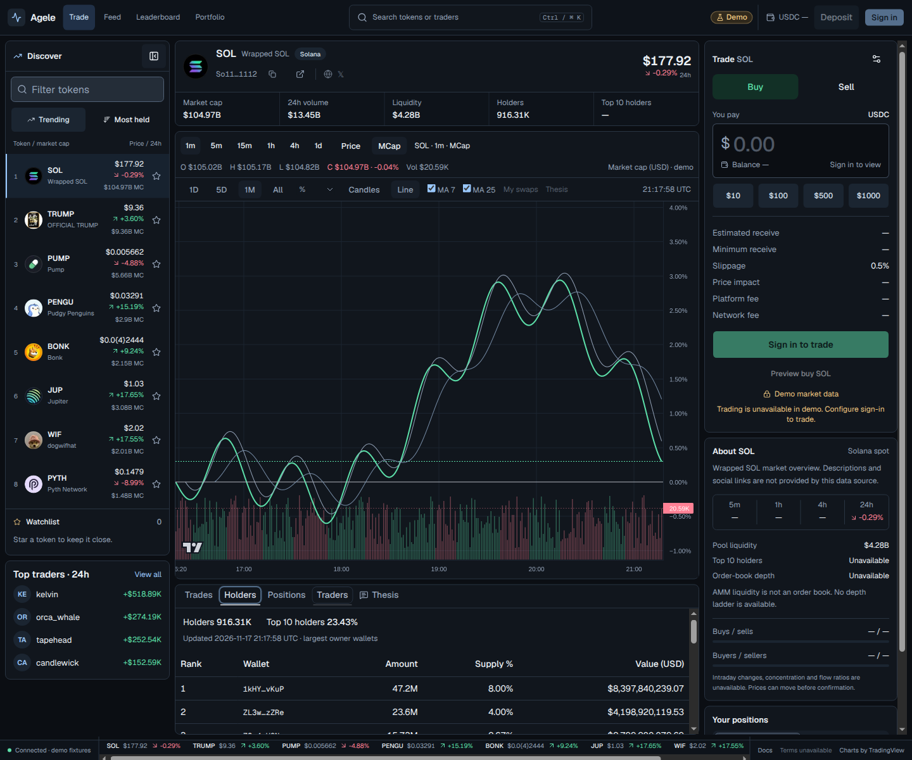

Panel/query tests cover bearer and signed-out gating, viewer/mint isolation,
logout, opaque cursor pagination, null/closed positions, missing wallets, empty
pages, initial and pagination errors, 404s, pool tagging, and holder 502 recovery.
`bun install --frozen-lockfile && bun run check && bun run build` passed with
22 test files and 202 tests. All six Mermaid blocks rendered successfully with
Mermaid CLI. The three new panels above were visually checked on the new build.
