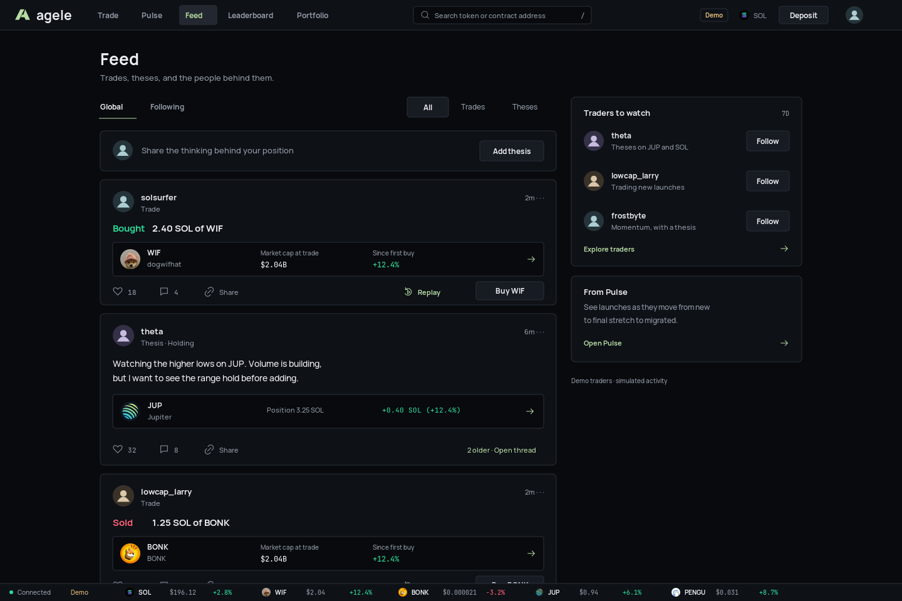
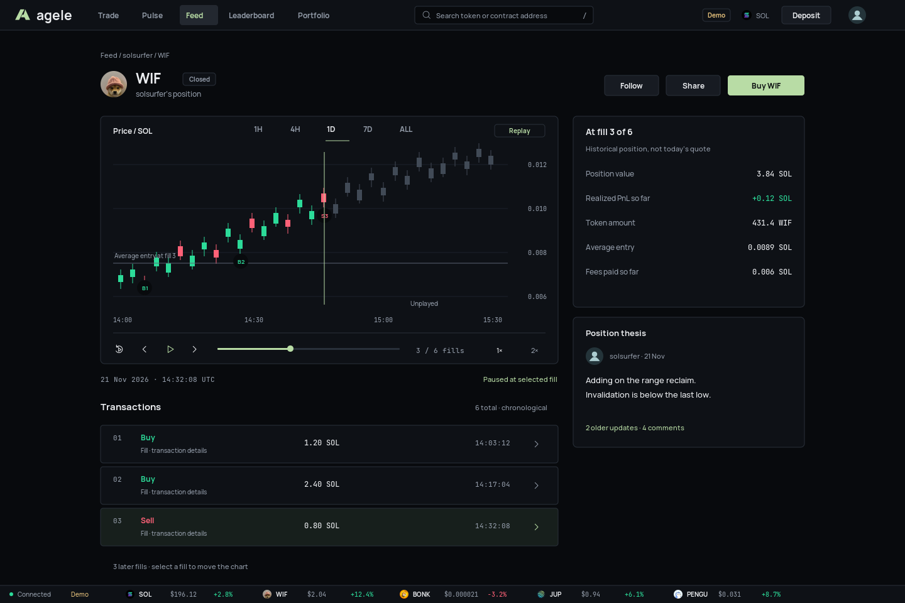
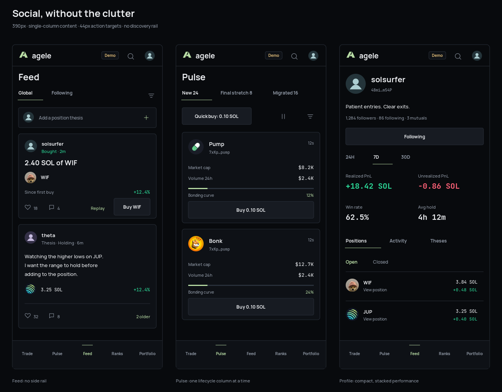
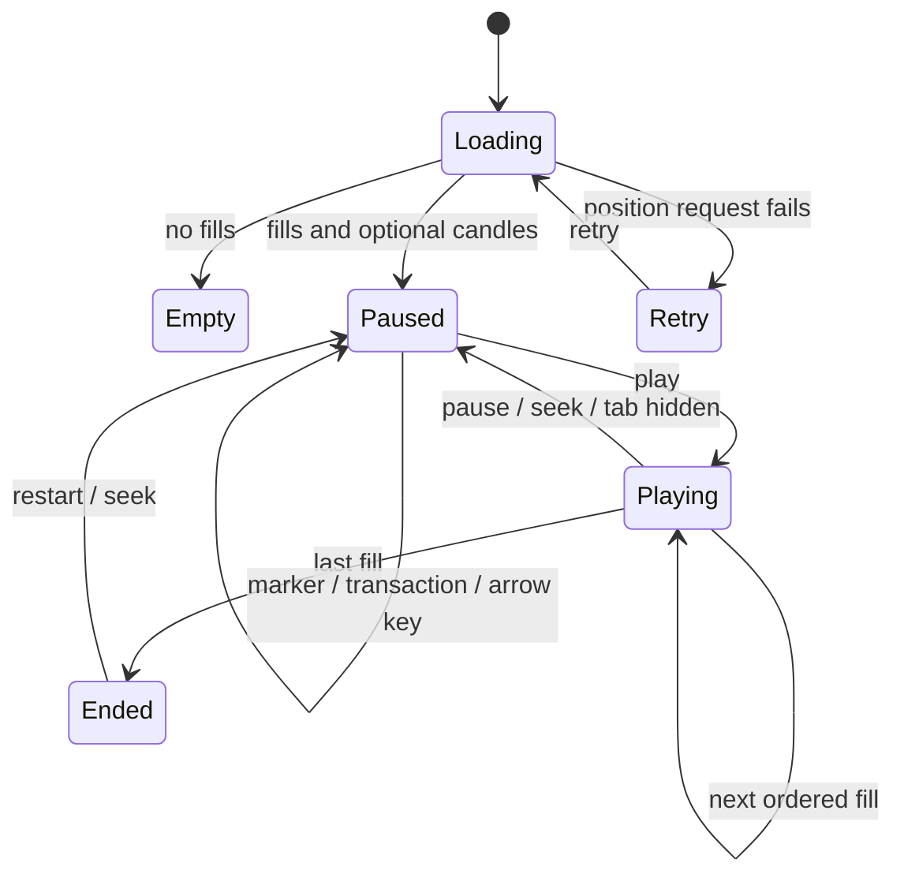
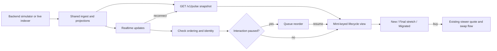
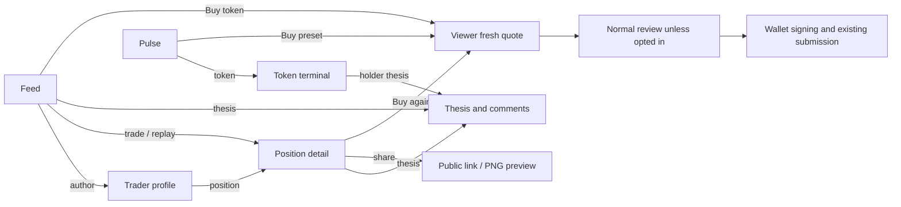

# Agele v0.2 — social design handoff

**Design, not an alternative app.** This pack defines the UI for the API-backed social product. It adds no browser demo provider, runtime fixture, route, hook or trading behavior. Frontend owns those implementations; Backend owns `jog01/agele/openapi.json`. Demo and indexed data use identical components and interactions.

## Boards

PNGs are the canonical visual reference. Each has an editable, text-based SVG beside it. The boards use fictional demo activity, not live performance; token artwork is reused from the repository solely to demonstrate circular crops. Pulse lifecycle placements, addresses and financial figures are **illustrations, not claims about these real tokens**. Seeded identities/positions in the app must come from the backend, never this renderer.

| Board | What to build |
| --- | --- |
| [01 Feed](01-feed.png) · [SVG](01-feed.svg) | Global/Following, activity types, position-thesis entry, trade summary, replay and explicit buy |
| [02 Profile](02-profile.png) · [SVG](02-profile.svg) | Identity, relationships, scoped performance, chart, activity and positions |
| [03 Pulse](03-pulse.png) · [SVG](03-pulse.svg) | Three lifecycle columns, remote artwork, curve progress, quote-sized buy action |
| [04 Replay](04-replay.png) · [SVG](04-replay.svg) | Position detail, fill markers, historical cursor, metrics, thesis and transactions |
| [05 Share card](05-share-card.png) · [SVG](05-share-card.svg) | Exported position result with chart, period, identity, fees and source label |
| [06 Mobile](06-mobile.png) · [SVG](06-mobile.svg) | Feed, Pulse and profile at 390px |
| [07 Social detail](07-thesis-thread-filters.png) · [SVG](07-thesis-thread-filters.svg) | Position-bound composer, versioned thesis, threaded comments, filter sheet |
| [08 Mobile replay](08-mobile-replay.png) · [SVG](08-mobile-replay.svg) | Chart, fill controls, tabs and separate Buy/Share bar at 390px |
| [09 Continuations](09-social-continuations.png) · [SVG](09-social-continuations.svg) | P1 leaderboard, token holders with theses, notification drawer |
| [10 States](10-states.png) · [SVG](10-states.svg) | Structure-matched loading, empty following, stale data and rejected publish |
| [11 Search and discovery](11-search-discovery.png) · [SVG](11-search-discovery.svg) | Token/trader destinations, recent tokens, market context, keyboard hints and 390px sheet |





## Parity and polish review

The [Fomo parity and polish review](implementation-review.md) separates current-main browser findings, source-only gaps and public Fomo documentation. A design target is not evidence that its app feature has shipped. Use the audited revisions and acceptance criteria when handing implementation to Frontend.

Board 11 adds the missing search target from Jogeshwar's reference screenshots. It keeps the market table compact, reserves numeric columns, and makes the token/profile destinations distinct. It does not add a runtime search index or expand Agele beyond supported Solana markets.

### Search interaction contract

- Search tokens by symbol/name/contract and traders by handle/display name through backend-supported search. Do not limit text search silently to the trending list or a browser-seeded set of traders.
- Empty queries show recent tokens and a useful discovery list. Store visited mints, not copied market data; resolve names, artwork and prices through the normal API/cache. Clear all clears that history, not the watchlist.
- Token rows show circular artwork, symbol, name, supported chain and unambiguous contract context. Align labelled USD market cap, price and change columns. Trader rows open the public profile; they do not open a token market.
- Arrow keys change the active result; Enter opens it; Escape closes and restores the originating search trigger. Keep the active row in view and expose it to assistive technology. Ignore shortcuts during IME composition.
- Show Paste address and keyboard hints where useful. Clipboard denial leaves manual paste available and keeps the dialog open. Never request clipboard access on page load.
- Use a full-width sheet at 390px, with 44px non-overlapping controls and a 16px input on coarse-pointer devices. Do not open the software keyboard until the visitor taps the input.
- Preserve results during background refresh. Initial loading, no matches, search failure and expired/unavailable markets have distinct states. No match must not mean the request failed.
- A search result is navigation, not an immediate trade. Buying from a social position remains a separate explicit action with a fresh viewer quote.

## References and decisions

- [CTO's v0.2 thread and fomo spec](https://jog-fld1119.slack.com/archives/C0CJE8VH25R/p1795805869071429), including priorities and published fomo screenshots. The replay interpretation is an **Agele product decision**, not a verified fomo playback implementation.
- [fomo's social guide](https://fomo.family/blog/guide/leveraging-fomos-social-features) and [public feed artwork](https://fomo.family/images/landing/social-static.webp) were inspected. The [parity review](implementation-review.md#official-reference-catalog) expands the reference set to official feature guides, articles and release notes. Borrow identity-first information hierarchy and position context, not fomo's brand, decorations or marketing claims. This design session did not access signed-in Fomo; the CTO owns that separate walkthrough.
- [Existing Agele brand contract](../../brand.md) stays authoritative: Manrope, mono numeric values, Agele mark, green accent, neutral black/grey, real circular token artwork.
- **No auto-copy.** A social Buy creates the viewer's own fresh quote. It does not mirror position size, buy automatically on an alert, or imply the viewer gets the author's historical entry.
- **No free-floating thesis.** Compose against a position; revisions remain in its history. A thesis may be authored for an open position or within the server-enforced three-hour post-close window.
- **SOL is the trading quote.** Trade size, position values and SOL-denominated PnL use explicit SOL suffixes. USD market cap/volume remain labelled USD; USD equivalents use the historical valuation supplied by the API, never today's SOL price applied to old fills.
- **No fabricated completeness.** Unavailable fields are `—` with an explanation on focus/hover, not zero. Never invent verified badges, fees, ranks, curves, conversion rates or PnL.

## Visual and layout contract

Use existing semantic tokens and shadcn primitives, not hex literals in product components. Hex references are in `docs/brand.md`. Selection uses an underline or surface as well as color. Buy/Sell and signed gains/losses remain textual; the brand accent is not a performance signal.

| Dimension | Desktop | Small screens |
| --- | --- | --- |
| Shell | Existing 48px header and 28px status/ticker | Existing 56px header and bottom navigation; respect safe areas |
| Frame | Max 1120px, 24px gaps | 16px gutters, no horizontal page scroll at 320px |
| Feed | 728px stream + 368px discovery rail in the 1440px board | One stream; discovery after posts or via Discover traders |
| Profile | Identity, four metrics, one chart, purposeful tabs | Two-by-two metrics, stacked content; chart remains reachable |
| Pulse | Three equal columns, min 280px each | One lifecycle bucket selected with sticky tabs and counts |
| Replay | Chart/fills 728px + position/thesis rail 368px | Chart first; Fills/Thesis/Comments tabs; separate sticky Buy/Share bar |
| Detail surfaces | Single dialog or 440–488px right sheet | Full-width sheet; editor and footer clear the virtual keyboard |
| Type | 13–14px content, 11–12px metadata, 24–26px page title | 13–14px content; never shrink the desktop board to fit |
| Rhythm | 16–20px card inset, 12–16px between items, 6px radius | 16px inset; 44px minimum interactive targets |

At 1024–1199px reduce gutters and hide the discovery rail before squeezing post text. Pulse changes to tabbed single-column presentation below the width needed for three 280px columns and gaps. Tab strips may scroll internally, never the entire page. At 320px, wrap metric labels and move actions to their own row. The 390px boards are examples, not fixed-width layouts.

Keep the established terminal type scale for compact data; reading text can grow rather than squeezing to match a mockup. Editors and inputs use at least **16px whenever the primary pointer is coarse**, including tablets; never disable pinch zoom. Target areas are at least 40px on desktop and 44px on touch, even when the visible icon is smaller, and must not overlap. Use tabular digits plus reserved widths for live counts/prices, keep tab weights constant across selection, and expose full truncated names/text through detail or expansion. Hover enhancements require a fine pointer; all actions remain visible or reachable on focus and touch. Prefer existing neutral focus rings and semantic input-edge tokens.

Retain the existing resizable-panel behavior: any side-by-side workspace panels get keyboard-operable splitters using the terminal's existing separator pattern, bounded to readable minimums. Feed/discovery and replay/position rails can resize or collapse; Pulse column widths share the available space and can resize without hiding a lifecycle. Do not add a bespoke drag system for stacked mobile content. Native vertical scrolling stays available and themed inside panels.

## 1. Feed and thesis

**Order of attention:** author → action and token → position context → conversation or trade. Keep recommendations in the right rail; never place them between individual feed entries. No empty market decoration or permanent mini-charts on every post.

### Feed variants

| Kind | Primary content | Context and action |
| --- | --- | --- |
| Buy / Sell | Trader, verb, quote amount, token and age | Market cap at fill, price change since first buy when supplied; detail/replay, Buy token |
| Closed position | Trader, token, Closed, realized PnL and return | Explicit closed state; replay of the position, Buy again |
| Thesis / update | Author, position state, newest short text | Position value/PnL, pinned state, older versions count, discussion |
| Milestone | Server-provided milestone and relevant position | Label as milestone, not realized profit; open that position |
| Multi-user trade | Avatar stack, named traders, token, count | Server-defined grouping interval; expand individual trades; do not imply coordinated buying |
| New trader | Avatar, identity and short bio | Follow, profile; no invented performance |

Do not render unsupported item types as ordinary trades. API-backed new listing, transfer or house-post variants can follow the same identity/context layout when their contract exists; never synthesize them client-side.

- Global/Following is the primary scope; All/Trades/Theses is secondary. Filters expose minimum size, trader portfolio size and market-cap range **only when server-supported**. Persist values per device and scope. Show an active-filter count and Reset; format custom amounts with a visible unit. Do not fetch one page then filter it locally as though it were the full feed.
- Scrolling never jumps to new posts. Queue incoming items behind `N new updates`; reveal on activation, preserving position. Dedupe by stable item ID. Counts and own optimistic actions can update without resorting the list.
- Author/avatar opens profile. Token identity opens its market. Main trade summary opens position detail at that fill. Replay opens the same detail with the player paused on that fill. Heart, comment, copy-link and Buy are separate controls, not nested links.
- Show Like + count, Reply + count and Share; large counts compact visually but retain full accessible labels. Do not add views unless the API returns measured views. A thesis preview truncates after three lines with Read more.

### Position thesis and conversation

Entry points: post-trade toast `Bought WIF · Add thesis`, an owned position's Add thesis, or the feed composer, which first chooses an eligible owned position. If no position is eligible, show Choose a position / View portfolio rather than accepting an unattached post. A post-trade toast is not the only way to find composition.

Editor: selected token and position state, labelled multiline field, 3,000-character limit/counter, Public label, optional Pin this update, Publish. Validate length client-side and server-side; preserve the draft on all errors. Publishing appends a version, never silently rewrites history. The author sees Update thesis only while permitted by the server; after the three-hour close window, show read-only history. Pin/unpin is author-only and returns errors visibly.

Thread: newest thesis and position context first, older versions collapsed behind `N older updates`; pinned state explicit. Comments are 200 characters, with counts, reply action and likes. Visually indent one reply level; deeper replies use `Replying to @handle` and can expand without a progressively narrower column. Paginate older comments without discarding the current draft. A reply composer names its recipient and has Cancel reply.

Follow and engagement require sign-in; reading remains public. Respect server follow caps, moderation and rate limits. Toggle optimistically only with rollback and a readable failure message; avoid double-submits while pending. A 401 returns the person to their intended action after sign-in. Do not expose raw provider errors.

## 2. Profile

Header: avatar, display name, handle (only if known), short copyable wallet, bio, follower/following counts, mutual followers, joined date, average hold and trade count. Names and handles are distinct. Counts open paginated relationship lists with inline follow controls. Own profile replaces Follow with Edit profile; server-provided `followsViewer` permits Follow back. Follow pending/failed state never lies about counts.

Performance windows: 24h/7d/30d; All appears only with a real all-time contract. Keep the window in the URL and accessible control state. Realized/unrealized PnL must have explicit denomination, period and fee treatment. Win rate requires its closed-position denominator in detail. Never compare USD-ranked stats under a SOL header. Portfolio/PnL chart selection requests the matching time series; hide an unavailable chart option rather than drawing a plausible curve.

Tabs: Activity, Positions, Theses, Replays. Positions has Open/Closed and rows with token/logo, value or proceeds, PnL and age. Open position → position detail, Closed position → completed replay. Replays are the trader's actual position histories, not generated videos. Empty tabs say what is missing. Preserve unrelated tabs while one query fails.

Do not expose private viewer cash/balance controls on another person's profile. Top-100 or verified badges require the API's actual qualification and window. Send, Rewards and clan controls are P2, not empty buttons on a P0 profile.

## 3. Position detail, replay and share

The detail is a historical position, **not a quote review or automatic copy flow**. Header: trader/Follow, token/logo, Open or Closed, Share, Buy token (Buy again for a closed position). It opens from a stable position ID, not just a mint; a trader can close and reopen the same token.

### Player behavior

1. Start paused at the originating fill; direct links without a fill start at the first fill. Reduced-motion visitors never autoplay. Keep play state distinct from live market subscriptions.
2. Order fills by the backend's canonical chain ordering; never sort solely by second-resolution timestamps. Select/reveal one fill at a time; active marker, transaction row, timestamp and metrics change together.
3. Provide Restart, Previous fill, Play/Pause, Next fill, a labelled fill scrubber, speed 1×/2× and `Fill N of M`. Mobile keeps the same controls in one scroll-free row; expand speed options via a menu.
4. Buy markers use B, Sell markers use S, and the active fill has an outline/cursor, not color alone. Clicking a marker or transaction pauses and seeks to it. Keyboard arrow keys step fills when the player is focused; Space toggles playback there only. Announce fill number, side, amount and time through a polite region.
5. The chart's average-entry line and sidebar say **At selected fill**. Compute no live valuation from a historical cursor. Future historical candles may be dimmed as context, but future fills and final PnL cannot enter cursor metrics. Return to current position is explicit, not an automatic jump.
6. Reaching the final fill pauses with Replay again. Changing chart timeframe keeps the fill anchored; it does not change the fill order. Gaps say Candles unavailable for this range, retaining the transaction list. No fills means no replay; one fill permits a static position view and no pretend animation.

The right rail shows value, realized PnL so far, token amount, average entry and fees **at the cursor**, plus position thesis/history. If these historical aggregates are not returned or cannot be computed reliably from complete fills, show unavailable, not the final snapshot under a cursor label. Final realized/unrealized totals belong in a separately labelled Position summary. Live chart updates cannot mutate a paused historical sequence.



### Share contract

Share opens a preview of the **position's full result**, not the partially played cursor. Offer Copy link and Download PNG. Include trader, token, Open/Closed, period/UTC timestamps, result denomination, realized vs unrealized, fee treatment, chart/fill context and a small Demo marker plus Simulated performance for demo data. Losses use the same layout, with a minus sign and negative color—never a wins-only export. Open positions say Snapshot at [time]. Do not describe gross PnL as net if fees are missing.

The public link resolves stable position/fill identity; choose a route with Frontend when the position contract lands (proposed `/positions/[id]?fill=[fillId]`). This is a route proposal, **not an existing API endpoint**. Copy-link success/failure is visible. The PNG must not include private wallet balances, draft text or a full wallet address. Render remote token artwork through a same-origin/allowed export path or embed validated image bytes so canvas export is not tainted. Show a useful export error if artwork cannot be loaded; never fall back to initials or silently save a blank chart. Use Web Share only when supported, with Copy link/Download as ordinary browser fallbacks.

## 4. Pulse

One mint appears in one backend-defined bucket: **New**, **Final stretch**, **Migrated**. New and Migrated are latest-first by their respective event times; final-stretch order and the graduation boundary are backend-owned and documented in OpenAPI. The board does not assume that 70%, 80% or any visual mock percentage defines the boundary.

Card: round remote logo, symbol/name, short copyable mint, age with exact UTC on focus/hover, market cap USD, volume with explicit **24h** window, bonding progress only when meaningful, migration venue after graduation, View token and Buy [preset] SOL. Card age in Migrated is time since migration, not launch. No progress bar for a migrated token or an AMM without a known curve. Unknown liquidity/holders stay out of the compact card; include them in detail only when provided.

Quick-buy amount lives in one shared preset control, not a separate editable state on each card. Preserve the selected amount when cards move. Default Instant buy is off; default behavior is the normal quote review. Opt-in skips only the app review, never a fresh quote, wallet signing, slippage/fee checks or trading availability. If no key/provider permits trading, show the normal disabled/preview state from the API. Never claim a local preview is a confirmed order.

Streaming updates are keyed by mint and applied atomically across buckets; ignore older versions and dedupe migrations. Pause reordering on pointer hover, keyboard focus, an explicit Pause action, or an open row action; numeric values may refresh without moving targets. Resume through `N updates`; no buy target moves under a click. On reduced motion, use an instant state change and a polite graduation announcement, not animated cross-column travel. After disconnect, show last-updated time and keep the snapshot; resync `/v1/pulse` before applying a new stream. No browser-side fallback simulator.



## 5. P1 social continuations

- **Token holders:** show identity, position value/amount and average hold, with the latest thesis and age nested under the same holder. Following toggle filters server-side. Team holders pin only from a verified server flag. Clicking thesis opens its thread; token Feed supports Buys/Sells/Thesis-only without changing the terminal shell. A chart thesis marker opens the matching version and timestamp.
- **Leaderboard:** Traders / Positions tabs; 24h/7d/30d/All only as supported, Following filter and viewer's pinned rank in Traders. Rows open profile; Positions rows open the closed position/replay. Positions shows invested, entry basis and realized profit with invested/hold-time filters. Do not show a positive-only positions leaderboard as a trader's full win rate. Return unit/ranking basis from the API; the board's SOL numbers are illustrative.
- **Notifications:** add a bell in the existing header with an accessible unread label; a compact drawer groups Today / This week / Earlier. Each entry opens its exact thesis/comment/profile/trade context. Group likes/follows by the server's IDs and mark read only when the intended item is viewed, according to contract. Settings include Following activity, minimum trade size, per-trader enable/pause and other supported categories. Empty, all-read and delivery-failure states are separate. Alerts never submit a buy.
- **Not P0 UI:** Clans, sends, rewards/referrals and their moderation/security flows stay P2 per the CTO spec. No promotional panels, dead tabs or invented badges in these boards. Their omission is prioritization, not a demo-only feature switch.

## State, data and accessibility acceptance

| State | Required result |
| --- | --- |
| First request | Layout-matched skeleton; one screen-reader loading status; controls remain stable |
| Background refresh | Keep loaded data; no full-page spinner or replacement skeleton |
| Empty | Specific empty state; Following offers discovery; no positions offers history/portfolio context |
| Signed out | Public reads work; gated mutation offers sign-in, returning to the intended action |
| Auth unavailable | Explain that sign-in is unavailable once; no enabled action that cannot work |
| First-request error | Local Retry for the failed region; no invented content |
| Stale or reconnecting | Last known snapshot with timestamp/status; reconnect/resync without losing focus |
| Load-more error | Keep prior rows and retry the same cursor; never reset the feed |
| Mutation pending | Disable duplicate submit; retain editor and announce pending status |
| 401 / 403 / 404 | Sign in again / explicit permission reason / not-found view respectively |
| 409 / 429 / moderation | Preserve draft; refresh conflicting version or show safe reason / server retry time |
| Missing artwork | Maintain circular reserved space, neutral unavailable-art glyph and meaningful token text; never initials |
| Missing values | `—` and an accessible explanation, not `$0`, `0%` or a forged chart |
| Empty candle range | Explain chart gap; actual fills remain navigable; export cannot imply fabricated candles |
| 320px / 200% zoom | No page-level horizontal scroll; controls wrap without covering content |
| Keyboard / reader | Named buttons, selected tabs, visible focus, Esc close and focus return for sheets |
| Reduced motion | Static skeletons, paused replay, no animated reordering or compulsory ticker movement |

Dialogs/sheets trap focus and restore it to the trigger. Use explicit link/button targets, not a clickable article wrapping nested controls. Separate the post timestamp, exact UTC and source labels. Don't emit a screen-reader announcement for each market tick; group updates and announce only the user's selected context or a meaningful lifecycle change.

```mermaid
sequenceDiagram
  actor Viewer
  participant UI as Shared social UI
  participant API as API and viewer-keyed cache
  participant RT as Realtime
  Viewer->>UI: Read global feed / profile / position
  UI->>API: Fetch stable entities and cursor
  API-->>UI: Data, source, permissions, counts
  Viewer->>UI: Follow / like / comment / thesis update
  UI->>UI: Keep intent and draft; gate sign-in if needed
  UI->>API: Authenticated mutation
  alt Accepted
    API-->>UI: Canonical entity and counts
    RT-->>UI: Versioned update
    UI->>UI: Dedupe and reconcile, preserve scroll
  else Denied or unavailable
    API-->>UI: Typed safe error and optional retry time
    UI->>UI: Roll back optimistic state; preserve draft
  end
```

## Contract handoff and implementation boundaries

The table names **design requirements**, not a second API schema. Existing endpoint names are listed where already present; new endpoint names/field spellings must follow Backend's generated `openapi.json`. Frontend must not ship local providers to approximate missing operations.

| Surface | Existing entry point | Required additions from the social contract |
| --- | --- | --- |
| Feed | `GET /v1/feed` | Stable item/position IDs, discriminated kinds, author/token metadata, cursor, position context, counters, filter semantics, source |
| Follow/profile | `GET /v1/traders/{wallet}`, `PUT/DELETE /v1/follows/{wallet}` | Viewer relationship, mutuals, counts/lists, joined/hold/trade stats, explicit valuation/window and history |
| Thesis/thread | Existing token comments must be extended/replaced by Backend | Owned position identity, versions/pin, editable-until permission, parent IDs, counts, mutation errors and limits |
| Position/replay | Existing trader trades alone do not identify position cycles | Stable position ID, complete ordered fills, timestamps/order keys, quote/fees, opening/closing state, snapshot/cursor PnL basis and candles |
| Pulse | Agreed `GET /v1/pulse` | Source, buckets, mint identity, timestamp units, ordering, curve applicability, versioned realtime membership and counts |
| Share | Same position entity as detail | Public stable URL identity, complete snapshot, source/fee/valuation labels; no separate demo-only export data |
| P1 | Holders/leaderboard exist in v0.1 | Thesis/hold context, positions ranking, All window, notification persistence/read state and preferences |

Do not show any unimplemented interaction as a decorative live control. Where P0 is missing, complete the backend operation rather than permanently hiding it in demo. P1/P2 unavailable surfaces are not claimed shipped. Use one source label for the enclosing region; an exported image carries its own source because it leaves that region.



## Rebuilding the boards

This is an offline **design renderer**, not an app mock API or a test harness. It reads only the existing token artwork in `public/tokens`; it makes no network requests. Install [Manrope](https://github.com/google/fonts/tree/main/ofl/manrope) locally (OFL licensed) for the canonical typography; SVG text remains editable with Arial as fallback. `JetBrains Mono` is the local design-export stand-in for the product's self-hosted Geist Mono.

```sh
python -m pip install cairosvg==2.9.1 pillow==12.3.0
python docs/design/social-v0.2/render.py
```

Re-export all PNG/SVG pairs after source edits. Review at original size and mobile width; do not alter the PNG independently. The text-based source intentionally uses fixed brand colors; a theme-adaptive report template would not represent the product's required dark UI. No font or third-party reference screenshot is redistributed in this pack.
