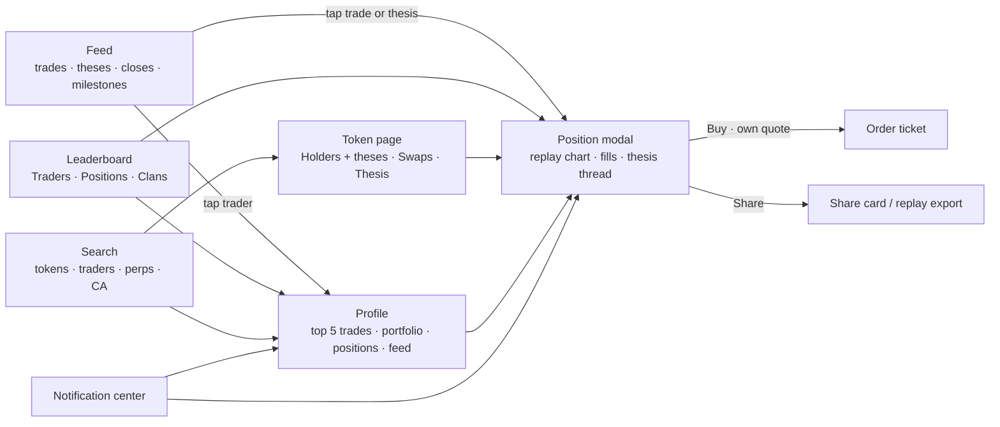
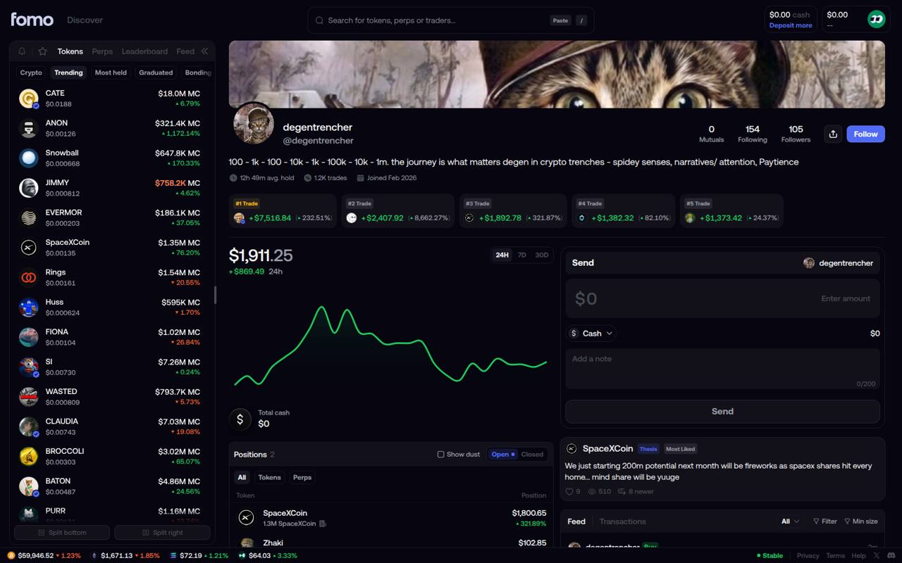
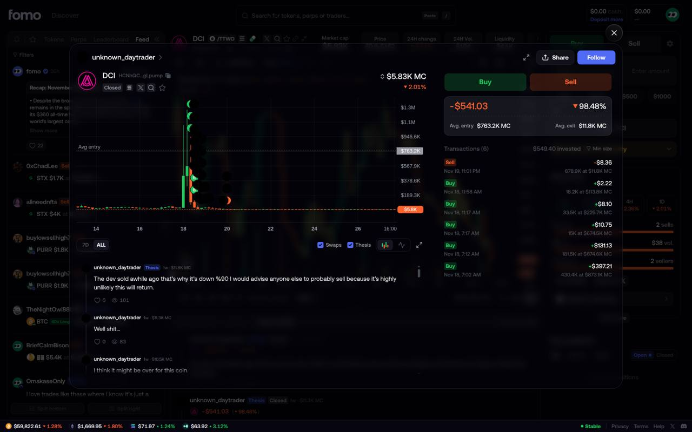
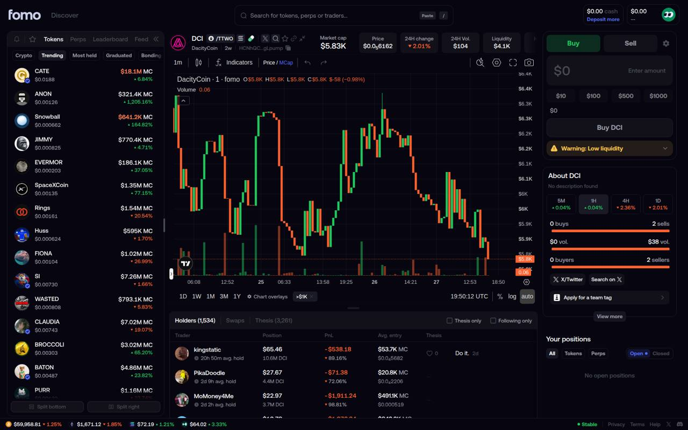
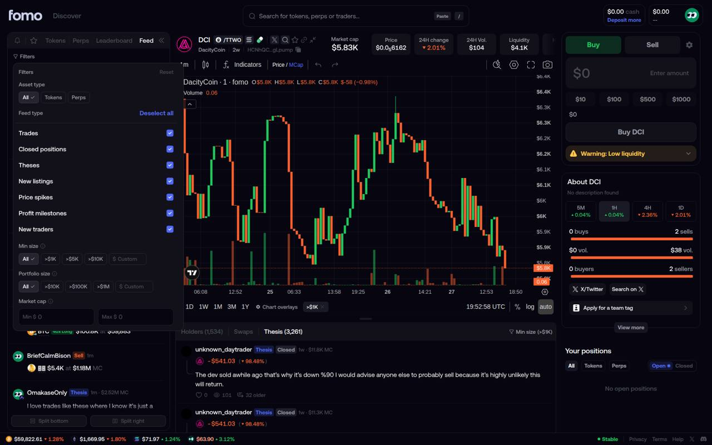
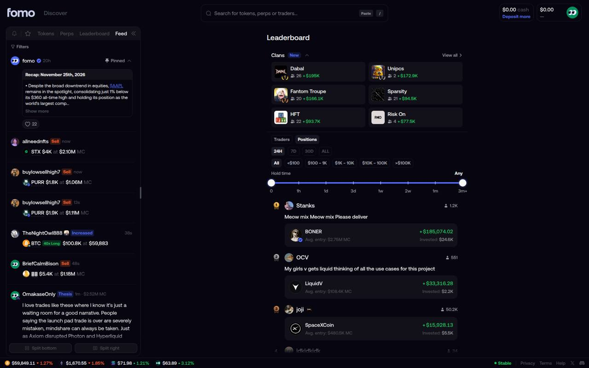
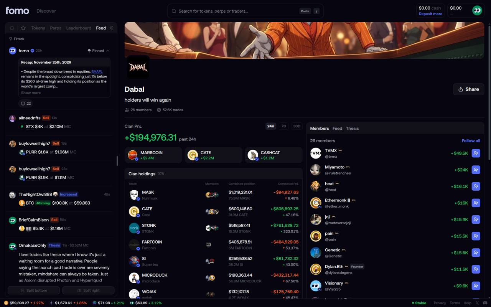

# fomo social parity audit

This is what fomo ships for social trading, checked against Agele web (`main`) and the Agele API (`main` plus [agele#25](https://github.com/jog01/agele/pull/25)). It sets the order of the next social work.

**Sources (November 2026):** a signed-in session on fomo web (read-only), screenshots from Jogeshwar, the strings in fomo's signed-in route bundles (`profile`, `token`, `leaderboard`, `clan`, `discover`), fomo's [release notes](https://fomo.family/release-notes), its [social features guide](https://fomo.family/blog/guide/leveraging-fomos-social-features), the [Discover filters post](https://fomo.family/blog/news/discover-filters-on-fomo), and `fomo-social-spec.md`.

We copy fomo's information density and interaction patterns, not its look. Agele keeps its own green, graphite and sage brand ([brand.md](./brand.md)).

## How the social loop fits together

## Screens

### Profile

| fomo element | Agele today | Gap | Owner |
| --- | --- | --- | --- |
| Banner image, avatar, name, @handle, bio | Avatar, name, bio | Banner, handle | FE + BE |
| Mutuals · Following · Followers counts, each opening a list | Follower count only | Mutuals; Following count; list sheets | FE + BE |
| Follow / **Follow back** / Following, Share profile | Follow toggle | Follow back state, share | FE + BE |
| Meta row: avg. hold, trade count, joined date | Not shown | All three | FE + BE |
| **#1 to #5 Trade** strip: realized PnL and %, opens the position | Missing | Whole strip | BE (planned) + FE |
| Portfolio value with a 24H / 7D / 30D chart and change, total cash | Missing | Chart and toggle | BE (planned) + FE |
| Positions: Open / Closed / **Top trades**, All / Tokens / Perps, **Show dust** | Open positions table | Closed and Top trades tabs, dust filter | FE + BE |
| Closed rows: "$3,232 invested · 2mo", PnL, % | Missing | Whole list | FE + BE |
| **Most Liked** thesis card: likes, views, "8 newer" | Missing | Card and view counts | BE (planned) + FE |
| Feed / Transactions tabs, All filter, **Min size** | Missing on profile | Both tabs | FE |
| Send panel (tip in cash, 200-character note) | Missing | P2 in the spec | Later |

### Position modal (trade detail and replay)

Opens from a top trade, a feed row, a thesis or a leaderboard row. Its URL keeps `?tradeId=`, so it can be shared.

| fomo element | Agele today | Gap | Owner |
| --- | --- | --- | --- |
| Header: trader link, Share, Follow, expand | Missing | Modal route | FE |
| Token, CA copy, Open/Closed badge, socials, watchlist star, MC and 24h change | Token page only | Header reuse | FE |
| Chart with B/S fill markers, avg-entry line, thesis markers, 7D / 1M / ALL, **Swaps** and **Thesis** toggles, MCap/price | API has replay ([agele#23](https://github.com/jog01/agele/pull/23)); no UI | Replay chart | FE |
| Buy / Sell buttons (viewer's own quote) | Order ticket on token page | Buttons in the modal | FE |
| PnL and % card, **avg. entry / avg. exit as MC** | Missing | Card | BE (planned) + FE |
| Transactions (N), total invested, **Min size**, rows "21.1K at $124.2M MC", pages | Missing | Fill list | BE (planned) + FE |
| Thesis thread under the chart: versions, likes, views | Thread sheet exists | Embed it in the modal | FE |
| About token, 5M/1H/4H/1D, buys/sells, volume, buyers/sellers bars | Asset summary | Reuse | FE |

### Token page

| fomo element | Agele today | Gap | Owner |
| --- | --- | --- | --- |
| Stats strip: MC, price, 24H, volume, liquidity, holders, **Top 10 holding** | Have | Minor polish | FE |
| **Holders** tab: trader with avg. hold, position, PnL, avg. entry MC, **latest thesis and its age** | Holders panel without theses | Thesis column and hold time | FE + BE |
| **Thesis only** and **Following only** toggles; "No one you follow is holding" | Missing | Both toggles | FE + BE |
| **Swaps** tab with Min size (>$1K) | Trades panel | Min size filter | FE |
| **Thesis (3,261)** tab: Closed badge, "1w · $11.8K MC", PnL at writing, likes, views, "32 older" | Thesis panel | Counts, views, versions link | FE + BE |
| Chart overlays: thesis markers and the viewer's avg entry | Missing | Overlays | FE |
| Safety: low liquidity, low volume, unverified token, team tag | Partial | Labels | FE + BE |

### Feed (side panel and full page)

| fomo element | Agele today | Gap | Owner |
| --- | --- | --- | --- |
| Row types: Buy, Sell, **Increased**, Closed position, Thesis, **New listing, Price spike, Profit milestone, New trader** | Trades and theses | Four system types and the closed-position row | BE + FE |
| Pinned house post (fomo recap) | Missing | Pinned announcement | BE + FE |
| Filters sheet: asset type, feed type checklist, **Min size**, **Portfolio size**, **Market cap** range, Reset | Scope and type only | Size, portfolio and MC filters | FE + BE |
| "Show new activity" pill on live updates | Missing | Live prepend | FE |
| Likes, replies and views on every card; hold to see likers | Theses only; trades in [agele#25](https://github.com/jog01/agele/pull/25) | Views, likers sheet | FE + BE |

### Leaderboard

| fomo element | Agele today | Gap | Owner |
| --- | --- | --- | --- |
| Traders tab: 24H / 7D / 30D / ALL, **Your rank**, PnL, held-token avatars, Follow | Rank, PnL, return, win rate, Follow | Your rank, held tokens | FE + BE |
| **Positions** tab: invested bucket (<$100 to >$100K), **hold-time slider**, trader, thesis, token, avg. entry MC, PnL, invested | Missing | Whole tab | BE + FE |
| Clans strip and tab | Missing | P2 | Later |

### Search

| fomo element | Agele today | Gap | Owner |
| --- | --- | --- | --- |
| `/` shortcut, **Paste**, ESC; "Search for tokens, perps or traders" | Tokens and CA | Traders in results | BE (planned) + FE |
| **Recents** with Clear all; rows with MC, price, change, social icons, star | Recents exist | Socials, star | FE |

### Notifications and alerts

| fomo element | Agele today | Gap | Owner |
| --- | --- | --- | --- |
| Bell: one timeline of likes (open the thesis), grouped follows, clan invites, sends, leaderboard events | Missing | Center and endpoint | BE + FE |
| Trader activity alerts with sound, synced across devices | Missing | Alerts | BE + FE |

### Clans, rewards, referrals (later)

Clan pages show members, trades, clan PnL by window, top tokens, combined holdings and "Replay clan portfolio". Creator rewards pay for theses and following, and referrals pay a share of fees. All three stay P2.

## Order of work

| # | Work | Why first | Owner |
| --- | --- | --- | --- |
| 1 | Position modal with replay chart, fills, avg entry/exit MC, thesis thread, Buy/Sell, Share | Every other surface links here | FE, after the planned BE PR |
| 2 | Profile v2: meta row, top 5 trades, portfolio chart, Open/Closed/Top trades, Most Liked, Feed/Transactions | The screen Jogeshwar sent most | FE + BE |
| 3 | Token Holders with theses, Thesis only / Following only, min-size filters | The social layer on every token | FE + BE |
| 4 | Feed filters (size, portfolio, MC) and system rows (closed, milestone, spike, new trader) | Makes the demo feed feel live | BE + FE |
| 5 | Positions leaderboard with invested buckets and hold time | Finds traders of every size | BE + FE |
| 6 | Trader search, notification center, follow back, mutuals | Retention loop | BE + FE |
| 7 | Share cards and replay export, views and likers | Growth | FE |

Demo mode must fill every new field from the seeded Postgres store ([social.md](./social.md)), so each screen above looks complete without live keys.
