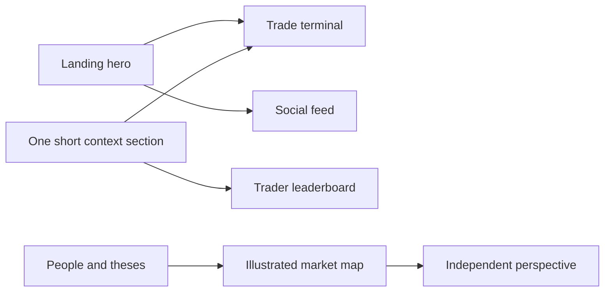

# Agele landing page

A hero-led introduction to the social trading terminal. Arbital informs the visual-first restraint; Axiom informs the direct product entry. Neither page's artwork, layout, assets or copy is reused.

## Composition

- Short navigation: Agele identity, Feed, Open terminal.
- Hero: “Markets move. People matter.”, one paragraph and the primary `/trade` action. `/feed` is the secondary social entry.
- Original social market map: independent people and shared theses connect to a conceptual candlestick chart. The SOL logo is the existing real token asset. No invented prices, balances, returns, traders, testimonials or usage counts.
- One brief follow-up section connects the market desk and trader discovery. A small footer preserves volatility and availability context.

## Implementation

`src/app/page.tsx` and `src/components/landing/signal-map.tsx` are Server Components. The artwork uses deterministic SVG geometry, semantic color tokens and one brief reduced-motion-aware entrance fade. It has no canvas, animation loop, market API request or client state. The visual is identified as an illustration and is non-interactive; its figure has an accessible summary. Layout uses Tailwind utilities, avoiding the repo's CSS Module / wildcard Tailwind loader issue.

The desktop split becomes a stacked hero on small screens. SVG aspect ratio and explicit token-image dimensions reserve space. Navigation and actions retain 44px targets; keyboard focus and a skip link are visible. Terminal, wallet, API and execution behavior are untouched.
