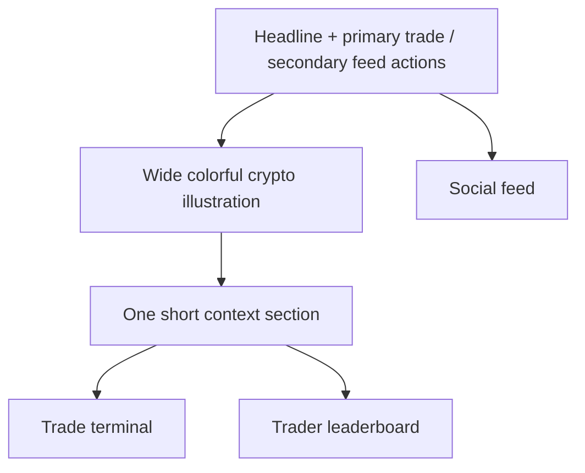

# Agele landing page

## Direction

Jogeshwar rejected the first copy-left / chart-right direction as dull. The revision follows his ElevenLabs reference structurally: headline and actions above a wide, original image. Arbital informs the restraint and emphasis on the visual, not copied artwork.

“Markets move. People matter.” sits above a colorful isometric crypto scene. Real BTC, ETH, SOL, USDC, JUP, BONK and PENGU artwork surrounds the Agele meeting point; people and crossing trajectories communicate independent perspectives connecting. There is no chart, miniature UI, fabricated price, trader identity, return, usage count or implied live feed. Token artwork is conceptual crypto imagery, not a list of supported trading pairs; the copy identifies the product as Solana trading.

Only one short section follows the hero. It connects the trading desk and trader discovery. Feed and terminal entry remain direct.

## Implementation

`src/app/page.tsx` and `src/components/landing/crypto-scene.tsx` are Server Components. Deterministic SVG geometry uses semantic surface colors and token-derived brand colors only inside the illustration. The Agele identity and actions remain pastel green on graphite. There is no gradient, glow, canvas, animation loop, market request or client state. Static artwork respects reduced motion without additional code.

The mobile scene is recomposed rather than cropped or shrunk from desktop. Both variants reserve their aspect ratio, use the same cached local artwork, and contain no tiny SVG text. The figure has an accessible summary and is non-interactive. Keyboard focus, a skip link, native scrolling and 44px targets remain. Terminal, wallet, API and execution behavior are untouched.

## Artwork provenance

SOL, JUP, BONK and PENGU use the existing Jupiter-sourced assets documented in `src/lib/token-assets.json`. BTC, ETH and USDC use unmodified logos from Trust Wallet's public asset repository; its MIT license is retained beside those images. The illustration does not invent or redraw token identities:

- BTC: https://github.com/trustwallet/assets/blob/master/blockchains/bitcoin/info/logo.png
- ETH: https://github.com/trustwallet/assets/blob/master/blockchains/ethereum/info/logo.png
- USDC: https://github.com/trustwallet/assets/blob/master/blockchains/ethereum/assets/0xA0b86991c6218b36c1d19D4a2e9Eb0cE3606eB48/logo.png
