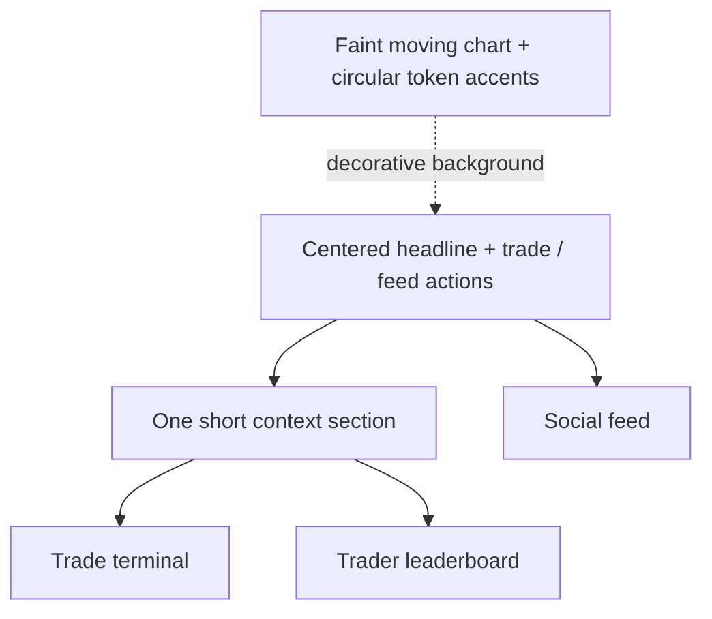

# Agele landing page

## Direction

The hero follows Jogeshwar's latest Arbital-inspired direction: centered headline and actions over a low-opacity moving chart background. It is not a copy-left / chart-right split, nor a foreground coin scene. The composition is original rather than copied reference artwork.

“Markets move. People matter.” remains the foreground. A faint candlestick trace moves slowly behind it, with stronger masking under the text for readability. Real BTC, ETH, SOL, USDC, JUP, BONK and PENGU artwork adds color at the edges. Every image is clipped by an equal-width/height, overflow-hidden circular wrapper and a second circular crop on the image—square source corners cannot protrude. The chart is decorative, not live: no prices, axes, returns, trader identities or implied performance. Token artwork is conceptual imagery, not a list of supported pairs; the copy identifies the product as Solana trading.

Only one short section follows the hero. It connects the trading desk and trader discovery. Feed and terminal entry remain direct.

## Implementation

`src/app/page.tsx` stays a Server Component. `src/components/landing/market-backdrop.tsx` is a small Client Component solely for the pause/resume control. Hardcoded illustrative SVG geometry is deterministic; no market API, canvas, JavaScript frame loop or new animation dependency is involved. Candles use semantic primary/negative colors; local token art supplies its own brand colors. The Agele UI remains pastel green on graphite. The radial gradient is an SVG opacity mask, not a colored surface or glow.

The chart drifts at constant speed across a seamless 200-second CSS transform loop. `motion-safe` enables it only when reduced motion is not requested; a keyboard-accessible 44px pause/resume control freezes and continues the same position. The control is hidden when reduced motion makes the background static. Decorative layers are `aria-hidden` and `pointer-events-none`, except the actual pause control. A center-cropped background fills mobile without changing the foreground layout; mobile keeps four token accents at safe outer positions and desktop shows seven. Image dimensions are explicit. Keyboard focus, skip link and native scrolling remain; terminal, wallet, API and execution behavior are untouched.

## Artwork provenance

SOL, JUP, BONK and PENGU use the existing Jupiter-sourced assets documented in `src/lib/token-assets.json`. BTC, ETH and USDC use unmodified logos from Trust Wallet's public asset repository; its MIT license is retained beside those images. The illustration does not invent or redraw token identities:

- BTC: https://github.com/trustwallet/assets/blob/master/blockchains/bitcoin/info/logo.png
- ETH: https://github.com/trustwallet/assets/blob/master/blockchains/ethereum/info/logo.png
- USDC: https://github.com/trustwallet/assets/blob/master/blockchains/ethereum/assets/0xA0b86991c6218b36c1d19D4a2e9Eb0cE3606eB48/logo.png
