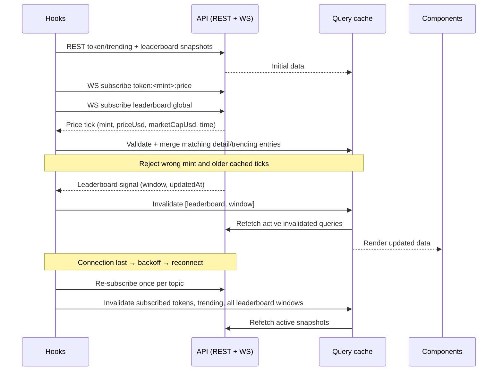
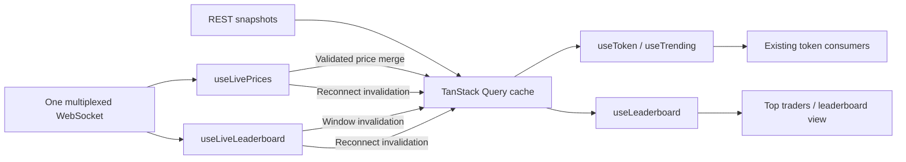
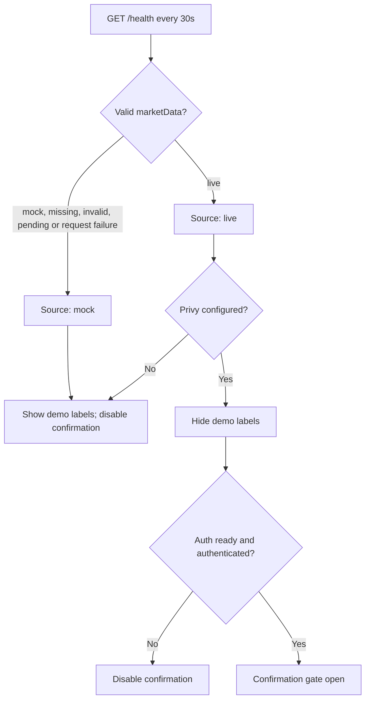
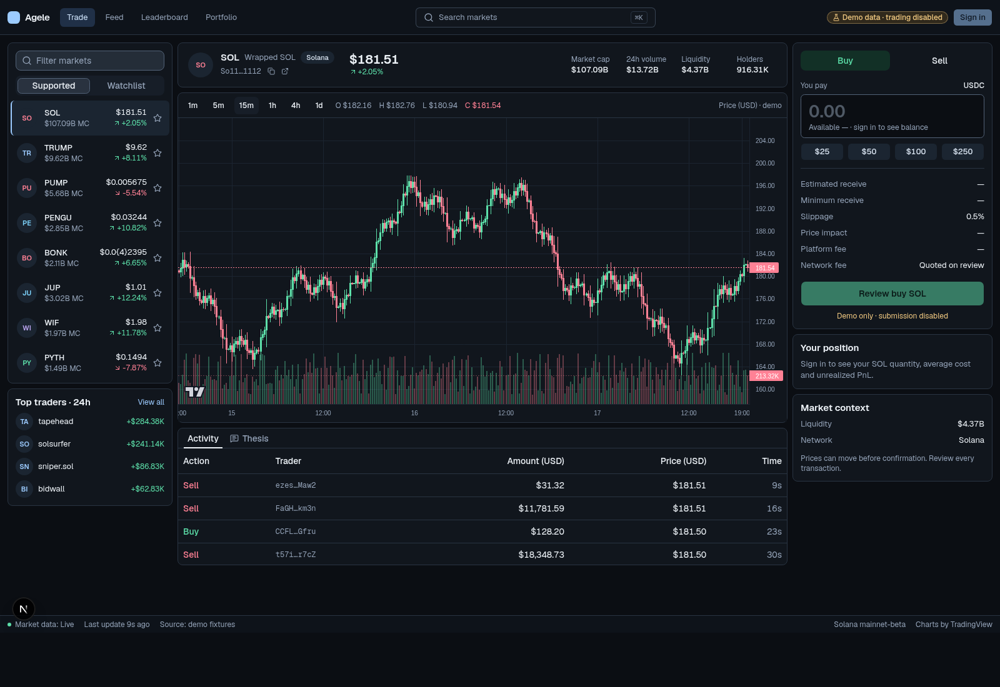

# Live data

## Snapshot → stream → recover

Inactive invalidated queries refresh when observed again. REST polling remains a fallback.

## Client wiring

## Demo labels and trading gate

An open gate does not implement swaps: confirmation currently has no submission handler.
The source strip reflects market data only. The chart's static demo caption is still owned by the chart workstream.
Live candles/trades require a Birdeye key: a 503 shows “Chart data unavailable”; the activity table has no explicit error state.

## Mock-mode trade page

Captured from this repository's dev server on port 3000 with the mock API on port 4000 and Privy unconfigured.
This screenshot demonstrates the UI, not production/live-provider delivery.

