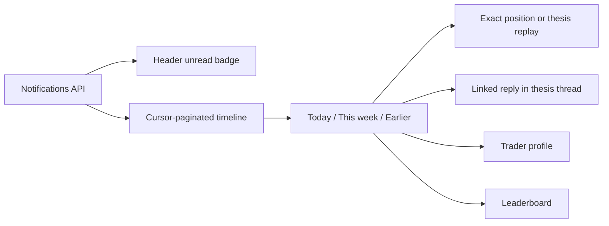
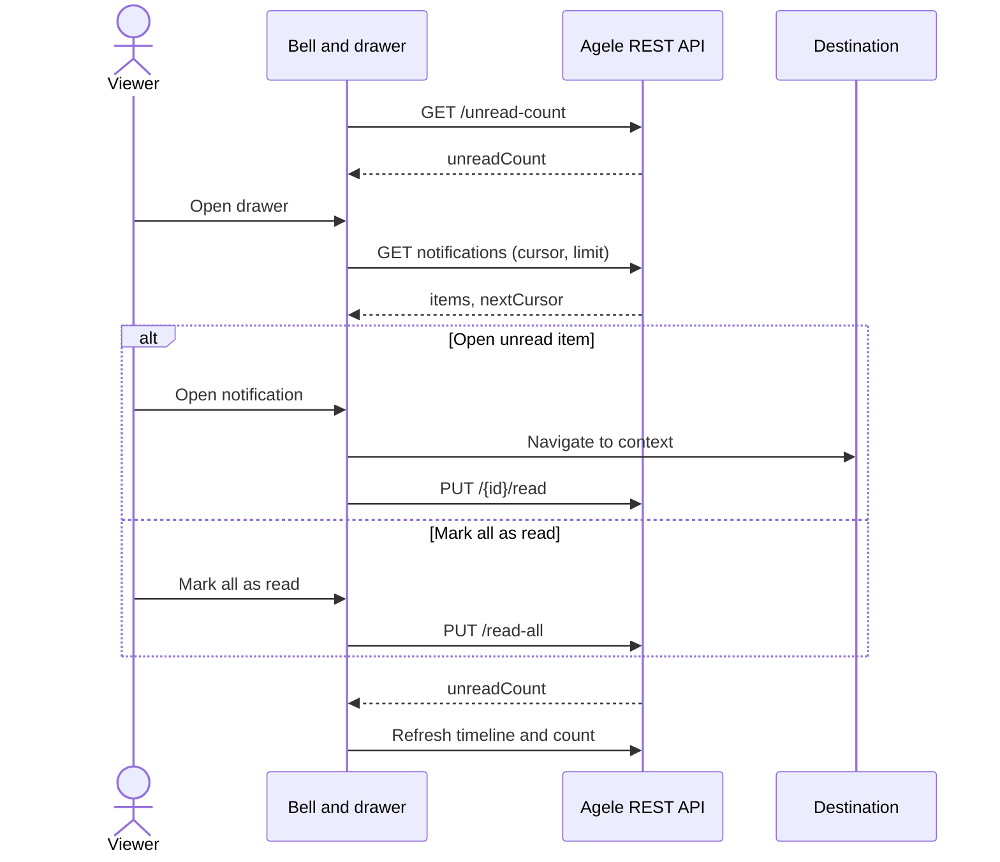

# Notification center

The header bell opens a right-hand drawer (432px on desktop, full width on small screens).
The timeline keeps server order and groups results into Today, This week (starting Monday), and
Earlier in the viewer’s local time. Opening the drawer alone does not change read state.
Opening a row navigates to its context and marks it read; the explicit **Mark all as read**
action covers the whole inbox, not just the pages loaded in the browser. Opening a trade
notification never starts an order.

## Data and synchronization

`src/lib/api/notifications.ts` isolates the proposed API contract until agele publishes it in
OpenAPI. This adapter is the replacement point for generated types. The endpoints under
`/v1/me/notifications` are:

- `GET ?limit=25&cursor=…` returns `{ source, items, nextCursor }`. The server owns grouping,
  actor counts, stable IDs and the order of rows. Timestamps are Unix seconds.
- `GET /unread-count` returns `{ unreadCount }`. The header refreshes it every 30 seconds while
  the app is active and on focus. No private events are sent over the public WebSocket.
- `PUT /{id}/read` and `PUT /read-all` return `{ unreadCount }`. Successful writes refresh
  account-scoped caches. While open, the timeline also refreshes periodically.

Authenticated requests carry the viewer’s bearer token. With no Privy configuration the
frontend can request a demo inbox without a token, but only the backend decides whether to
serve its seeded data. No runtime fixtures or browser-side notifications are used.

Thesis notification destinations include the thesis owner wallet, mint, position ID and
thesis ID. Replies also carry a comment ID; the thread loads pages until that comment is
found or the cursor is exhausted. Trade notifications currently open the identified position
episode; an individual fill link would need a fill ID from the API. Preferences and sound are
not part of the proposed API; the drawer does not present non-functional controls.

