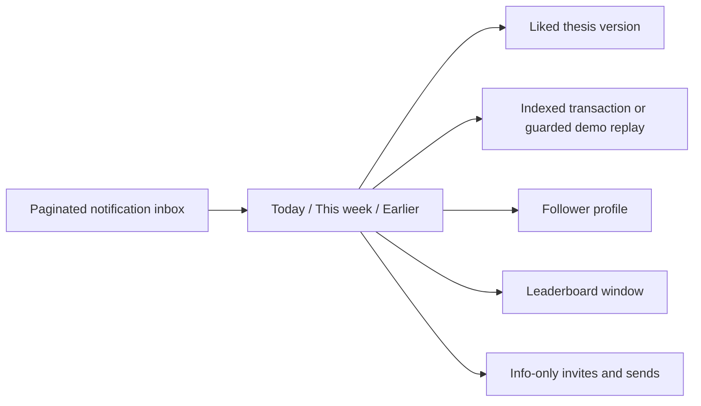
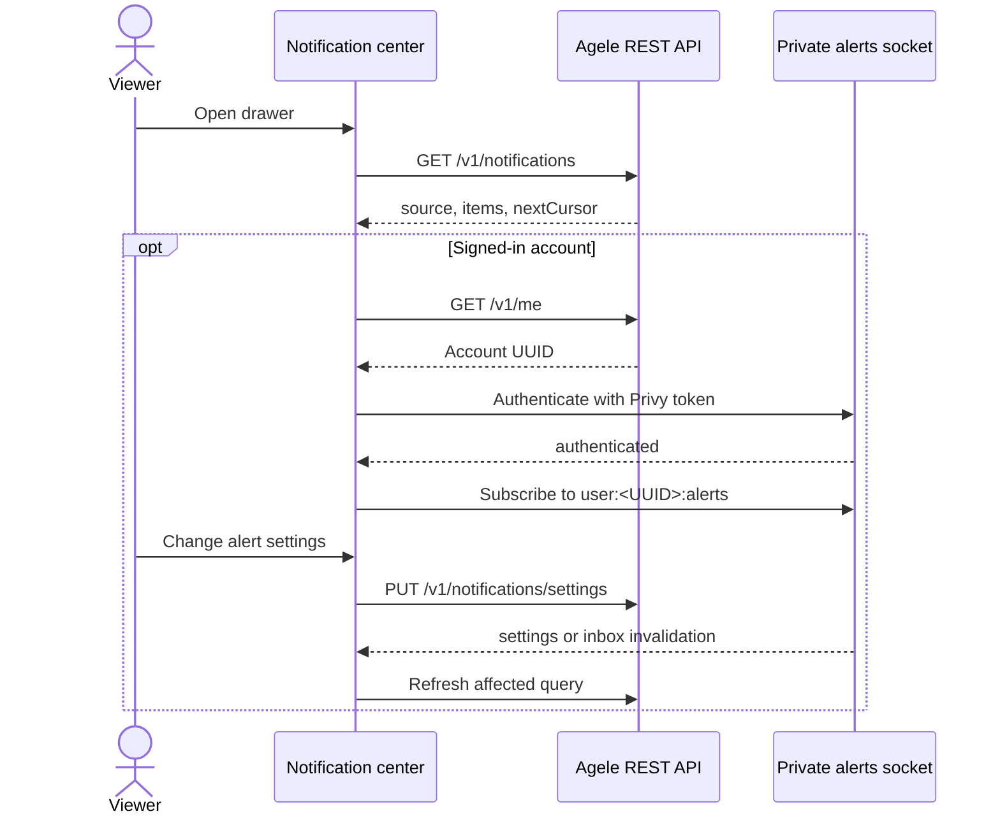

# Notification center

The header bell opens a right-hand drawer (432px on desktop, full width on small
screens). The timeline keeps server order and groups items into Today, This week
(starting Monday), and Earlier in the viewer’s local time. Opening a notification
never places a trade.

## API and synchronization

- `GET /v1/notifications?limit=30&cursor=…` returns `{source, items, nextCursor}`.
  The server owns ordering, follow groups, timestamps, and actor counts.
- Authenticated `GET /v1/notifications/settings` reads `{traderActivity,sound}`; the
  corresponding `PUT` replaces both values.
- The private socket authenticates with a fresh Privy access token and subscribes
  to `user:<account UUID>:alerts`. Inbox and settings events invalidate separate
  queries. The inbox also polls while open and refreshes on window focus.
- Authenticated API calls include the bearer. In keyless demo mode, a bearer-free
  inbox request uses the backend’s seeded data; it cannot change settings or
  subscribe to private alerts. There are no browser-side demo fixtures.
- Device audio requires a browser gesture, even when the synced sound preference
  is already enabled. Only inbox events with `sound: true` trigger a sound.

Thesis likes use the supplied mint and thesis ID to open the thread and focus the
supplied post ID. The notification actor is the person who liked it, not the thesis
owner. Indexed trader activity links to its exact transaction signature. The demo
replay is guarded by the actual trade ID; when the fill is not in the latest
position episode, the replay does not present that episode as an exact match.

## Design gaps in the current backend contract

There are no unread counts, per-item read states or read mutations, so the bell
does not show an unread badge and the drawer does not simulate dots, all-read or
mark-all. There are no thesis-comment events. Alert settings do not provide
minimum trade size or per-trader enable/pause. A trade includes a fill ID but
not a position episode ID or historical fill-to-episode lookup. Clan and send
rows are informational until the corresponding product destinations exist.

