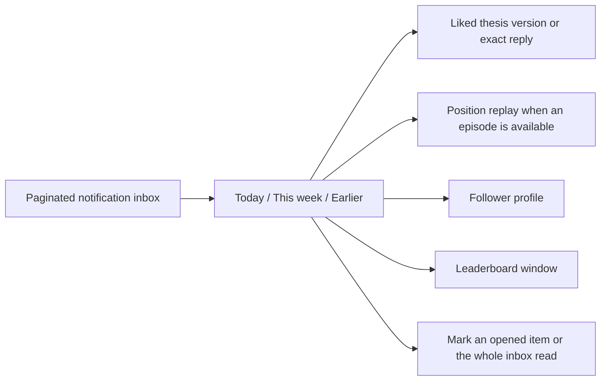
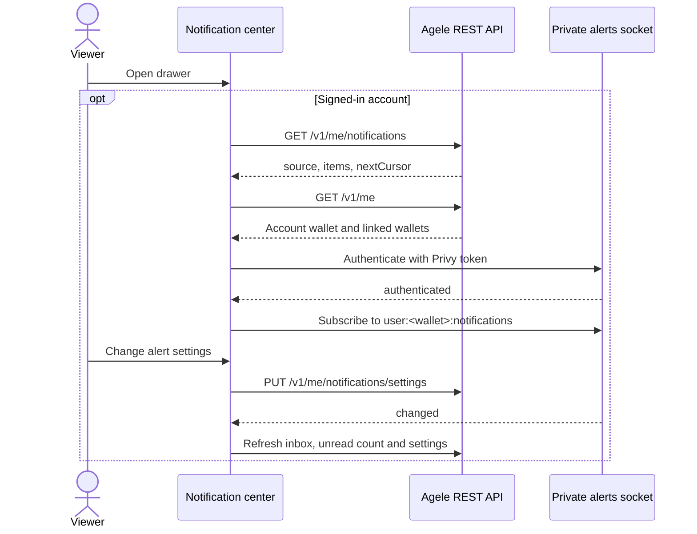

# Notification center

The header bell opens a right-hand drawer (432px on desktop, full width on small
screens). The timeline keeps server order and groups items into Today, This week
(starting Monday), and Earlier in the viewer’s local time. Opening a notification
never places a trade.

## API and synchronization

- `GET /v1/me/notifications?limit=25&cursor=…` returns `{source, items, nextCursor}`.
  The server owns ordering, grouping, timestamps, actor counts, and read status.
- Under the same prefix, `GET /unread-count`, `PUT /{id}/read`, and `PUT /read-all`
  return the updated unread count. `GET /settings` returns `{traderActivity,sound}`
  and `PUT /settings` replaces both values.
- The private socket authenticates with a fresh Privy access token and subscribes
  to `user:<wallet>:notifications`. A `{type: "changed"}` event refreshes inbox,
  unread count, and settings. The inbox also polls while open and refreshes on
  window focus.
- All notification routes require a bearer, including in demo mode. The backend
  copies its seed inbox for each signed-in demo account so read state is private.
  There are no browser-side demo fixtures.
- Device audio requires a browser gesture, even when the synced sound preference
  is already enabled. Once armed, sound plays for new trade notifications when
  the account’s sound setting is on, not for changes to existing items.

Thesis notifications use the supplied mint and thesis ID to open the thread and
focus the post or reply in `target.commentId`. The actor is not the thesis owner.
Trade notifications use the supplied wallet, mint, and position episode ID. When
that ID is absent, the row stays informational instead of opening a different episode.

## Design gaps in the current backend contract

Alert settings do not provide minimum trade size or per-trader enable/pause.
Trader alerts include an episode ID when available, not the alerted fill ID or
transaction signature. Clan invites and sends are not notification kinds in this
contract.

