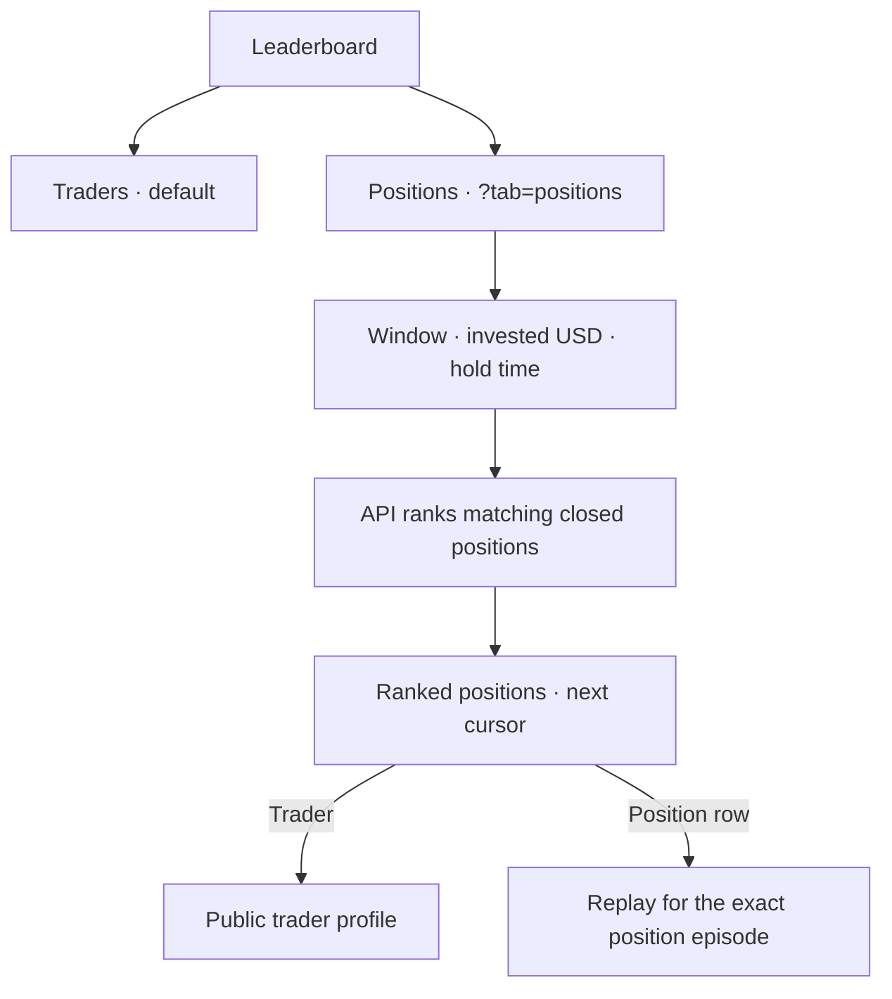
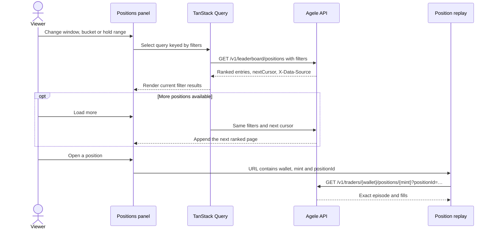

# Positions leaderboard

Open **Leaderboard → Positions** to compare profitable, fully closed positions. The window is based on close time. Invested buckets are lower-inclusive and upper-exclusive; the dual-thumb hold-time filter omits the upper bound at **3m+**. The API filters before ranking by realized PnL in USD and paginating. Demo positions come from the same API and are marked **Demo fixtures**.

