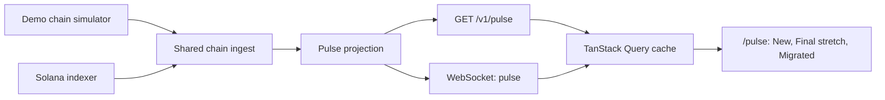
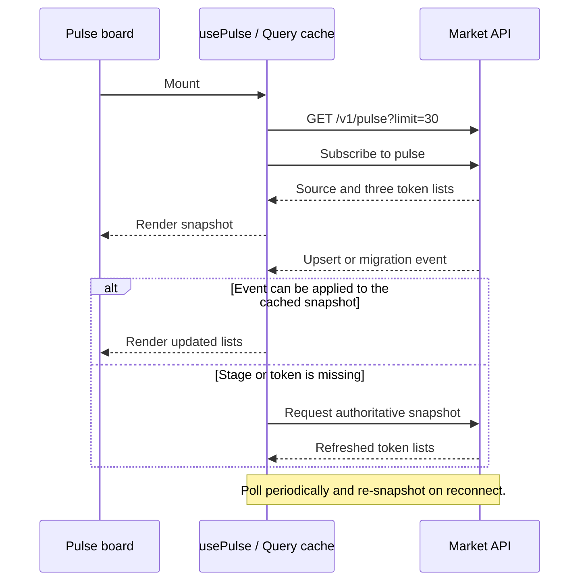

# Pulse

Pulse uses one market lifecycle API in both modes. In demo mode, the backend simulator
produces the launch, trade and migration events; the browser does not generate tokens
or classify a launch as nearing migration independently of the API.

