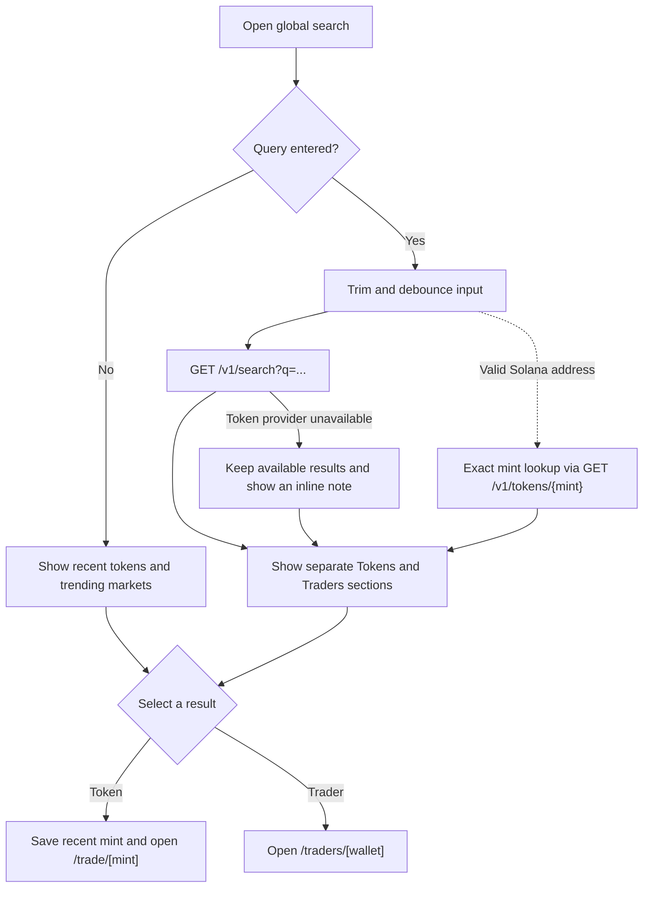
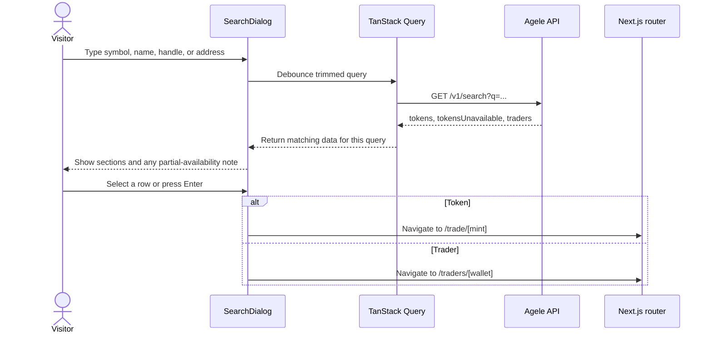

# Global search

Use **Search Agele** or **/** (also Ctrl/Cmd+K) to find supported Solana
markets and public trader profiles. The dialog uses the same API in demo and
indexed modes. The design target is [board 11](design/social-v0.2/11-search-discovery.png).

An empty query shows trending markets and recent token selections. Only up to
four selected mint addresses are stored locally; token metadata and prices come
from the API/cache. **Clear all** does not change the watchlist.

