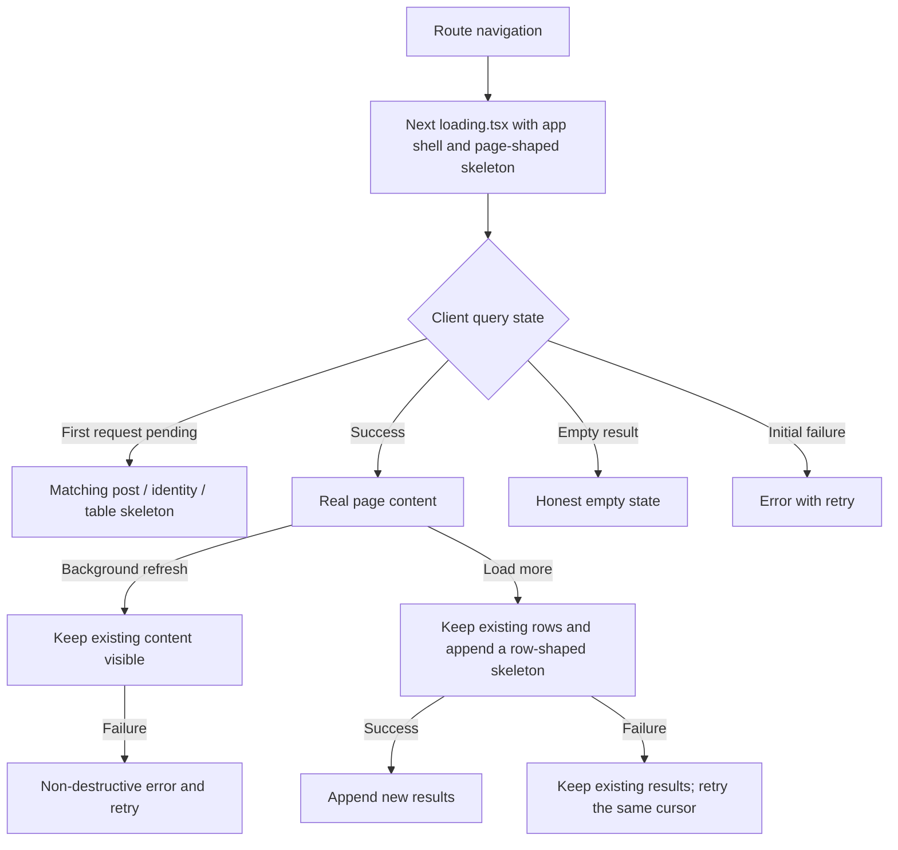
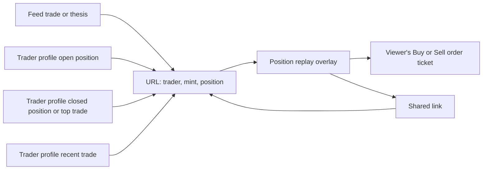
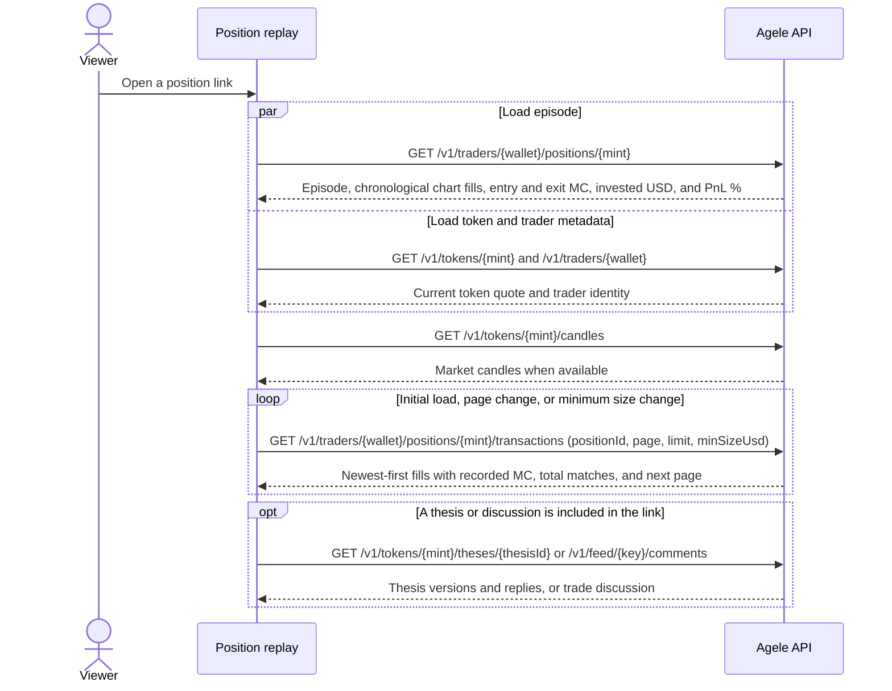

# Feed and trader-profile loading

The social pages use the terminal’s green/graphite tokens, existing shadcn skeleton primitive, and compact typography. No APIs, authentication, follow semantics, trade execution, shell or terminal behavior change.

## Layout

- Feed: 1120px maximum frame, flexible posts, 280px desktop discovery rail; posts precede discovery on mobile and in keyboard order. The title and scope controls stay visible during queries. Cards reserve space for the author, two lines of copy and a token link.
- Trader profile: the same maximum frame, compact identity with a meta row, two PnL totals, the top-trades strip and six window metrics, then portfolio and positions beside the most-liked thesis and activity. Panels sit side by side at wide desktop widths; narrow screens stack them. See [trader-profile.md](./trader-profile.md).
- Demo labels and simulated-performance explanations stay explicit. Empty, unavailable and sign-in-required states explain what happened rather than displaying an endless loader.

## Loading behavior

The profile’s route-parameter Suspense fallback and first profile query use the same skeleton. Trade history loads independently after identity resolves. Feed posts and suggested traders also resolve independently. A background refetch does not blank the whole screen.

Named status regions expose loading to assistive technology; placeholder shapes are hidden from it and never act as fake links or buttons. Skeletons become static under reduced motion. Query-backed auth gates stay distinct from pending data, and viewer-keyed caches continue to prevent signed-in state leaking after sign-out.

Portfolio and Leaderboard loading are handled separately by Staff Frontend; this change does not edit those routes.

## Position replay

The URL opens one position overlay without navigating away from the current page. Closing the overlay removes its replay parameters and preserves the underlying page's parameters. Sharing a loaded replay pins the episode in the link so a later trade does not change what it opens.

The chart falls back to recorded fill prices when candles are unavailable or don't cover its fills. Its optional market-cap axis scales price data by current implied supply, but the entry and exit market caps in Position performance are the backend's historical values and display a dash if unavailable. Transaction rows show the backend's fill market cap, or USD per token if it is unavailable. The server filters transaction pages by minimum USD size without changing the chart or the whole episode's performance metrics. The feed passes its thesis ID, or the ID of a thesis on the same episode already loaded in the feed. Otherwise the trade's discussion is shown when available. Trader history doesn't expose episode IDs, so a history row checks that its selected fill belongs to the latest episode instead of silently showing an unrelated episode.
