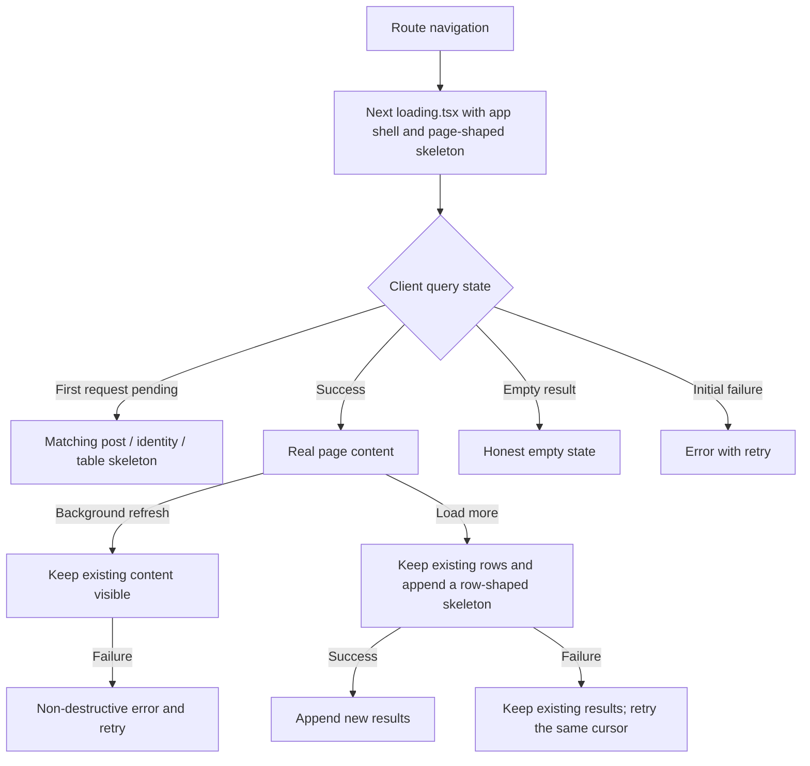

# Feed and trader-profile loading

The [v0.2 social design handoff](design/social-v0.2/README.md) extends this foundation with feed, position theses, profiles, replay/share, Pulse and supporting social layouts. It is a design specification, not a claim that those features are implemented by this loading change.

The social pages use the terminal’s green/graphite tokens, existing shadcn skeleton primitive, and compact typography. No APIs, authentication, follow semantics, trade execution, shell or terminal behavior change.

## Layout

- Feed: 1120px maximum frame, flexible posts, 280px desktop discovery rail; posts precede discovery on mobile and in keyboard order. The title and scope controls stay visible during queries. Cards reserve space for the author, two lines of copy and a token link.
- Trader profile: the same maximum frame, compact identity and source label, two PnL totals, six window metrics, then positions and history. Tables share a row-shaped loader and sit side by side at wide desktop widths; narrow screens stack them.
- Demo labels and simulated-performance explanations stay explicit. Empty, unavailable and sign-in-required states explain what happened rather than displaying an endless loader.

## Loading behavior

The profile’s route-parameter Suspense fallback and first profile query use the same skeleton. Trade history loads independently after identity resolves. Feed posts and suggested traders also resolve independently. A background refetch does not blank the whole screen.

Named status regions expose loading to assistive technology; placeholder shapes are hidden from it and never act as fake links or buttons. Skeletons become static under reduced motion. Query-backed auth gates stay distinct from pending data, and viewer-keyed caches continue to prevent signed-in state leaking after sign-out.

Portfolio and Leaderboard loading are handled separately by Staff Frontend; this change does not edit those routes.
