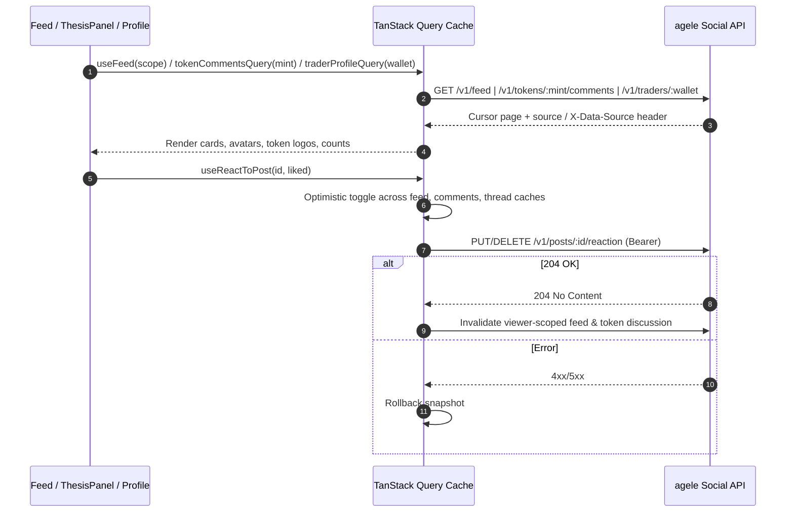
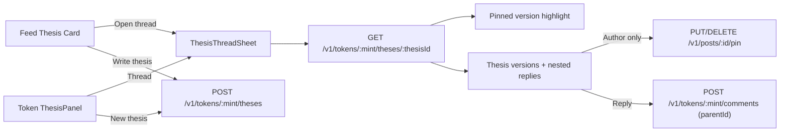

# Social Surfaces (Feed, Theses & Profiles)

Agele's social layer is backed entirely by the backend social API (`agele/openapi.json`). Demo mode and live mode share the exact same client, TanStack Query cache keys, and components — only the backend data source (`source: "demo" | "indexed"` or `X-Data-Source`) changes.

## Read & Mutation Flow

## Thesis Threads, Versioning & Pinning

## Cache Isolation & Provenance

- **Viewer isolation:** All social queries include `socialViewer(auth)` in their query keys so `isFollowing` and `likedByMe` never leak across sign-out or account switches.
- **Provenance:** Feed items carry `source: "demo" | "indexed"`; profiles and trades carry `X-Data-Source`. UI surfaces subtle provenance captions (`Demo traders · simulated activity`, `Demo profile`) without blocking seeded demo positions, trades, or theses.
- **Token imagery:** Token chips render API-provided `imageUrl` via `AssetAvatar` (falling back to `TokenAssetAvatar` or the generic `Coins` glyph, never text initials).
