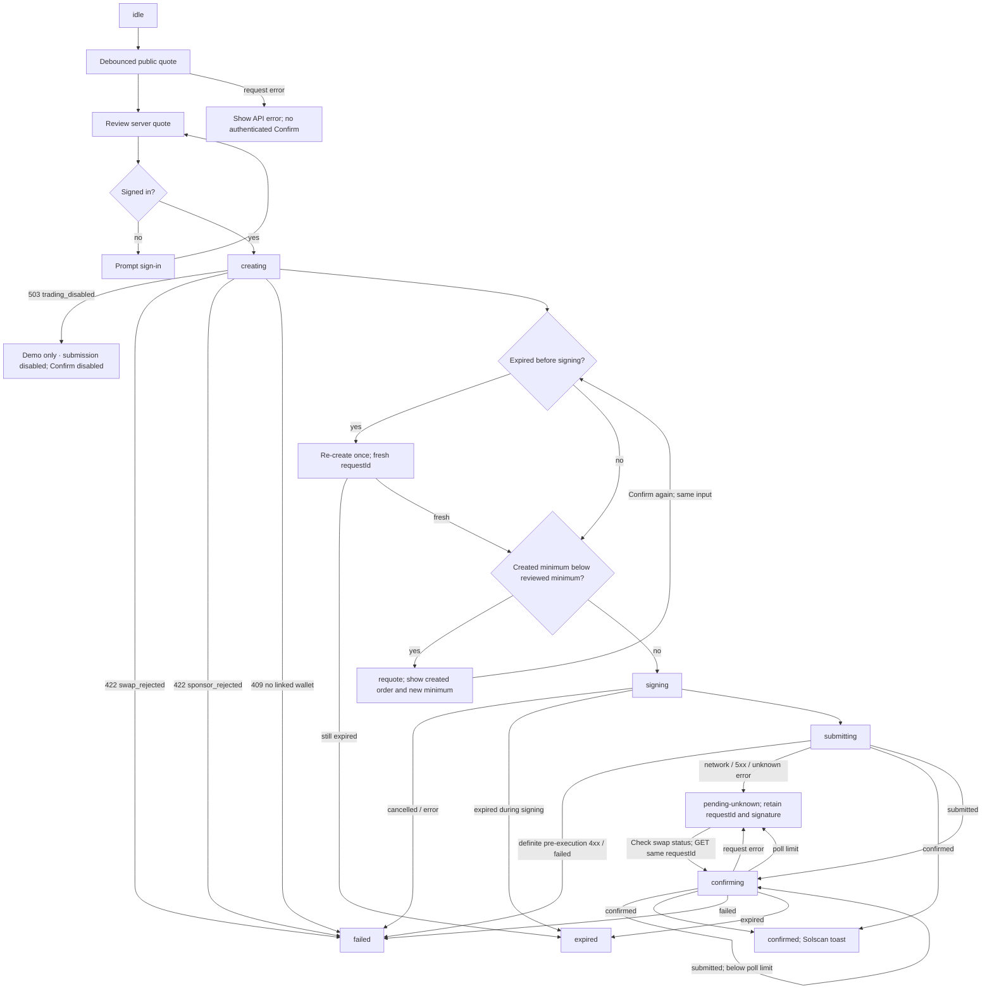
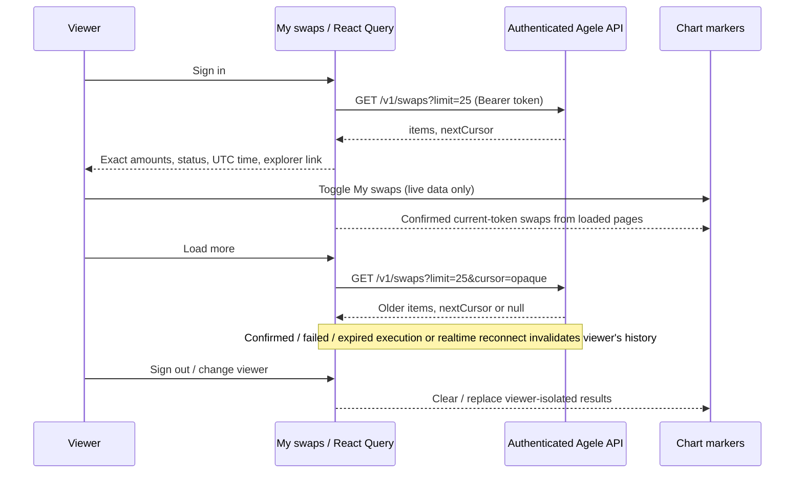
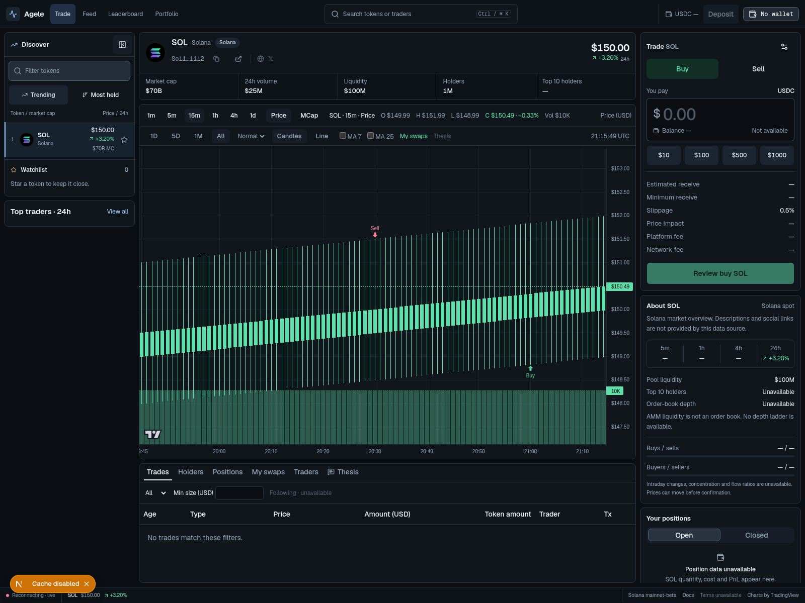
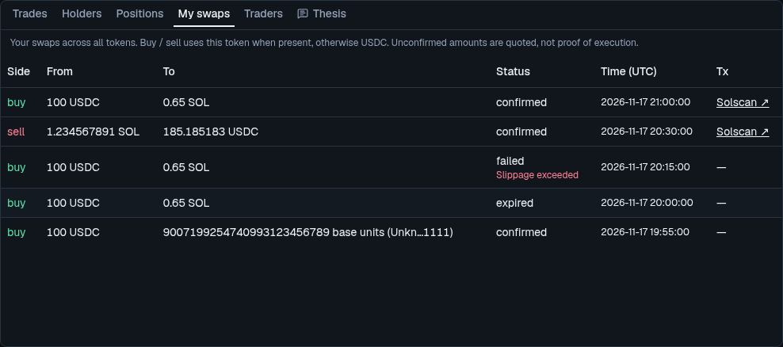
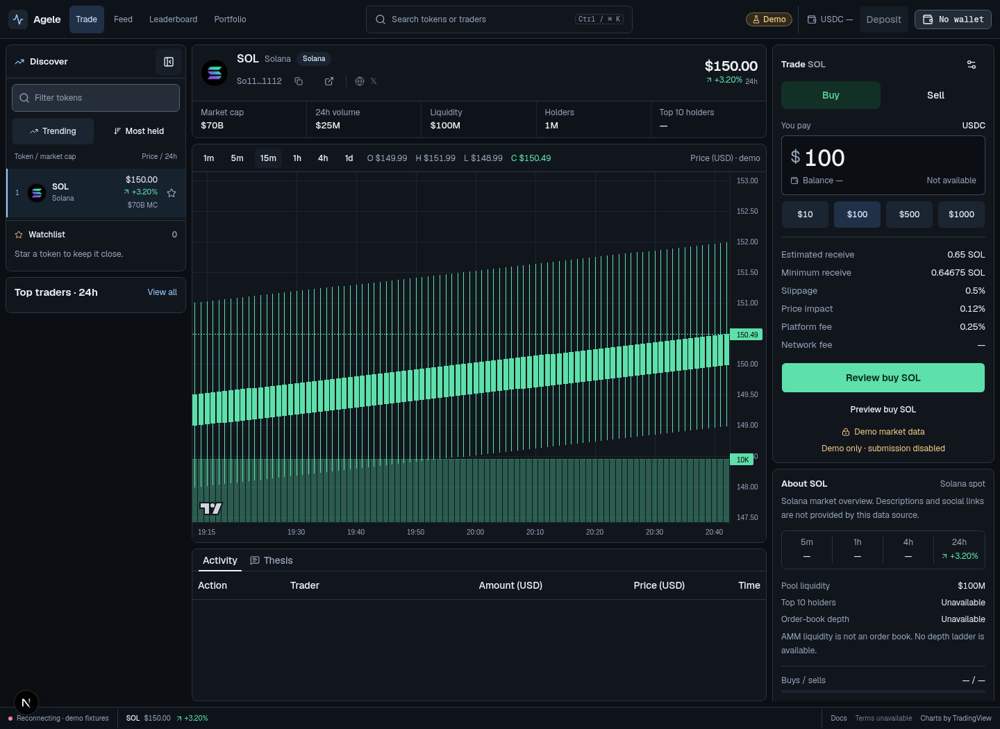
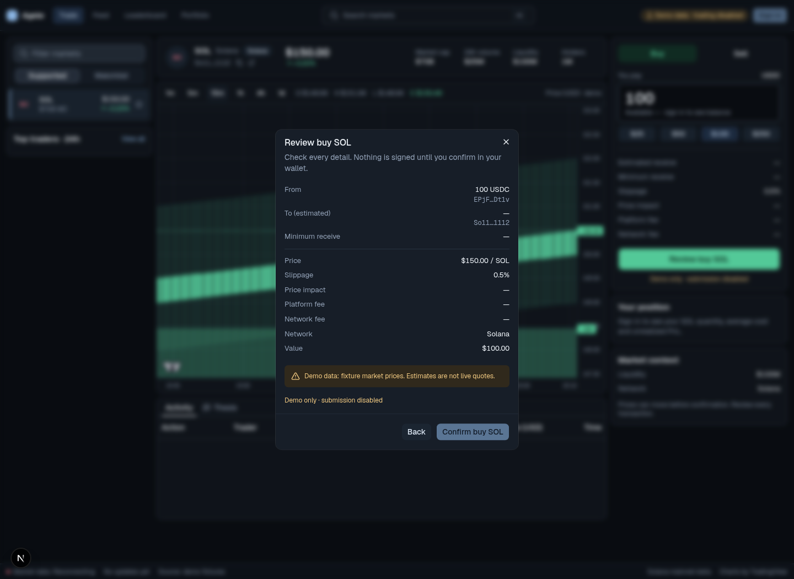

# Gasless swaps

The terminal requests a server quote before review, creates an unsigned transaction when the user confirms, and asks Privy's embedded Solana wallet to sign it. The frontend never broadcasts the transaction: the API sponsors and submits it. Amounts sent to the API are base-unit strings; token precision comes from `Token.decimals`, and USDC uses six decimals.

## Quote, sign and submit

```mermaid
sequenceDiagram
  actor U as User
  participant T as Order ticket
  participant A as Agele API
  participant P as Privy embedded wallet
  U->>T: Enter buy / sell amount
  T->>T: Validate precision, debounce 350ms
  T->>A: GET /v1/swaps/quote?inputMint&outputMint&amount&slippageBps
  A-->>T: Quote (base-unit amounts, impact, fee)
  T-->>U: Review server quote; network fee Sponsored
  U->>T: Confirm (signed out → prompt sign-in)
  T->>A: POST /v1/swaps (Bearer token)
  A-->>T: requestId, unsigned base64 transaction, expiresAt (Unix milliseconds)
  opt Already expired before signing
    T->>A: POST /v1/swaps again
    A-->>T: Fresh requestId and transaction
  end
  T->>P: signTransaction(Uint8Array, wallet, chain)
  P-->>T: signedTransaction (Uint8Array)
  T->>A: POST /v1/swaps/{requestId}/submit (base64 signedTransaction)
  A-->>T: confirmed / failed / submitted, signature?, result amounts?, code?, error?
  loop Until terminal status; up to 40 polls, 1.5s apart
    T->>A: GET /v1/swaps/{requestId} (Bearer token)
    A-->>T: status, signature?, error?
  end
  alt Confirmed
    T-->>U: Success toast with View on Solscan action
  else Failed / expired
    T-->>U: Error / fresh quote required
  else Still submitted after polling limit
    T-->>U: Outcome unknown; keep requestId and block new swaps
    U->>T: Check swap status
    T->>A: GET /v1/swaps/{same requestId} (never create again)
  end
```

`lib/swaps.ts` contains the injected orchestration and typed API adapter; `hooks/use-swap.ts` owns quotes and execution state. `hooks/use-swap-signer.ts` uses Privy 3.51.4's `useSignTransaction` and `useWallets`. Signing takes bytes plus the connected wallet and returns signed bytes; it does not send the transaction.

Buy routes USDC → token; sell routes token → USDC. The USDC mint and Solscan cluster follow `NEXT_PUBLIC_SOLANA_CLUSTER`. Decimal conversions use strings and BigInt, not floating-point multiplication. Review's From amount uses the exact base-unit conversion without display rounding (for example, `1.234567891 SOL` sends `1234567891` base units). Numeric USD display values are computed separately from formatted receive labels.

## Execution states



Before signing, the created order's minimum is compared to the reviewed minimum using BigInt. A lower minimum returns `requote` without signing and displays the created order's values with “Price moved: review the new minimum and confirm again”. The next Confirm uses that same order for the same mints, amount and slippage. Changing the input discards that review; expiry triggers re-creation and another minimum check. An expired transaction is never submitted.

Once submit is sent, the ticket retains its request ID before awaiting the response. Network errors, 5xx responses and unrecognized submit errors are uncertain, not failures: the client checks GET status automatically. Each polling pass is bounded to 40 GET requests (60 seconds of interval waits, plus request latency). A failed status request or polling limit enters `pending-unknown` and retains the request ID and any signature, with a Solscan link when available. **Check swap status** resumes GET on that same request even if the amount, side or quote changed; it never creates, signs or submits another swap. An `issued` status after uncertain submission is not proof of non-execution. Only a definite terminal status (`confirmed`, `failed`, `expired`) or a recognized pre-execution 4xx rejection clears tracking. No timeout, transport error or unknown response unlocks a new create.

Pending tracking is written to `sessionStorage` before submit, scoped by Solana cluster and wallet address. Closing the mobile trade sheet, reopening it, or reloading the tab restores `pending-unknown` and automatically resumes GET status polling. A shared in-flight lock also survives ticket remounts, so an old ticket's outstanding submission cannot race a new create. Only request ID and optional signature are stored, never transactions or tokens. A terminal result clears the record; corrupt or inaccessible storage blocks new trading rather than silently forgetting a pending swap. Tracking is isolated between wallets and lasts for the browser tab's session.

## Errors and demo gating

| API status / code | User message / behavior |
| ----------------- | ----------------------- |
| `503 trading_disabled` on create | **Demo only · submission disabled**; Confirm disabled; no signing. The client also handles this code on quote/submit. |
| `422 swap_rejected` | Swap rejected: token, slippage or price impact exceeds trading limits. |
| `422 sponsor_rejected` | Sponsorship rejected. Please try again later. |
| `409 wallet_not_linked` | No linked wallet. Create or link your embedded Solana wallet first. |
| `400 validation_error` | Server message (“Invalid request”). |
| `404 not_found` | Server message (“Swap not found”). |
| `429 rate_limited` | Server message (“Swap quote limit exceeded”). |
| `502 upstream_error` | Server message (“Jupiter request failed”). |
| `503 rate_limit_unavailable` | Server message (“Swap quoting temporarily unavailable”); not a demo/trading-disabled label. |
| Other API errors | Server error message, falling back to “Request failed”. |
| Failed transaction | Returned transaction error, falling back to “Swap failed”. |
| Expired transaction | Quote expired. Review a fresh quote and try again. |

`DEMO_MODE` labels fixture market data only; it does not gate submission. The API determines whether trading is disabled. Receive, minimum receive, price impact, slippage and platform fee use the server quote when available. Client estimates appear only while the quote loads. Network fees are labelled **Sponsored** only with a server quote and without a trading-disabled response; otherwise they show a dash. A signed-out Confirm prompts sign-in when Privy is configured and ready. Without a Privy app ID, Confirm is disabled with “Trading is unavailable in demo. Configure sign-in to trade.” Signed-in users without a signer also see disabled Confirm and a wallet-readiness message.

## Backend contract (merged PR #9)

Types are regenerated from backend main at `c878ea4`, including merged [PR #9](https://github.com/jog01/agele/pull/9) and [PR #12](https://github.com/jog01/agele/pull/12). Quote/build responses do **not** echo `inputMint` or `outputMint`. `priceImpactPct` is a number in percentage points (`3` means `3%`), not a ratio or string. `expiresAt` is a number in Unix milliseconds, compared directly with `Date.now()`. Submit results have an optional signature, optional base-unit `inputAmountResult` / `outputAmountResult`, optional numeric `code`, and optional `error`. GET status retains `inAmount` / `outAmount`.

Requests require positive base-unit amount strings (up to 78 digits), base58 mint strings of 32–44 characters, and optional integer slippage from 0–10,000 bps. Quote OpenAPI additionally permits nullable slippage; the frontend always sends `50`. Submit accepts a nonempty signed-transaction string up to 4,096 characters. All four documented routes list `400`, `401`, `404`, `409`, `422`, `429`, `502` and `503` errors, although some apply only to specific operations.

The current backend quote is preview-only: it calls Jupiter without checking sponsorship, the mint allowlist, or trading caps. Disabled sponsorship is checked during create/submit. A quote can therefore succeed before create returns `503 trading_disabled`. A sponsor kill switch currently returns `422 sponsor_rejected` (reason `kill_switch`), not `503`. Swap rejection also covers transaction/payer integrity mismatches, not only slippage, impact or mint caps. If execution outcome is unknown, submit returns `{ status: "submitted" }` without a signature; the client polls and, on timeout, shows the request ID rather than inventing an explorer link.

The merged backend bounds Redis operations with deadlines. Sponsor-store failures now propagate `503 rate_limit_unavailable` (“Swap rate-limit storage temporarily unavailable”), rather than being classified as `422 sponsor_rejected` quota/missing-record failures. The client preserves that server message and does not label it as trading disabled. Swap paths and payload schemas are unchanged from the previously checked PR head `d5a52a0`.

## My swaps history and chart overlay

The terminal's existing **Market activity → My swaps** tab sits beside Positions and Trades, keeping personal execution history alongside market activity without changing the terminal layout. It lists the authenticated viewer's swaps across tokens, newest first: side, exact amounts and symbols, status, UTC creation time, optional Solscan link, and failed-swap error text. Loading, retryable error, empty and signed-out states are explicit. A pagination failure preserves already-loaded rows. **Load more swaps** passes the opaque `nextCursor` unchanged with `limit=25`; overlapping requests are deduplicated by request ID.



History queries use the existing feed's viewer-isolation convention (`["swaps", walletAddress-or-userLabel]`) and are enabled only for authenticated viewers with an identity. Terminal results from `useSwap` and realtime reconnects invalidate that viewer's history. Pages are shared between the chart and history tab. There is no separate history websocket topic or background history polling.

USDC uses six decimals; other mint decimals and symbols come from token metadata queries. Amounts use `fromBaseUnits` (string/BigInt), never floating-point conversion. While metadata is missing, unavailable or invalid, rows show the original base-unit string and shortened mint rather than guessing decimals. Non-confirmed amounts remain quoted values, not proof of execution. Buy/sell is relative to the current chart token if present, otherwise the USDC side; other pairs are labelled swap.

The **My swaps** chart toggle uses Lightweight Charts markers at `createdAt` (ISO UTC → Unix seconds), not execution time, floored to the containing loaded candle's open time. Swaps before the first loaded candle or at/after the final candle's open plus its interval are omitted. Only confirmed swaps involving the current token are drawn: output token = green Buy below the bar, input token = red Sell above the bar. Signed-out or demo-market views keep the toggle disabled with an explanatory label/tooltip. The overlay covers **loaded history pages only**; load older history pages and a covering candle snapshot to extend it. Failed, expired, issued and submitted swaps never produce markers.

### Mock-backed history screenshots





Captured against a throwaway local API and temporary signed-in auth fixture, neither committed. The mock reports `marketData: live` solely to exercise the overlay's live-data gate; prices, history, identities and signatures are fixtures, not real market data or transactions. The list screenshot follows an actual Load more interaction, shows exact `1.234567891 SOL`, failed/expired statuses, an error, and raw units for an unknown mint. Each screenshot was visually inspected. No signing, real authentication, explorer transaction, websocket reconnect or on-chain execution was exercised.

## Screens

| Server quote in ticket | Review server quote |
| ---------------------- | ------------------- |
|  |  |

| Trading disabled: ticket | Trading disabled: review |
| ------------------------ | ------------------------ |
|  |  |

| Rejected quote | Sell review |
| -------------- | ----------- |
|  |  |

These screenshots show the redesigned ticket from main using a throwaway local HTTP mock API with `NEXT_PUBLIC_API_URL=http://localhost:4100`. “Server quote” here means a response from that mock, not a live Jupiter quote. A temporary screenshot-only signed-in auth-context fixture enables Review and Confirm without a Privy app ID, real identity or wallet; it was removed before checks and is not committed. Balances and positions remain unavailable.

The mock supplies market endpoints and successful quotes, or `422 swap_rejected` on quote for the rejection screenshot. For both trading-disabled screenshots, quote succeeds and clicking Confirm sends `POST /v1/swaps`, which returns `503 trading_disabled` before signing. The existing quote amounts remain visible, Network fee changes to a dash, and Confirm becomes disabled. The ticket screenshot is captured after closing that review; the disabled review is then reopened. Sell review verifies a numeric **$1,500.00** Value for 10 SOL. Each PNG was visually inspected after capture.

Real authentication, wallet signing, transaction submission, confirmation toast and on-chain execution were not exercised by these screenshots; orchestration is covered by Vitest tests.

## Configuration and checks

Use `NEXT_PUBLIC_API_URL` for the Agele API and configure Privy and Solana as described in [Sign-in, embedded wallet and deposit](auth-wallet.md). `lib/api/schema.d.ts` is fully generated from backend main's OpenAPI, including merged portfolio/indexing endpoints as well as swaps.

```bash
bun run check
bun run build
```
