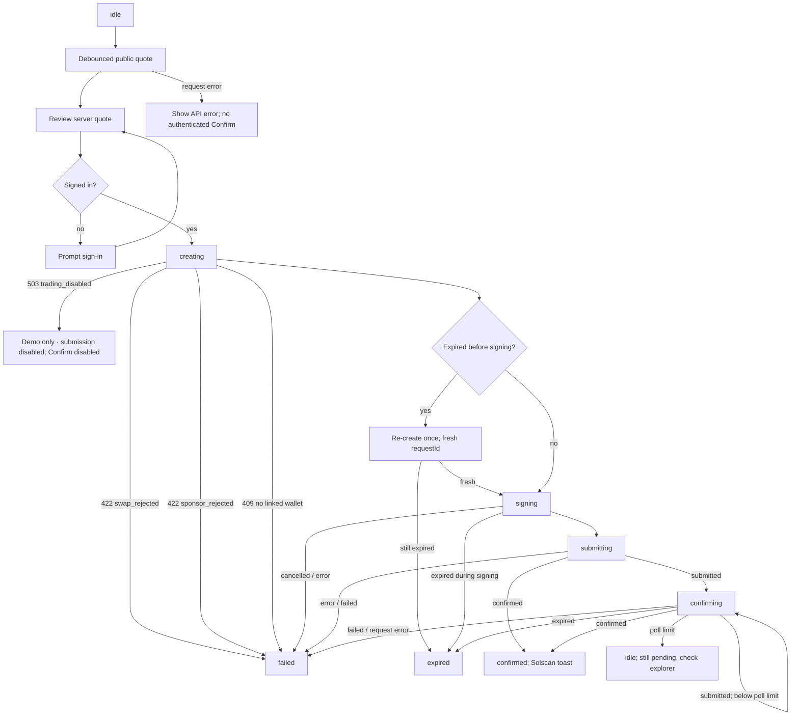
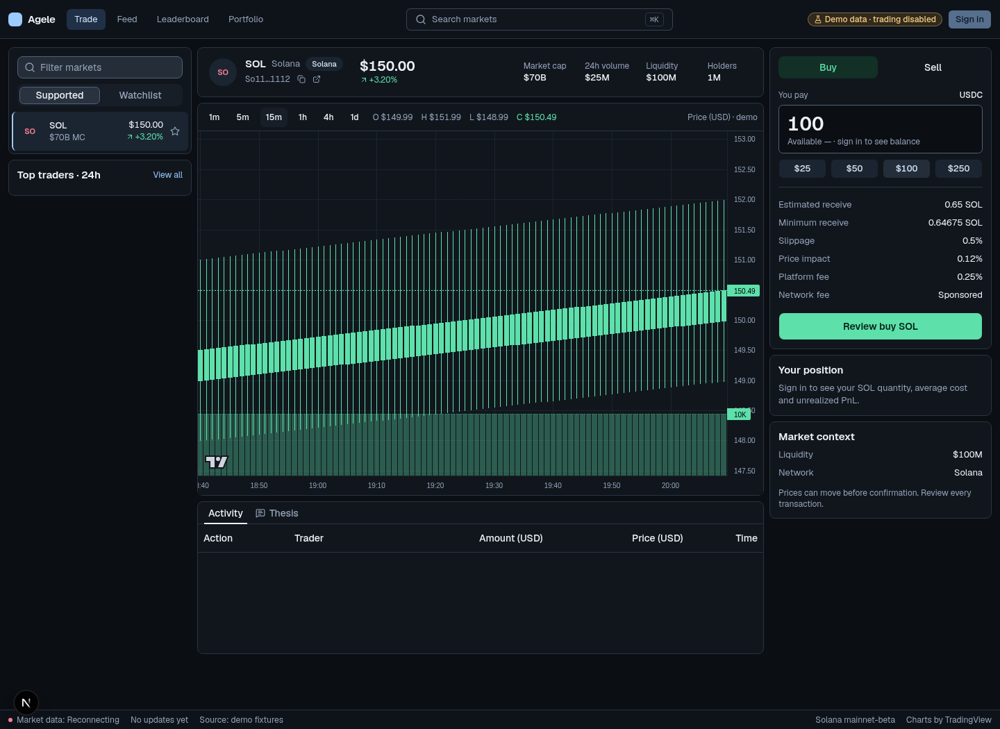
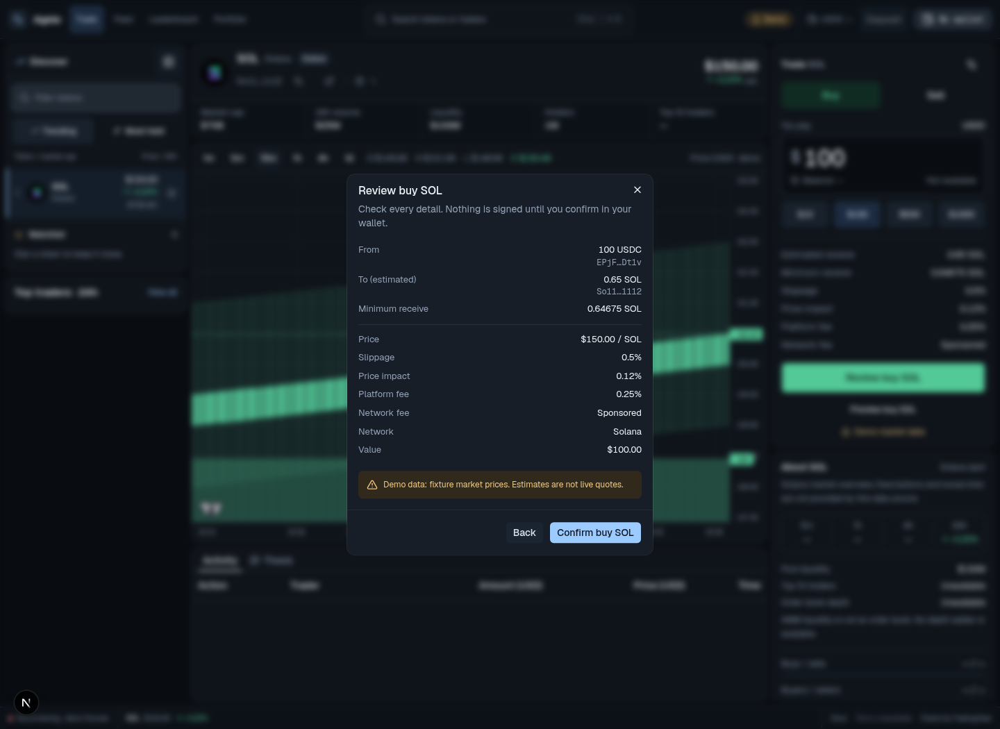
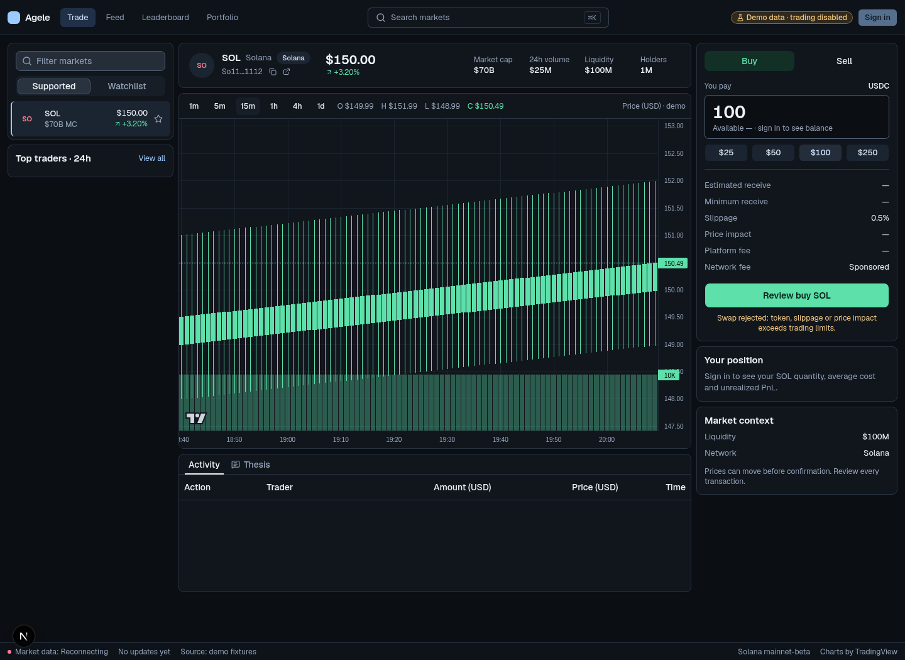
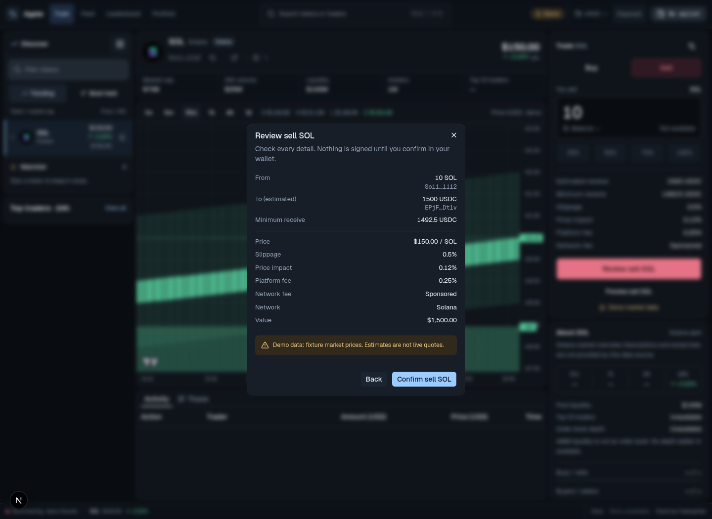

# Gasless swaps

The terminal requests a server quote before review, creates an unsigned transaction when the user confirms, and asks Privy's embedded Solana wallet to sign it. The frontend never broadcasts the transaction: the API sponsors and submits it. Amounts sent to the API are base-unit strings; token precision comes from `Token.decimals`, and USDC uses six decimals.

## Quote, sign and submit

```mermaid
sequenceDiagram
  actor U as User
  participant T as Order ticket
  participant A as Agele API
  participant P as Privy embedded wallet
  U->>T: Enter buy / sell amount
  T->>T: Validate precision, debounce 350ms
  T->>A: GET /v1/swaps/quote?inputMint&outputMint&amount&slippageBps
  A-->>T: Quote (base-unit amounts, impact, fee)
  T-->>U: Review server quote; network fee Sponsored
  U->>T: Confirm (signed out → prompt sign-in)
  T->>A: POST /v1/swaps (Bearer token)
  A-->>T: requestId, unsigned base64 transaction, expiresAt (Unix milliseconds)
  opt Already expired before signing
    T->>A: POST /v1/swaps again
    A-->>T: Fresh requestId and transaction
  end
  T->>P: signTransaction(Uint8Array, wallet, chain)
  P-->>T: signedTransaction (Uint8Array)
  T->>A: POST /v1/swaps/{requestId}/submit (base64 signedTransaction)
  A-->>T: confirmed / failed / submitted, signature?, result amounts?, code?, error?
  loop Only while submitted; up to 40 polls, 1.5s apart
    T->>A: GET /v1/swaps/{requestId} (Bearer token)
    A-->>T: status, signature?, error?
  end
  alt Confirmed
    T-->>U: Success toast with View on Solscan action
  else Failed / expired
    T-->>U: Error / fresh quote required
  else Still submitted after polling limit
    T-->>U: Still pending; check explorer before retrying
  end
```

`lib/swaps.ts` contains the injected orchestration and typed API adapter; `hooks/use-swap.ts` owns quotes and execution state. `hooks/use-swap-signer.ts` uses Privy 3.51.4's `useSignTransaction` and `useWallets`. Signing takes bytes plus the connected wallet and returns signed bytes; it does not send the transaction.

Buy routes USDC → token; sell routes token → USDC. The USDC mint and Solscan cluster follow `NEXT_PUBLIC_SOLANA_CLUSTER`. Decimal conversions use strings and BigInt, not floating-point multiplication. Numeric USD display values are computed separately from formatted receive labels.

## Execution states



Every execution creates a new request and obtains a new signature; signed transactions are not reused. An expired transaction is never submitted. Polling is bounded to 40 GET requests (60 seconds of interval waits, plus request latency). A pending message is not a failure or a confirmation: check the linked transaction before retrying.

## Errors and demo gating

| API status / code | User message / behavior |
| ----------------- | ----------------------- |
| `503 trading_disabled` on create | **Demo only · submission disabled**; Confirm disabled; no signing. The client also handles this code on quote/submit. |
| `422 swap_rejected` | Swap rejected: token, slippage or price impact exceeds trading limits. |
| `422 sponsor_rejected` | Sponsorship rejected. Please try again later. |
| `409 wallet_not_linked` | No linked wallet. Create or link your embedded Solana wallet first. |
| `400 validation_error` | Server message (“Invalid request”). |
| `404 not_found` | Server message (“Swap not found”). |
| `429 rate_limited` | Server message (“Swap quote limit exceeded”). |
| `502 upstream_error` | Server message (“Jupiter request failed”). |
| `503 rate_limit_unavailable` | Server message (“Swap quoting temporarily unavailable”); not a demo/trading-disabled label. |
| Other API errors | Server error message, falling back to “Request failed”. |
| Failed transaction | Returned transaction error, falling back to “Swap failed”. |
| Expired transaction | Quote expired. Review a fresh quote and try again. |

`DEMO_MODE` labels fixture market data only; it does not gate submission. The API determines whether trading is disabled. Receive, minimum receive, price impact, slippage and platform fee use the server quote when available. Client estimates appear only while the quote loads. Network fees are labelled **Sponsored** only with a server quote and without a trading-disabled response; otherwise they show a dash. A signed-out Confirm prompts sign-in; without a Privy app ID, sign-in is unavailable.

## Backend contract (PR #9)

Types are regenerated from [backend PR #9](https://github.com/jog01/agele/pull/9)'s `openapi.json`. Quote/build responses do **not** echo `inputMint` or `outputMint`. `priceImpactPct` is a number in percentage points (`3` means `3%`), not a ratio or string. `expiresAt` is a number in Unix milliseconds, compared directly with `Date.now()`. Submit results have an optional signature, optional base-unit `inputAmountResult` / `outputAmountResult`, optional numeric `code`, and optional `error`. GET status retains `inAmount` / `outAmount`.

Requests require positive base-unit amount strings (up to 78 digits), base58 mint strings of 32–44 characters, and optional integer slippage from 0–10,000 bps. Quote OpenAPI additionally permits nullable slippage; the frontend always sends `50`. Submit accepts a nonempty signed-transaction string up to 4,096 characters. All four documented routes list `400`, `401`, `404`, `409`, `422`, `429`, `502` and `503` errors, although some apply only to specific operations.

The current backend quote is preview-only: it calls Jupiter without checking sponsorship, the mint allowlist, or trading caps. Disabled sponsorship is checked during create/submit. A quote can therefore succeed before create returns `503 trading_disabled`. A sponsor kill switch currently returns `422 sponsor_rejected` (reason `kill_switch`), not `503`. Swap rejection also covers transaction/payer integrity mismatches, not only slippage, impact or mint caps. If execution outcome is unknown, submit returns `{ status: "submitted" }` without a signature; the client polls and, on timeout, shows the request ID rather than inventing an explorer link.

## Screens

| Server quote in ticket | Review server quote |
| ---------------------- | ------------------- |
|  |  |

| Trading disabled: ticket | Trading disabled: review |
| ------------------------ | ------------------------ |
|  |  |

| Rejected quote | Sell review |
| -------------- | ----------- |
|  |  |

These screenshots use a throwaway local HTTP mock API and the real frontend with `NEXT_PUBLIC_API_URL=http://localhost:4100`, signed out and without a Privy app ID. “Server quote” here means a response from that mock, not a live Jupiter quote. The mock supplies market endpoints plus the agreed swap contract and switches quote responses between success, `503 trading_disabled` and `422 swap_rejected`. No auth context was stubbed. Wallet signing, authenticated submission, confirmation toast and real on-chain execution were not exercised by these screenshots; orchestration is covered by Vitest tests.

## Configuration and checks

Use `NEXT_PUBLIC_API_URL` for the Agele API and configure Privy and Solana as described in [Sign-in, embedded wallet and deposit](auth-wallet.md). `lib/api/schema.d.ts` is fully generated from PR #9's OpenAPI; non-swap additions (`PriceTick` and `Health.marketData`) are already on backend main. Regenerate after the backend merge.

```bash
bun run check
bun run build
```
