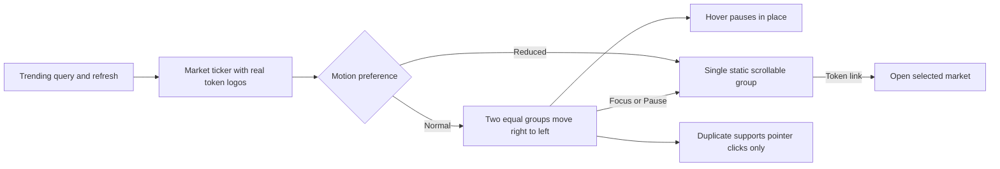

# Compact terminal shell

The terminal uses the [Green / Graphite contract](brand.md): neutral black/grey surfaces, pastel-green identity and sharper financial direction colors. Arbital/Fomo's compact chart-first composition replaces the previous oversized chrome. This change does not alter routes, market data, quotes or signing.

| Element | Before | Now |
| --- | --- | --- |
| Desktop header | 72px | 48px |
| Desktop footer | 40px | 28px |
| Explorer title | 64px | 36px |
| Explorer filter | 44px | 32px |
| Ranking buttons | 40px | 28px |
| Market rows | 64px | 44px |
| Panel radius | 10px | 6px |

The shell returns 36px of vertical space to the workspace before the terminal grid changes. Market names remain readable with two-line identity/market-cap and price/change columns, real 28px artwork, a selected edge and independent watchlist actions. Empty, loading, error, no-match and collapsed states retain the same contract.

## Moving footer

Movement is CSS transform-only and linear, not a React render loop. The visual duplicate is aria-hidden and excluded from tab order, but remains clickable with a pointer. Hover pauses in place without resetting links on pointer focus; explicit pause, keyboard-visible focus and reduced-motion preferences use native horizontal scrolling. The footer stays hidden on mobile, where the existing safe-area bottom navigation takes priority. Demo and connection labels remain separate from prices.

## Ownership and verification

Design owns the shared tokens, header, explorer and footer. Staff Frontend separately owns resizable grid, chart/terminal loading skeletons, compact asset summary/order rail and relocation of Top traders into lower tabs. Both consume unchanged semantic names and sRGB chart aliases.

Automated validation uses the existing contrast, canvas parity, icon, explorer hydration and ticker-refresh checks plus the repository lint/typecheck/test/build suite. Browser validation covers market selection/filter/sort/watchlist, search shortcuts, ticker movement/pause/keyboard/reduced motion, responsive shell and the integrated terminal once the companion grid change lands. Authentication, deposits and swaps still require their existing provider configuration; demo data is never presented as live execution.
