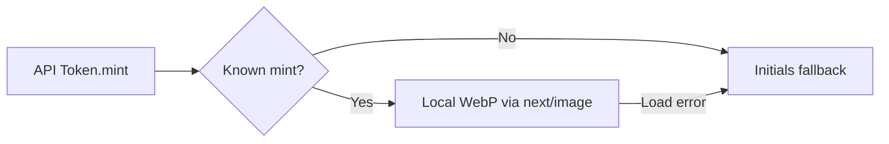
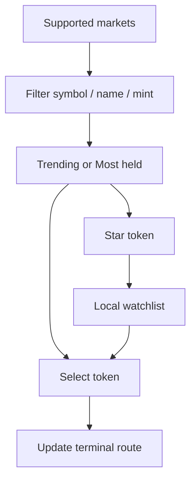
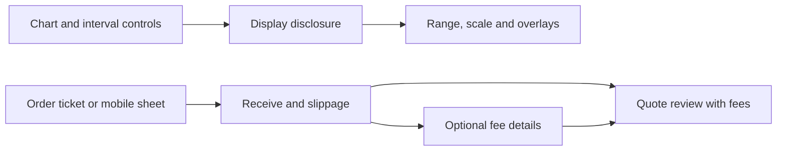
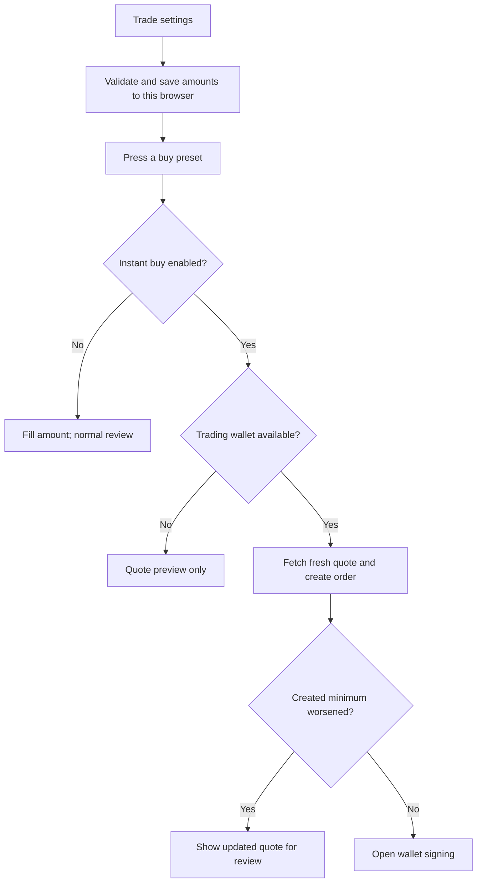

# Terminal presentation

The terminal uses the [Sage / Ink brand contract](brand.md) in `src/app/globals.css`. shadcn controls supply keyboard and dialog behavior; prices use tabular Geist Mono figures. Chart and activity behavior remain separate from layout and identity rendering.

## Token identity

`src/lib/token-assets.json` records each supported mint, symbol and Jupiter source URL. Eight WebP assets are bundled locally (about 56 KB total); no arbitrary remote image hosts are allowed. A symbol alone never selects a trusted logo.

## Discover and watch

Trending preserves the provider order. Most held sorts only the supported set by holder count; it does not claim to rank every Solana token. The watchlist is a separate, locally persisted list. Collapsing the explorer preserves token navigation and gives the chart more room.

## Focused workspace

The chart stays central: laptops pair it with the order ticket, while the explorer and top traders appear from 1536px. Mobile opens order entry in a Buy or Sell sheet. Panels use the shared spacing contract; shorter desktop viewports retain internal scrolling rather than clipping chart or activity content.

Intervals stay visible above the chart. **Display** reveals range, scale, chart style, moving averages and overlays without keeping every option on screen. Estimated receive, minimum receive and slippage remain visible in the ticket; **Fees & price impact** and **Market details** disclose secondary information. Quote review still shows the complete available fee breakdown before signing.

## Trade states

**Trade settings** edits the four USDC buy amounts and four whole sell percentages. Saved amounts persist in the browser across markets and desktop/mobile tickets. Buy presets normally fill the amount; sell presets stay disabled until the ticket has a real token balance.

**Instant buy** is off when a ticket opens. It applies only to buy presets, never typed amounts or sells. Preview consent does not enable it for a signed-in wallet; enable it again when ready to trade. Demo without trading access previews the amounts without creating a swap, signing, or fabricating a fill.

The market overview uses the existing 24h change, liquidity and holder count. Social URLs, descriptions, top-10 concentration, intraday changes, buy/sell ratios and order-book depth are explicitly unavailable when absent from the contract. Empty bars are placeholders, not invented ratios. Terms are not linked until a real policy is published. Trader discovery links to the leaderboard; global trader search is not represented as working.

The UI PR contains desktop/mobile screenshots and browser-verification evidence. Presentation changes do not enable authentication, deposits or live order submission without their existing provider configuration.
