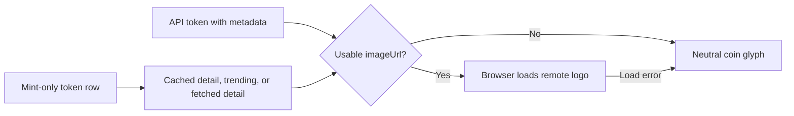
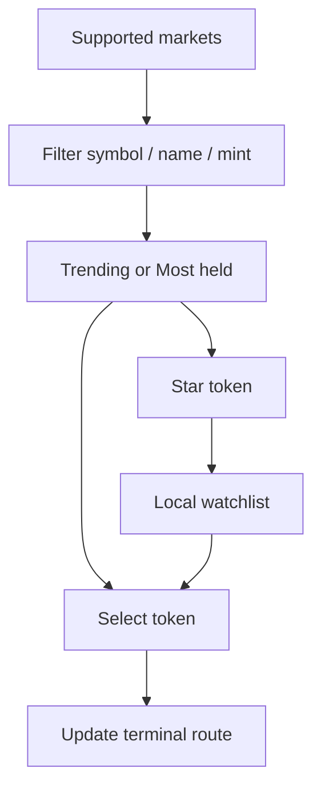
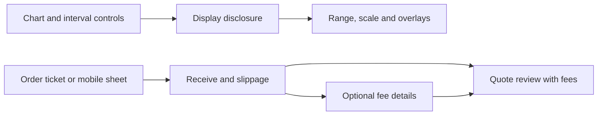
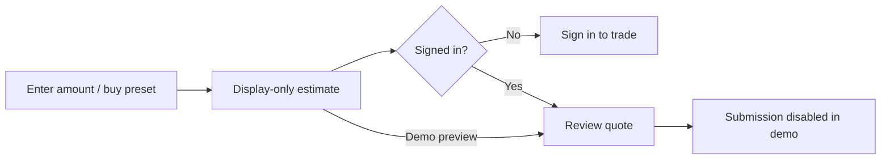

# Terminal presentation

The terminal uses the [Sage / Ink brand contract](brand.md) in `src/app/globals.css`. shadcn controls supply keyboard and dialog behavior; prices use tabular Geist Mono figures. Chart and activity behavior remain separate from layout and identity rendering.

## Token identity

Token avatars use remote HTTPS logos from the token API, in demo and live modes. Rows with only a mint read the token detail and trending query caches, and can fetch token details when needed. The browser loads the logo without a referrer; missing, invalid, or broken URLs show a neutral coin glyph, never initials. The landing illustration is separate.

## Discover and watch

Trending preserves the provider order. Most held sorts only the supported set by holder count; it does not claim to rank every Solana token. The watchlist is a separate, locally persisted list. Collapsing the explorer preserves token navigation and gives the chart more room.

## Focused workspace

The chart stays central: laptops pair it with the order ticket, while the explorer and top traders appear from 1536px. Mobile opens order entry in a Buy or Sell sheet. Panels use the shared spacing contract; shorter desktop viewports retain internal scrolling rather than clipping chart or activity content.

Intervals stay visible above the chart. **Display** reveals range, scale, chart style, moving averages and overlays without keeping every option on screen. Estimated receive, minimum receive and slippage remain visible in the ticket; **Fees & price impact** and **Market details** disclose secondary information. Quote review still shows the complete available fee breakdown before signing.

## Trade states

The main action is sign-in when signed out. Demo mode retains a separate, display-only quote preview; balances, fills and PnL are never fabricated. Sell percentage presets stay disabled until a real balance exists. Settings disclose the fixed preview slippage instead of presenting non-functional controls.

The market overview uses the existing 24h change, liquidity and holder count. Social URLs, descriptions, top-10 concentration, intraday changes, buy/sell ratios and order-book depth are explicitly unavailable when absent from the contract. Empty bars are placeholders, not invented ratios. Terms are not linked until a real policy is published. Trader discovery links to the leaderboard; global trader search is not represented as working.

The UI PR contains desktop/mobile screenshots and browser-verification evidence. Presentation changes do not enable authentication, deposits or live order submission without their existing provider configuration.
