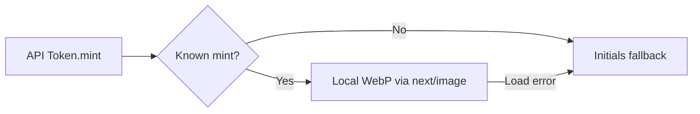
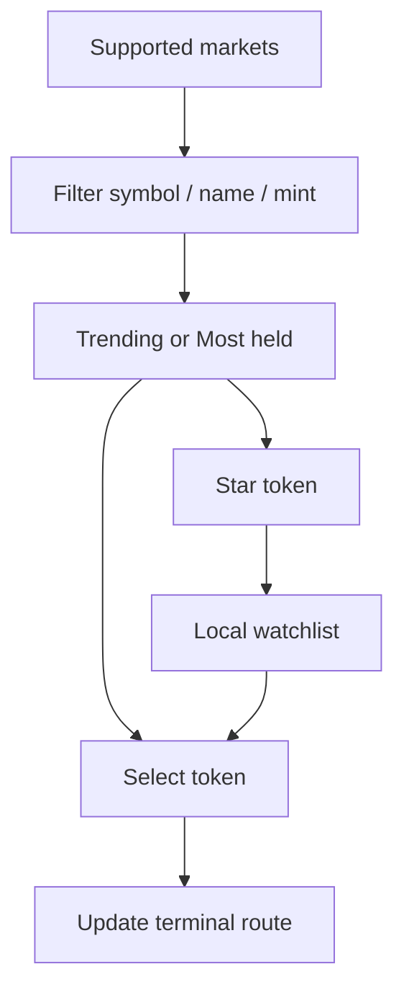
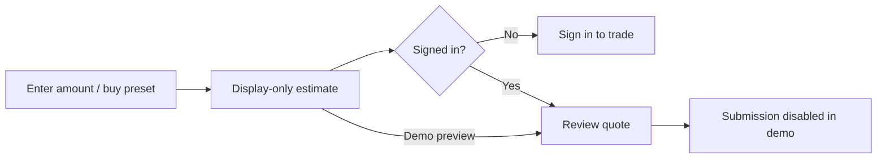

# Terminal presentation

The terminal keeps the Graphite/Ice palette in `src/app/globals.css`. shadcn controls supply keyboard and dialog behavior; prices use tabular figures. Chart and activity behavior remain separate from layout and identity rendering.

## Token identity

`src/lib/token-assets.json` records each supported mint, symbol and Jupiter source URL. Eight WebP assets are bundled locally (about 56 KB total); no arbitrary remote image hosts are allowed. A symbol alone never selects a trusted logo.

## Discover and watch

Trending preserves the provider order. Most held sorts only the supported set by holder count; it does not claim to rank every Solana token. The watchlist is a separate, locally persisted list. Collapsing the explorer preserves token navigation and gives the chart more room.

## Trade states

The main action is sign-in when signed out. Demo mode retains a separate, display-only quote preview; balances, fills and PnL are never fabricated. Sell percentage presets stay disabled until a real balance exists. Settings disclose the fixed preview slippage instead of presenting non-functional controls.

The market overview uses the existing 24h change, liquidity and holder count. Social URLs, descriptions, top-10 concentration, intraday changes, buy/sell ratios and order-book depth are explicitly unavailable when absent from the contract. Empty bars are placeholders, not invented ratios. Terms are not linked until a real policy is published. Trader discovery links to the leaderboard; global trader search is not represented as working.

The UI PR contains desktop/mobile screenshots and the browser-verification evidence. Authentication, deposits, live-market switching and chart/panel enhancements are delivered separately by Staff Frontend.
