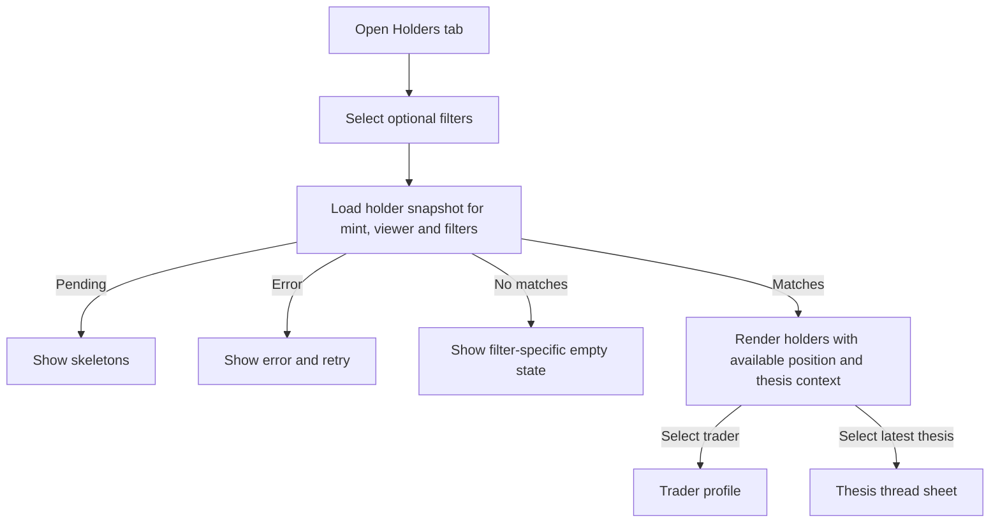
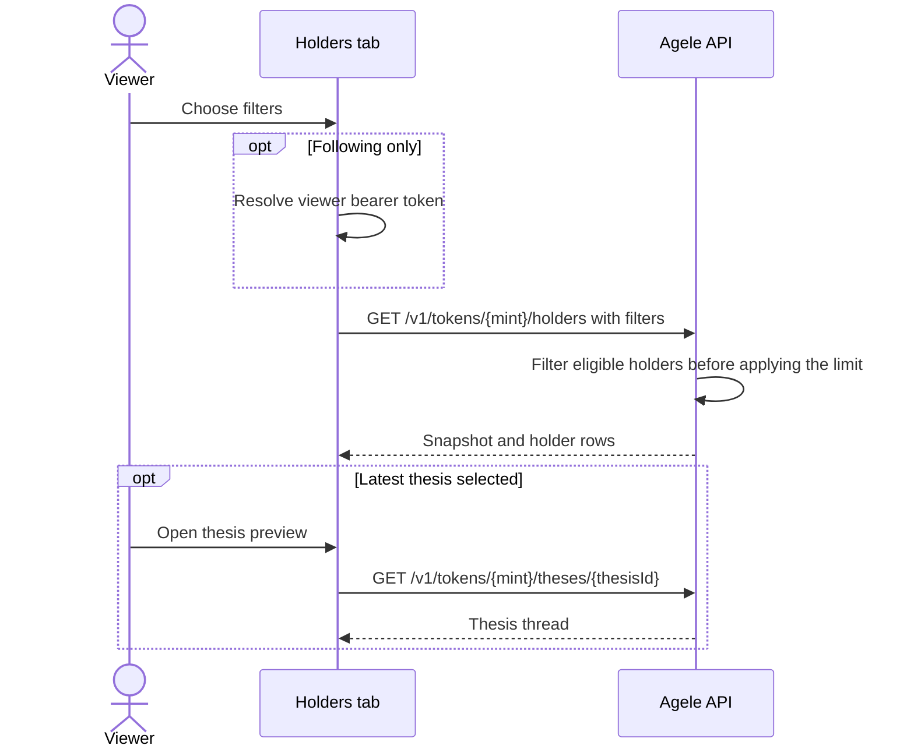

# Token holders

The Holders tab shows the API's largest owner wallets for a token. Known traders link to their profiles; unknown wallets link to the explorer. Position value and token balance are snapshot values. **Hold age** is time since the position's first buy, not an estimated average. The latest thesis is nested in its holder's row; selecting it opens the existing thesis thread sheet.

**Thesis only**, **Following only**, and **Min size (USD)** can be combined. The USD minimum applies to current holding value, not invested cost. The backend applies filters before the response limit. Following is only available to a signed-in viewer with a wallet. Query results are keyed by mint, viewer and filters. Demo and indexed markets use the same API; the browser does not generate holder data.

