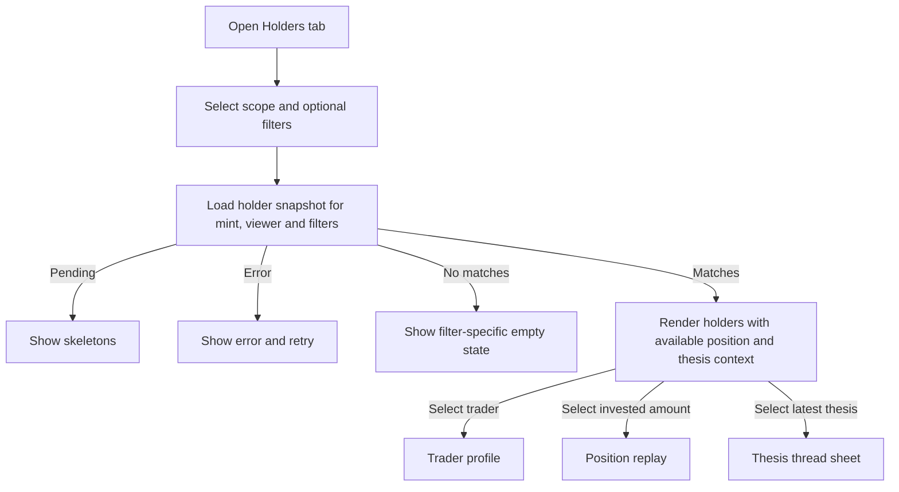
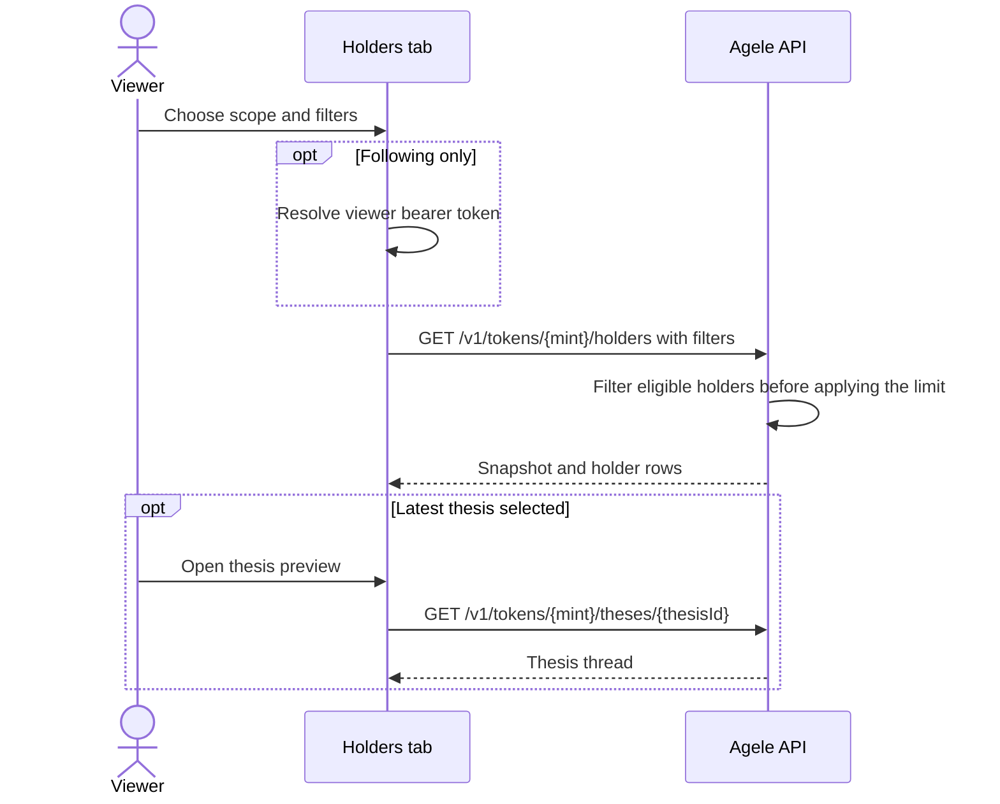

# Token holders

The Holders tab opens on **All holders** (the largest owner wallets). **Agele traders** shows traders with an open indexed position in the token, ordered by holding amount. Known traders with a public wallet link to their profiles; unidentified wallets link to the explorer. Position value and token balance are snapshot values. **Avg. hold** is the trader's average across closed positions; **Hold age** is time since the current position's first buy. Selecting the invested amount opens the matching position replay; selecting the latest thesis opens its thread.

**Thesis only**, **Following only**, and **Min size (USD)** can be combined within either scope. The USD minimum applies to current holding value, not invested cost. The backend applies filters before the response limit, within the market snapshot or the indexed trader candidate set. Following is only available to a signed-in viewer with a wallet. Query results are keyed by mint, viewer, scope and filters. Demo and indexed markets use the same API; the browser does not generate holder data.

