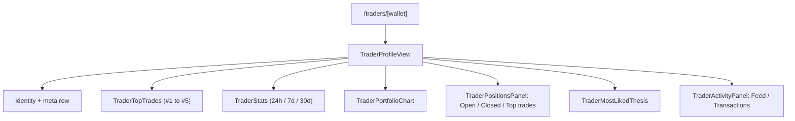
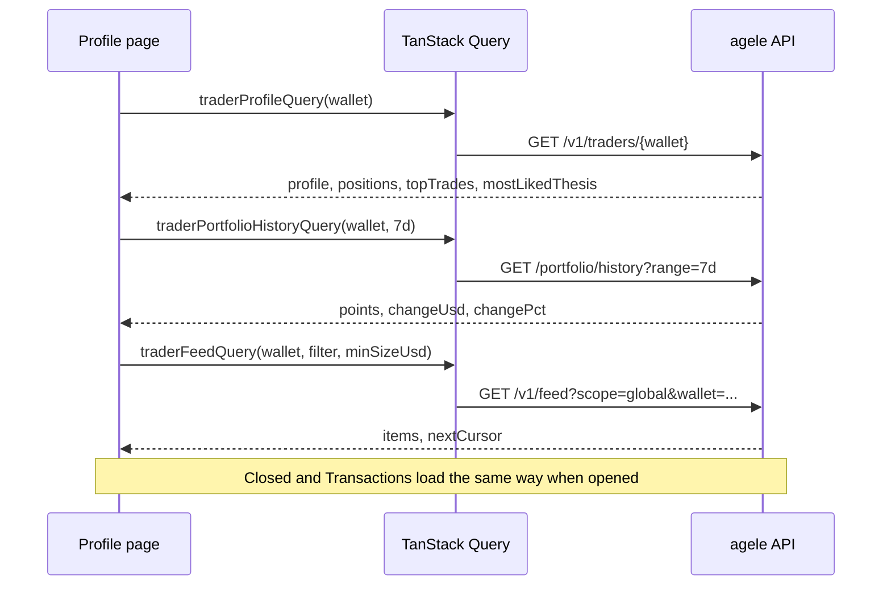

# Trader profile

Profile v2 is step 2 of the [fomo parity order](./fomo-parity.md#profile). Everything on it comes from the backend API, in demo and indexed mode alike. A value the API does not return is shown as `—`.

## Layout

| Area | What it shows | Source |
| --- | --- | --- |
| Identity | Avatar, name, @handle, bio, followers and following, follow button | `GET /v1/traders/{wallet}` |
| Meta row | Mutuals (signed in), average hold, trade count, joined month | `mutuals`, `avgHoldSeconds`, `tradeCount`, `joinedAt` |
| #1 to #5 strip | Top closed trades by realized PnL, with % | `topTrades` |
| Leaderboard performance | Rank, net PnL, return, volume, trades, win rate for 24h / 7d / 30d | `stats` |
| Portfolio value | Area chart and change for 24H / 7D / 30D | `GET /v1/traders/{wallet}/portfolio/history?range=` (`points`, `changeUsd`, `changePct`) |
| Positions | Open (profile `positions`), Closed (feed `types=closed`), Top trades (`topTrades`) | profile and `GET /v1/feed?wallet=` |
| Most liked | The trader's most-liked thesis with likes, replies, views and newer-version count | `mostLikedThesis` |
| Feed | The trader's trades, closes and theses; All / Trades / Theses and a minimum size | `GET /v1/feed?scope=global&wallet=&types=&minSizeUsd=` |
| Transactions | Every fill, paged, with a Solscan link for indexed trades | `GET /v1/traders/{wallet}/trades` |

On wide screens the portfolio and positions sit on the left and the most-liked thesis and activity on the right. Narrow screens stack them in that order.

## Data flow

The profile request renders the page. Each panel then loads on its own, so a slow history or feed request never blanks the profile. Closed positions, the feed and transactions only request data when their view is opened.

Range, filter and size each have their own query key, so switching back to a view already loaded is instant.
